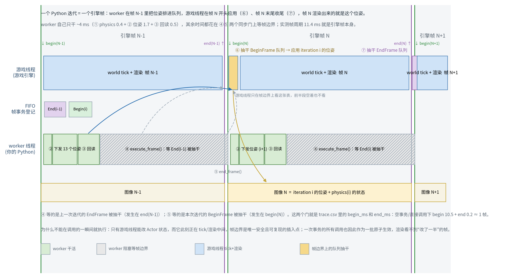

# 渲染预算：显存与帧时间，杠杆与分级降载（实测）

> 相关：[`rendering.md`](rendering.md)（采集链路与示例工程对比）、[`risks.md`](risks.md) R13、[`urdf_workflow.md`](urdf_workflow.md)（分辨率/细线历史结论）。
> 所有数字都是本机（RTX 4060 Laptop，8188 MiB）**实测**：`standalone -game`、单 SceneCapture、固定机位、4 帧（显存）或 30 帧（帧时间）、`--vram-poll-seconds 0.5`。原始 CSV 在 `/tmp/rm_sim_sweep*`、`/tmp/rm_sim_perf*`。

---

## 1. 先定预算与指标

| 项 | 值 |
|---|---|
| device-local heap | 8188 MiB |
| 驱动给出的可用 budget | **6358–6736 MiB**（随桌面上其它进程浮动） |
| 崩溃方式 | 单次 256 MiB 连续 transient 分配失败 → `VulkanMemory.cpp` Fatal；Python 侧只看到 `rpc::timeout` |
| 桌面常驻（采样起点） | 1270–1680 MiB（本轮 13 次运行的实测范围，本身就是噪声源） |
| 判据 | `min_free_mb ≥ 1024` 才算稳（`risks.md` R13 的验收口径）；`peak_used_mb` 是全局值，只作参考 |

采样口径（本轮给 `tools/run_physics_sim.py` 加的开关）：`--vram-poll-seconds 0.5`，采样线程在 `spear.configure_system()` **之前**启动，因此覆盖 map-load 峰值；每行 `time,used_mb,free_mb` 落 `<output-dir>/vram.csv`。每帧耗时写进 `trace.csv` 的 `frame_ms` 列（`end_frame(single_step=True)` 之后计入，即真实帧时间）。

## 2. 结论先行

1. **显存几乎不随分辨率变化。** 捕获 256²→1440×1080 只差 52 MiB（6170→6222），主视口 512²→1440×1080 只差 181 MiB。省显存**不该**动分辨率。
2. **显存由渲染特性与场景规模决定**：GI+反射 −732 MiB、光追 −594 MiB、VSM −590 MiB、Lumen surface cache −349 MiB、mesh distance field −56 MiB。
3. **帧时间由像素决定**：捕获 512²→1440×1080 在同一个 1440×1080 窗口下 42.4 ms→81.2 ms。关 GI/光追几乎不影响帧时间（±4 ms）。
4. **关 VSM 是负优化**：省 590 MiB 显存，但帧时间 77.6 ms→134.0 ms（回落到 CSM + 多动态灯）。`--low-vram` 因此同时是"画质最差 + 更慢"的组合。
5. **纹理驻留几乎不花钱**：1440×1080 下全量纹理比流式只多 **20 MiB**；`r.Streaming.PoolSize=512` 相对默认几乎没有变化（−3 MiB）。之前"全量纹理会吃掉预算"的结论来自 PIE + 双捕获的上下文，已按新实测修正（见 [`urdf_workflow.md`](urdf_workflow.md)）。**因此这两条 cvar（`PoolSize=512` + `LimitPoolSizeToVRAM=1`）已于 2026-10-08 从 `--low-vram` 预设删除**：它们不省显存，只把细线/alpha 细节压到低 mip。
6. **PIE 做画质验收纯属浪费**：PIE 1440×1080 峰值 7419 MiB，独立 `-game` 同参数 5984–6087 MiB，差 **约 1.4 GB**（编辑器世界 + PIE 世界 + 编辑器视口）。
7. **内容侧最大的两个开关是 Nanite 与阴影等级**：`r.Nanite=0` 省 **819 MiB** 但帧时间 +10 ms；`r.ShadowQuality=0` 省 **1008 MiB** 且帧时间 **−14 ms**（画质上等于放弃动态阴影）。这两个都是"内容/观感换显存"的典型权衡点。

## 3. 显存实测

### 3.1 单杠杆（窗口 512²，捕获 1440×1080，贴图流式）

| 配置 | 命令增量 | peak_used_mb | min_free_mb | Δpeak |
|---|---|---|---|---|
| `1080_base` 项目默认（Lumen+RT+VSM+DF） | — | 6222 | 1560 | 0 |
| `1080_lowsurface` | `r.LumenScene.SurfaceCache.AtlasSize=1024` | 5873 | 1909 | **−349** |
| `1080_nort` | `r.RayTracing.Enable=0` | 5628 | 2154 | **−594** |
| `1080_novsm` | `r.Shadow.Virtual.Enable=0` | 5632 | 2149 | **−590** |
| `1080_nogi` | `r.DynamicGlobalIlluminationMethod=0` + `r.ReflectionMethod=0` + `r.Lumen.DiffuseIndirect.Allow=0` | 5490 | 2292 | **−732** |
| `1080_nodf` | `r.GenerateMeshDistanceFields=0` | 6166 | 1615 | −56 |
| `1080_nort_nogi_novsm` | 三者同关 | 4465 | 3317 | **−1757** |
| `1080_lowvram` | `--low-vram`（当时还含纹理池/SP/DF；前两者 2026-10-08 已移除） | 4341 | 3440 | **−1881** |
| `1080_fulltex` | `--fully-load-textures` | 6242 | 1540 | +20 |
| `720_base` / `512_base` / `256_base` | 捕获分辨率 | 6253 / 6229 / 6170 | 1529 / 1553 / 1611 | +31 / +7 / −52 |
| `512_fulltex` | 512² + 全量纹理 | 6136 | 1645 | −86（噪声） |

### 3.2 主视口分辨率（窗口 1440×1080）

| 配置 | peak | min_free | Δpeak |
|---|---|---|---|
| `win1080_cap1080` | 6403 | 1379 | 0 |
| `win1080_cap512` | 6498 | 1284 | +95 |
| `win1080_pool512` | 6400 | 1382 | −3 |
| `win1080_taa`（`r.AntiAliasingMethod=2`） | 6387 | 1395 | −16 |
| `win1080_nort` | 5831 | 1951 | **−572** |
| `win1080_logic`（RT+GI+VSM 全关，仍 1440×1080） | 4661 | 3120 | **−1742** |

### 3.3 预算上限类开关（窗口 512²，捕获 1440×1080，30 帧）

这一批的桌面起点漂到 1481–1590 MiB，所以只能比 **UE 自身占用（peak − baseline）**：

| 配置 | UE 占用 | ΔUE | min_free | 帧时间 |
|---|---|---|---|---|
| 参考（`1080_base`，3.1 节） | 4899 | 0 | 1560 | 81.2 ms |
| `r.Shadow.Virtual.MaxPhysicalPages=1024` | 4472 | **−427** | 1730 | 80.3 ms |
| `r.Shadow.Virtual.MaxPhysicalPages=512` | 4325 | **−574** | 1945 | 83.8 ms |
| `r.ShadowQuality=0` | 3891 | **−1008** | 2300 | **67.3 ms（−14 ms）** |
| `r.Nanite=0` | 4080 | **−819** | 2220 | 91.4 ms（+10 ms） |

`r.Nanite=0` 单独做了同会话 4 次 A/B 复测：base 4841 → 4007（−834）、base 4852 → 4183（−669），并检查渲染结果——`nanite_off` 与 base 的帧**逐像素等价**（mean 84.22 vs 84.25、mean|Δ|=0.04、仅 500/262144 像素差 >16）。即本场景的网格本来就不是 Nanite，关掉这个特性只是释放了它预分配的池，属于**画质零代价**的一刀。

**但"显存零画质代价"不等于"帧时间免费"：`r.Nanite=0` 的 +10 ms 是开放项，2026-10-08 决定先保留。**
本表里只有这一项的帧时间没做同会话 A/B，而两条旁证都指向"关掉更慢"：本表 91.4 ms vs 基线
81.2 ms；`tmp/height_ladder/` 的同机位一对——`h60`（当前配置，`r.Nanite:0`）中位 **96.0 ms**、
peak 3968 / min_free 3813，`h60_runeini`（`r.Nanite:1` + VSM 4096 + Cache 4096 + 光追开）
**82.3 ms**、6305 / 1476（其余两条杠杆各自的帧时间实测都是 ~0 ms）。但这仍然不是"只开关 Nanite"
的对照，而且"本场景网格不是 Nanite"是从**画面逐像素等价**推断的，没有查过资产上的
`nanite_settings.enabled`：网格本就不是 Nanite 时这个 +10 ms 只能是噪声；是 Nanite 资产时关掉
就是改走 fallback 网格（画面几乎不变、帧时间上涨）。两种情况结论相反，所以不动 `r.Nanite`——
用户 2026-10-08 的决定是优先保住 OOM 余量（3× @1440×1080 只剩 1364 MiB，§9/§11），不为此跑
A/B。要推翻它，只需一次只开关 `r.Nanite` 的同会话 A/B（30 帧、固定机位，比 `trace.csv` 的
`frame_ms` 与 `vram.csv`）。
| `r.LumenScene.SurfaceCache.AtlasSize=512` | 4770 | −129 | 1451 | 79.6 ms |
| `r.Lumen.Reflections.Allow=0` | 5076 | +177（无收益） | 1158 | 80.6 ms |

**噪声地板 ≈ ±200 MiB**：桌面常驻在同一批内漂 1.27–1.68 GB，同一配置跨批次能差 ~180 MiB。因此 **小于 ~200 MiB 的差值不要当结论**（`AtlasSize=512` 的 −129、`Reflections.Allow=0` 的 +177 都属于这一类）。想量化小杠杆，必须**同一次会话里带 baseline 做 A/B**。

## 4. 帧时间实测

窗口/捕获都在 `--window-size`/`--width/--height` 指定，`r.VSync=0`、`t.MaxFPS=0`，取第 6 帧之后的中位数：

| 配置 | 中位帧时间 | 等效 fps | 与基线差 |
|---|---|---|---|
| `win512_cap512` | 37.95 ms | 26.4 | — |
| `win1080_cap512` | 42.39 ms | 23.6 | 窗口 512²→1440×1080：**+4.4 ms** |
| `win1080_cap1080`（基线） | 81.16 ms | 12.3 | 捕获 512²→1440×1080：**+38.8 ms** |
| `win1080_taa` | 82.55 ms | 12.1 | TAA 换 TSR：−0 ms（VRAM 也只差 16 MiB） |
| `nogi`（GI+反射关） | 77.59 ms | 12.9 | −3.6 ms |
| `nort`（光追关） | 84.36 ms | 11.9 | +3.2 ms（噪声内） |
| `novsm_nogi`（VSM+GI 关） | 133.97 ms | 7.5 | **+52.8 ms（更慢）** |

注意：窗口在 `DISPLAY=:1` 上不聚焦，这些数字用于**横向比较**，不是交付 fps；真要交付 fps 要用聚焦的全屏运行再测。

## 4.5 单刀清单与推荐次序（"一次砍一个，各能省多少"）

同一批实测的单刀收益（UE 占用口径，1440×1080 单捕获，基线 4841–4899 MiB）：

| 一刀 | 省 | 帧时间 | 画质 | 备注 |
|---|---|---|---|---|
| `r.ShadowQuality=0` | −1008 | **−14 ms** | 大（动态阴影消失，43 万像素变化） | 单次实测 |
| `r.Nanite=0` | −669 ~ −834 | +10 ms | **零**（逐像素等价） | 同会话 4 次 A/B |
| GI+反射同关 | −684 | −4 ms | 最大 | 本次**不动** |
| `MaxPhysicalPages=512` | −574 | +3 ms | 极端时页驱逐 | 未启用 |
| `r.RayTracing.Enable=0` | −551 | ~0 | 无 | 已进配置（按需） |
| VSM 全关 | −543 | **+53 ms** | 无 VSM | 不推荐 |
| `MaxPhysicalPages=1024` | −427 | 0 | 轻 | 已进配置 |
| `SurfaceCache.AtlasSize=1024` | −295 | 0 | 轻 | 已进配置 |
| `SurfaceCache.AtlasSize=512` | −129 | 0 | 轻 | 噪声内 |
| `GenerateMeshDistanceFields=0` | −10 | — | 需同时关 SDF 光追 | 不值得 |
| 只关反射 | **+177（无收益）** | 0 | — | 无效 |
| 纹理尺寸 / 纹理池 / 分辨率 | ~0（±100） | 分辨率是**帧时间**杠杆 | 清晰度 | 见 §2/§4 |

按"画质代价最小优先"的推荐次序与累计（预测值，±200 MiB）：

| 顺序 | 动作 | 单步省 | 累计 UE 占用 | 预计 min_free |
|---|---|---|---|---|
| 1 | `r.Nanite=0` | ~−750 | 4841 → ~4090 | 1395 → ~2150 |
| 2 | 光追改按需 | −551 | ~3540 | ~2700 |
| 3 | `SurfaceCache.AtlasSize=1024` | −295 | ~3245 | ~2995 |
| 4 | `MaxPhysicalPages=1024` | −427 | **~2818** | **~3420** |

1–4 已写进 `ue/Config/DefaultEngine.ini` 的 `[SystemSettings]`（并按用户要求保留 GI+反射不变）；`ShadowQuality=0` / VSM 全关 / GI 关作为注释开关留在同一段，需要时再打开并复测。

## 5. 分级执行路线（按"收益/代价"排序）

### 0 级：零画质代价（配置与启动层，立刻可做）

| 步骤 | 预期 | 依据 |
|---|---|---|
| 用独立 `-game` 而不是 PIE 做任何渲染验收 | **−1.4 GB** | PIE 7419 → standalone 5984–6087 |
| 光追改按需：`r.RayTracing.Enable=0` + `r.RayTracing.EnableOnDemand=1` | **−594 MiB**，帧时间不变 | §3.1 / §4；需要时再开 |
| `r.LumenScene.SurfaceCache.AtlasSize=1024` | **−295 MiB**（UE 占用口径） | §3.1/§3.3；远处间接光细节略降 |
| 单捕获 + 顺序读回（任何时候只有 1 个 SceneCapture 存活） | 避免数百 MiB 的 transient 峰值 | 历史实测（双捕获 @1440×1080 崩） |
| 保留 `--fully-load-textures` | +20 MiB，换来细线连续 | §3.1 |
| 按真实镜头设 FOV + DoF（8 mm @1/1.8" → 4:3 下 47.8°，[`lens.py`](../rm_sim_spear/lens.py)；`--view bound` 已默认启用） | **0 MiB** | `rendering.md` §13：像素/度 ×2.26（每立体角 ×5.1），等于免费拿到 2× 超采样；现在的 90° 相当于 2.8 mm 镜头 |
| 补齐 `[SystemSettings]`（`r.OneFrameThreadLag=0`、`r.GTSyncType=1`） | 帧同步语义正确，显存无关 | `rendering.md` |

0 级合计 ≈ **−1.0 GB（不含 PIE→standalone 的 −1.4 GB），画质基本不变**。做完这一步，1440×1080 单捕获的 `min_free` 从 1560 升到 ~2.5 GB。

### 1 级：可接受的小画质代价（工具参数，1 小时内）

| 步骤 | 显存 | 帧时间 | 代价 |
|---|---|---|---|
| GI/反射关或降级 | **−684 MiB**（GI+反射同关，UE 占用口径） | −4 ms | 观感变化最大的一项；单独关反射实测**没有可测收益**（+177 MiB，噪声内），所以省下来的主要是 GI |
| `r.Shadow.Virtual.MaxPhysicalPages=1024`（保留 VSM） | **−427 MiB** | 0 ms | 极端情况下阴影页会被驱逐，画质损失远小于关 VSM |
| `r.GenerateMeshDistanceFields=0` | −56 MiB | 未测 | 关掉后 Lumen 软件光追不能用 SDF，需同时关 `r.Lumen.TraceMeshSDFs` |
| 捕获分辨率按数据集需要降（输出侧再上采样） | ≈0 | **捕获 1440→512：−38.8 ms** | 出图清晰度；不要低于输出分辨率的 1.0×（会出虚线，见 `urdf_workflow.md`） |
| 降低采集频率（每 N 帧采一次） | ≈0 | 按比例 | 数据集时间分辨率 |
| 聚焦/全屏运行 | ≈0 | 待测 | — |

### 2 级：内容侧（你能改的场景与材质）

**先纠正一个直觉**：本场景的显存峰值不是"贴图/三角面数量"直接吃掉的，是**渲染特性为这些内容预分配的池**吃掉的（Nanite 池、VSM 页池、光追 BVH、DF atlas、Lumen surface cache）。所以内容侧优化的收益要分两种口径看：

- **能直接省显存的内容改动**：① 减少**投射阴影的动态灯与投影体**（决定 VSM 页需求，页数上限 −427/−574 MiB，关 VSM −543 MiB 但 +53 ms）；② 关 Nanite（−670~−834 MiB，实测画质零代价）；③ 关光追时 BVH 的 −551 MiB 是"几何→光追"成本的上界；④ 烘焙静态光（`r.AllowStaticLighting=True` + Lightmass）可以把 VSM 整体拿掉而保留阴影观感，是内容层唯一能拿到 ~0.5–1.0 GB 且不掉观感的路。
- **主要省帧时间、几乎不省峰值显存的内容改动**：减面/抽稀、LOD、合并小件、减材质与着色器排列、贴图降尺寸与换压缩格式、拆子关卡/Cull Distance。实测依据：几何相关的 DF 只有 −10 MiB（噪声），纹理全量驻留 +52 MiB、纹理池 512 仅 −3~+97 MiB，分辨率在 256²→1440×1080 之间只差 ~30–50 MiB。

#### 重导出模型/场景后怎么证明省了多少（同会话 A/B 协议）

1. 同一台机器、同一次会话里交替跑 A/B/A/B，避免桌面显存漂移（跨批次噪声可达 ±200 MiB，见 §3.3）；
2. 每次都用同一命令模板：`--frames 4 --settle-frames 1 --view fixed --camera-position-cm ... --width/--height/--window-size 固定 --no-fully-load-textures --vram-poll-seconds 0.5`，对比 `vram.csv` 的 **UE 占用（peak − baseline）** 与 **min_free**；
3. 帧时间用 30 帧、`r.VSync=0`、取 `trace.csv` 第 6 帧后的 `frame_ms` 中位数；
4. 画质必须看图（`frame_*.png` 逐像素对比），不允许只看数字——`r.Nanite=0` 就是先看数字再验图才敢下的结论。

可做的权衡：

| 方向 | 具体动作 | 预期收益 |
|---|---|---|
| 贴图 | 2K→1K/512、BC7→BC5/BC1、去掉重复贴图、设置 LODGroup | 显存≈0（§3.1），但降低流送 IO / 首帧抖动；反过来若要"全量常驻不糊"，Cost 也只有 ~20 MiB |
| 材质 | 减少材质/材质实例数量、去掉 Substrate（`r.Substrate=0`，需重编着色器）、关清漆/次表面/折射、减少贴图采样 | 帧时间与着色器编译；**显存未测**（建议单列一次实验） |
| 网格 / Nanite | 对合并后的 CAD 网格关 Nanite（更省显存、帧时间略增）或按需保留 | **关 Nanite：−819 MiB，帧时间 +10 ms**（实测）；加 LOD/删内部不可见几何主要省帧时间 |
| 阴影等级 | `r.ShadowQuality` 降级、减少动态灯数量与影响半径、限制投影灯、必要时改烘焙静态光 | **`r.ShadowQuality=0`：−1008 MiB 且 −14 ms**（实测，等于放弃动态阴影）；`MaxPhysicalPages=1024/512`：−427/−574 MiB，帧时间基本不变 → **优先用页数上限，而不是关 VSM** |
| 关卡 | Cull Distance Volume、把装饰件拆成可选子关卡/World Partition、HLOD | 帧时间、流送；峰值显存影响小 |
| 采集 | 用一路相机、按需采集、输出分辨率与内部分辨率分离 | 帧时间（见 1 级） |

### 3 级：架构级

- 训练/数据集生成走**离线批量渲染**（MRQ 或 `-game` 逐帧），不占交互预算。
- 需要 1440×1080 **双**捕获 + 全特性时，实测峰值 7419 MiB（PIE）起步、2× 超采样 7718 MiB 直接崩，本机不可行；可行替代是"两次单捕获顺序跑"或"单捕获 + 更宽 FOV + 后处理切分"。
- 双机/双卡或把 UE 放到第二台机器（远端渲染 + 共享内存/编码回传）是唯一能同时要"最高画质 + 最高分辨率 + 多路相机"的路。

## 6. 复现命令

```bash
# 显存：单杠杆
env DISPLAY=:1 PYTHONPATH=. /home/coffee/miniconda3/envs/spear-env/bin/python -u \
  tools/run_physics_sim.py --frames 4 --settle-frames 1 --view fixed \
  --camera-position-cm 110 -110 -100 --camera-target-cm 0 0 -150 \
  --width 1440 --height 1080 --window-size 1440 1080 --no-fully-load-textures \
  --ini r.RayTracing.Enable=0 --vram-poll-seconds 0.5 --output-dir /tmp/sweep_nort

# 帧时间：看 trace.csv 的 frame_ms 列（第 6 帧起取中位数）
python3 - <<'PY'
import csv, statistics
rows = list(csv.DictReader(open('/tmp/sweep_nort/trace.csv')))
ms = [float(r['frame_ms']) for r in rows[5:]]
print('median ms', statistics.median(ms))
PY
```

§12 的两组对照（2026-10-06 晚，原始证据在 `tmp/height_ladder/`）：

```bash
# E1 机位高度阶梯：只改 z（60 / 150 / 250 cm 离地面），其余完全相同
for spec in "h60 -80" "h150 10" "h250 110"; do set -- $spec
  env DISPLAY=:1 PYTHONPATH=. /home/coffee/miniconda3/envs/spear-env/bin/python -u \
    tools/run_physics_sim.py --frames 8 --settle-frames 20 --drive-gain 5.0 \
    --joint-armature 0.05 --drive-wheels 6 --view fixed --no-frame-robot \
    --world-offset-cm 0 0 -140 --width 1440 --height 1080 \
    --camera-position-cm 110 -110 $2 --camera-target-cm 0 0 -140 \
    --dump-robot-bounds --vram-poll-seconds 0.5 --output-dir /tmp/rm_sim_height/$1
done

# E2 同机位还原 rune 的渲染设置（逐条 --ini），与 E1 的 h60 做同帧像素 diff
env DISPLAY=:1 PYTHONPATH=. /home/coffee/miniconda3/envs/spear-env/bin/python -u \
  tools/run_physics_sim.py --frames 8 --settle-frames 20 --drive-gain 5.0 \
  --joint-armature 0.05 --drive-wheels 6 --view fixed --no-frame-robot \
  --world-offset-cm 0 0 -140 --width 1440 --height 1080 \
  --camera-position-cm 110 -110 -80 --camera-target-cm 0 0 -140 \
  --ini r.Nanite=1 --ini r.RayTracing.Enable=1 \
  --ini r.Shadow.Virtual.MaxPhysicalPages=4096 \
  --ini r.LumenScene.SurfaceCache.AtlasSize=4096 \
  --vram-poll-seconds 0.5 --output-dir /tmp/rm_sim_height/h60_runeini
```

## 7. 已验证"别做"的事

- **不要为了显存降分辨率**：256²→1440×1080 只差 52 MiB；分辨率是**帧时间**杠杆。
- **不要把 `r.ScreenPercentage` 当采集手段**：对 SceneCapture 无效（UE 强制 1.0），只降视口。
- **不要用运行时 `set_cvar` 改后处理类 cvar**：`r.PostProcessing.UserSceneTextureDebug` 在 `-game` 下会 SIGSEGV（见 `rendering.md`）。
- **不要只降纹理池**（`r.Streaming.PoolSize=512`）：实测对峰值 −3 MiB，反而换来低 mip 的糊/虚线（2026-10-08 已从 `--low-vram` 预设移除）。
- **不要关 VSM 来"省压力"**：省 590 MiB 显存但帧时间 +53 ms；要省就减动态灯。
- **不要用 `--low-vram` 做画质验收**：它是"画质最差 + 更慢"的组合（显存 −1881 MiB 是唯一优点）。

## 8. 优化面全景：除了引擎配置层还有哪些层

| 层 | 手段 | 主要买什么 | 本机证据/备注 |
|---|---|---|---|
| ① 驱动/OS | 关掉桌面与 IDE 的 GPU 加速、清残留 UE 进程、锁功耗/避免降频 | **min_free 直接受益** | 桌面常驻实测在 1.27–1.68 GB 之间漂，占 heap 的 15–20% |
| ② 进程形态 | PIE → standalone → 打包发行（cooked/Shipping） | 显存与常驻内存 | PIE→standalone 实测 **−1.4 GB**；打包再去掉编辑器模块 |
| ③ 引擎配置 | cvar/ini（本文主体） | 显存（特性池） | 见 §3 |
| ④ 采集/IO | 单捕获、顺序读回、单缓冲、每帧只读需要的模态、共享内存 vs 拷贝 | 每多一个模态/缓冲 = 多一份 RT+staging | 双捕获 @1440×1080 曾直接在 PIE 崩 |
| ⑤ 关卡/世界 | 子关卡、World Partition、HLOD、Cull Distance Volume、装饰件按需加载 | 常驻纹理/几何、渲染时长 | 未测；属于内容层 |
| ⑥ 材质/着色器 | 减材质数与实例、去 Substrate、关清漆/次表面/折射、PSO 预热 | CPU 与编译时长为主，显存少量 | `r.Substrate=0` 未测（要重编着色器） |
| ⑦ 光照 | 减动态灯数量/半径、VSM 页数、阴影贴图分辨率、烘焙静态光 | VSM/阴影 pass（显存+时间） | `MaxPhysicalPages` −427/−574；`ShadowQuality=0` −1008 且 −14 ms |
| ⑧ 几何 | 减面/抽稀、LOD、合并 mesh actor、Nanite 取舍、删内部不可见几何 | 光追 BVH / VSM 页 / Nanite 池 / draw call | `Nanite=0` −669~−834（画质零代价）；RT BVH −551 |
| ⑨ 纹理 | 尺寸/格式/mip/aniso、去重、虚拟纹理 | 流送 IO、首帧、带宽；峰值受池上限约束 | 全量纹理 +52 MiB、池 512 ±100 MiB → **峰值几乎不变** |
| ⑩ 时间/频率 | 采集帧率（每 N 帧）、物理步/帧、帧率上限、离线批量渲染（MRQ） | 平均功耗与总时长，不是峰值 | — |
| ⑪ 架构 | 渲染/物理分离、多机/云端渲染、数据集离线渲染 | 打破单机上限 | 1440×1080 双捕获 + 全特性单机不可行 |
| ⑫ 测量/验证 | 每步同会话 A/B、`vram.csv`、`frame_ms`、逐像素比图 | 避免"改了没效果"和"改坏了没发现" | 见 §3.3 噪声与 §7 的教训 |

### 三角面数现在是不是问题？

结论：**不是当前的显存瓶颈，也不是帧时间主因**，证据如下：

- 几何数据本身很小：本场景 210 个唯一网格 / 951 个视觉 Actor / 2.16M 三角面，顶点+索引量级 ~0.1 GB。
- 与几何相关的池里，`GenerateMeshDistanceFields=0` 只省 **−10 MiB**（噪声）；`Nanite=0` 省的 669–834 MiB 是**预分配的池**，而本场景网格根本没在用 Nanite（关掉后画面逐像素等价）。
- 帧时间随**像素**变化，不随几何变化：几何完全相同的情况下，捕获 1440×1080→512² 是 81.2→42.4 ms（−39 ms），窗口 512²→1440×1080 只 +4.4 ms；反开关 GI/光追在几何不变时只有 ±4 ms。
- 几何仍通过两条路影响成本：① **光追 BVH**（−551 MiB，已默认按需关闭）；② **投影阴影的体量/灯数（VSM 页池）**（页数上限 −427/−574 MiB）。

要精确量化"机器人这 951 个 Actor 值多少帧时间/显存"，做法是运行期按 tag 隐藏后同会话 A/B 对比（隐藏会跳过光栅与投影，但不释放顶点/BVH 常驻），这是下一步可以直接加的实验，不属于当前结论的一部分。

## 9. 新配置 + 2× 超采样的验收（2026-10-06）

命令：`tools/run_physics_sim.py --frames 160 --settle-frames 20 --drive-gain 5.0 --joint-armature 0.05 --drive-wheels 6 --view fixed --width 1440 --height 1080 --supersample 2 --window-size 512 512`（`[SystemSettings]` 新开关全部生效）。

| 判据 | 实测 | 结论 |
|---|---|---|
| `sim_time_s` 单调 | 0.005 → 0.800 | 通过 |
| 落地后 `base_link_z_cm` | −154.6 → **−151.16** | 通过（预期 −151…−153） |
| 驱动期位移 f20→f160 | **6.718 cm** | 通过（与 1× 一致，物理不受渲染影响） |
| `max|qvel|` / NaN | 2.278 / 无 | 通过 |
| 帧时间 | 中位 **129.3 ms**（p90 139.5） | 1440×1080 + 2× 下约 7.7 fps |
| 显存 | 桌面 1468 / peak 4845 / UE 占用 **3377** MiB / min_free **2937** MiB | 通过（远高于 1024 MiB 门槛） |
| 画面 | 末帧灰度均值 78.3，f1→f160 变化 394 像素 | 场景正常出图；**机器人仍未入画**（开放项，见 `rendering.md` §5） |

即：新开关（Nanite 关、光追按需、VSM 页数 1024、surface cache 1024）之后，1440×1080 + 2× 超采样仍有 **2.9 GB 空闲**；同样条件下再加到 3× 只剩 1364 MiB，4× 直接 OOM。

## 10. 机器人这 951 个 Actor 值多少（按 tag 隐藏的 A/B）

`--hide-tag "RMSimRobot=总装"` 会隐藏导入的全部机器人视觉 Actor（锚点不动，所以机位不变）。
同会话 A/B/A/B（1024×768，1×，30 帧）：

| 运行 | 中位帧时间 | UE 占用 | min_free |
|---|---|---|---|
| a 可见 | 69.80 ms | 2667 MiB | 3661 MiB |
| b 隐藏 | 47.63 ms | 2562 MiB | 3758 MiB |
| c 可见 | 70.67 ms | 2581 MiB | 3818 MiB |
| d 隐藏 | 50.47 ms | 2669 MiB | 3755 MiB |

**结论：机器人几何让每帧多花 20–23 ms（+45%），但几乎不影响峰值显存**（隐藏不释放顶点/BVH 常驻，
差值在噪声内）。也就是说：三角面数/材质数不是显存问题，却是**帧时间的主要来源之一**；
"减面、合并 951 个 Actor、减材质"属于性价比很高的内容优化。

同一批还用 `--dump-robot-bounds` 量到机器人的真实尺寸：`RMSimRobot=总装` 951 个 Actor 的并集包围盒
**73.8 × 67.4 × 27.9 cm**（绑定时刻、尚未施加位姿，中心在关卡原点附近）——尺度正常，不是"迷你模型"。

## 11. 3× 超采样 @1024×768（比 3×@1440×1080 便宜一半）

| 配置 | 内部目标 | 中位帧时间 | UE 占用 | min_free | 红线断裂段数（段中位面积） |
|---|---|---|---|---|---|
| 3× @1440×1080 | 4320×3240 | 190.0 ms | 5010 MiB | 1364 MiB | 3（107 px） |
| **3× @1024×768** | 3072×2304 | **112.2 ms** | **3488 MiB** | 1888 MiB | 8（8.5 px） |
| 2× @1440×1080 | 2880×2160 | 124.6 ms | 3468 MiB | 2875 MiB | 9（11 px） |
| 1× @1440×1080 | 1440×1080 | 88.1 ms | 2616 MiB | 3771 MiB | 20（12 px） |

**决定开销的是内部分辨率（采样密度），不是输出分辨率**：3×@1024×768 与 2×@1440×1080 内部分辨率相近
（7.1M vs 6.2M 采样），代价几乎相同（112 vs 125 ms），连续性还略好一点，但输出只有 1024×768。

---

## 12. 参照系：`~/rm_sim_rune` 打包 standalone 的工作点（2026-10-06）

有了参照物之后，"要不要超采样"这个问题的答案变了。完整对照见 [`rendering.md`](rendering.md) §12。

| 项 | rune（`/tmp/rm_sim_package/Linux/rm_sim.sh`） | 我们 |
|---|---|---|
| 交付形态 | **cooked standalone**（cook 296 MB，包 1.3 GB） | `UnrealEditor -game`（编辑器二进制） |
| 分辨率 / 采样数 | 1440×1080 / **1** | 1440×1080 / 1～2 |
| 帧率 | **21.4 fps** | 11.4 fps（1×）～7.7 fps（2×） |
| 整进程显存 | 5352 MiB（口径见 rendering.md §12.3） | 1× footprint 2616 MiB / 2× 3468 MiB |
| 画质开关 | Lumen + 光追 + VSM 4096 页 + SurfaceCache 4096 + Nanite **全默认** | 关光追、VSM 1024、Cache 1024、Nanite off |
| 画面 | 干净（单样本，同样的 SceneCapture 机制） | 掠射机位下细线断裂、地面椒盐/色块 |

三条要改的判断：

1. **`≥3×` 超采样从路线图里删掉**：它不是"贵一点"，而是每次都要 190–300 ms，换取的是"我们在一个
   rune 根本不用的贴地掠射机位下"的连续性。2× 保留为"必须掠射时"的选项（143 ms / +852 MiB）。
2. **省显存的下一刀不应该砍画质特性，而是砍交付形态**：packaged standalone 去掉编辑器模块与编辑器世界
   （PIE→standalone 已实测 −1.4 GB，§2.6），并且这是**唯一**同时改善显存、内存、帧时间的一项。
   SPEAR 原生支持（`LAUNCH_MODE: "game"` + `GAME_EXECUTABLE`，`instance.py:656-760`）。
3. **抬机位是零成本的画质杠杆**：把观察机位从 40–60 cm 抬到 1.5–2.5 m，细线断裂与地面混叠会大幅下降，
   不花显存也不花帧时间（§5 的"2 级：内容侧"里应当给它最高优先级）。

同机位复核（2026-10-06 晚，1440×1080 单样本，`(110,−110,−80)` → `(0,0,−140)`）：

| 量 | 当前 `[SystemSettings]` | rune 等值（Nanite/RT/VSM4096/Cache4096 全开） |
|---|---|---|
| 图像差异 | — | mean\|Δ\| **0.019**、p99 = 0、0.21% 像素差 >2 |
| speckle / detail | 1.492 / 2.504 | 1.492 / 2.504 |
| `peak_used_mb` / `min_free_mb` | **3968 / 3813** | 6305 / 1476（**+2337 MiB**） |
| 机位 60 / 150 / 250 cm 的 `peak_used_mb` | 3968 / 3997 / 3974 | — |

结论：**我们那 6 条降载开关是纯赚的（省 2.3 GB、画面逐像素相同），不要因为"rune 什么都没关"就撤掉它们；
该抄 rune 的是交付形态（cooked standalone）和机位高度。** 显存也不随观察机位高度变化（3968→3997 是噪声），
所以抬机位不需要额外预算。

打包版与 `UnrealEditor -game` 的背靠背对照（同机位同参数，2026-10-06 晚，完整表在
[`rendering.md`](rendering.md) §12.9）：

| 指标 | `UnrealEditor -game` | cooked standalone | 结论 |
|---|---|---|---|
| 进程 RSS 峰值 | 6.60 GB | **3.62 GB** | **−45%，这是打包真正的收益**：它直接缓解"机器内存被 cook/编辑器顶满 → ZenServer 被 OOM 杀掉 → cook 假死" |
| `frame_ms` 中位 | 91.2 ms | **87.1 ms**（max 135.9 → 106.3） | 只小胜 4.5%：我们的帧时间花在捕获读回 + Python 单步往返上，不在编辑器模块 |
| footprint / `min_free_mb` | 2673 MiB / 3011 | 3073 MiB / 2572 | **显存没有变便宜**（甚至略高）——省显存的活儿还得靠 `[SystemSettings]` |

**辅助内存闸门**：`ue/Config/DefaultEngine.ini` 新增 `[DevOptions.Shaders]
NumUnusedShaderCompilingThreads=12`（引擎默认 3，即 32 线程机上开 29 个 ShaderCompileWorker，每个约
0.5 GB）。这是本次"内存爆掉"的直接推手之一。

---

## 13. 帧时间提速：三段拆分、多缓冲、以及 `send_async` 的那一次帧同步（2026-10-09 实测）

> 触发：用户认为"一帧 100ms 不可接受，希望压到 10-20ms"。本文第 4 节此前只有**总帧时间**，这一节把它拆到每一段，并给出可复现的提速路径。
> 全部数字：RTX 4060 Laptop、`standalone -game`、`--view fixed --world-offset-cm 0 0 -140 --drive-gain 5.0 --joint-armature 0.05 --drive-wheels 6`、30-40 帧、**取第 6 帧起的中位数**。原始 `trace.csv`/`vram.csv` 在 `tmp/perf/`。

### 13.1 `trace.csv` 的新列与各自的含义

`tools/run_physics_sim.py` 现在每帧写 9 个时间列，一次迭代 = 一帧：

| 列 | 覆盖的代码 | 含义 |
|---|---|---|
| `physics_ms` | `physics.step`(5 子步) + `read_poses` + `Snapshot`/`FrameCommit` 构造 | 物理与状态提取 |
| `begin_ms` | `with instance.begin_frame():` 整块 | 事务提交 + 引擎帧同步点 |
| ├ `body_ms` | 各 link 的位姿下发 + 首帧机位解算 | 我们的位姿调用 |
| ├ `read_ms` | `read_pixels()` | 回读提交（triple 下取 3 帧前的结果） |
| └ `enqueue_ms` | `enqueue_copy()` | 本帧 capture 入环 |
| `end_ms` | `with instance.end_frame(single_step=True):` | 推进一帧 |
| `convert_ms` | `views._as_image(...).astype(np.float32)` | 像素裁剪/转 uint8 + 转 float32 |
| `capture_ms` | `begin_ms + end_ms + convert_ms` | 旧口径，便于与第 4 节对齐 |
| `save_ms` | `_reconstruct` + `_display_image` + 提交 writer / 同步 `imwrite` | 落盘；PNG 编码本体在后台线程 |
| `frame_ms` | 整个迭代 | 仿真每帧真正付的墙钟时间 |

### 13.2 结论先行

1. **PNG 是编码，不是 I/O，也不是 Python**：1440×1080 `cv2.imencode('.png')` = **21.8 ms**、`imwrite` = 22.4 ms、写已编码字节 = 1.3 ms、写 raw = 2.2 ms、`np.save` = 2.1 ms、JPEG q95 = 3.5 ms。20ms 全在 libpng 的 deflate 里。SPEAR 的 `bUseSharedMemory=true` 让回读直接落在 POSIX 共享内存上，Python 侧本来就是零拷贝视图。
2. **`read_pixels()` 的每帧 flush 值 ~22 ms**；`--buffering triple` 把它拿掉。
3. **每帧写一组 Actor 位姿会把游戏线程的帧周期从 11.2 ms 拉到 ~22.8 ms，且与调用方式无关**。游戏线程自己的计时（`USpSceneCaptureComponent2D::updateFrameTime`）：空事务 **11.19 ms / 89.4 fps**、13 link `send_async` **23.19 ms / 43.1 fps**、13 link 直接调用 **22.74 ms / 44.0 fps**（`tmp/perf/q1/q2`，260 帧）。所以 **`--sync-pose` 不是性能杠杆**——旧结论"`send_async` 每帧多付一个引擎帧"是错的，见 §13.11 的更正记录。
4. **1440×1080 单样本的引擎帧地板 ≈ 10.5 ms**（空事务、无采集、无位姿），capture 在 512×384 上几乎免费、在 1440×1080 上 +8~12 ms。
5. 关 `r.OneFrameThreadLag`/`r.VSync`/`t.MaxFPS`、把窗口缩到 64×64、关掉回读（`bReadPixelData=false`）**都没有改善**。

### 13.3 总帧时间：一刀一刀砍（1440×1080，窗口 512²）

| 配置 | 命令增量 | frame_ms | 等效 fps |
|---|---|---|---|
| 原始链路 | `--buffering single --save-images sync` | 108.5 | 9.2 |
| + PNG 出主循环 | `--save-images async` | 73.2 | 13.7 |
| + 流水线回读 | `--buffering triple` | 51.2 | 19.5 |
| 只关回读（隔离像素拷贝） | `--buffering triple --no-readback` | 50.9 | —（**无变化**） |
| 位姿改直接调用 | `--buffering triple --sync-pose` | ~~19.2~~ → **21.5**（见 §13.11） | 46 |

> 旧表里 `--sync-pose` 让 1440×1080 从 51.2 → 19.2 ms 这一行**不成立**：那时的 `--sync-pose` 运行因为 `--pose-every` 的默认值有 bug，一帧位姿都没下发（§13.11）。现在两边都是 ~21–24 ms。

`--buffering triple --save-images async --sync-pose` 仍然 37.2 ms，因为 PNG 编码（38.7 ms/张）比主循环慢，writer 队列反压，`save_ms` 变成 31.2 ms——**吞吐的上限这时是编码器，不是仿真**。

### 13.4 阶段拆分（triple，512×384，窗口 512²，`--save-images none`）

| 段 | 中位 ms |
|---|---|
| `physics_ms` | 0.3 |
| `body_ms`（13 个 link 位姿） | 1.7 |
| `read_ms` | 0.3 |
| `enqueue_ms` | 0.2 |
| `begin_ms` 其余（事务同步） | ~19 |
| `end_ms` | 0.1 |
| `convert_ms` | 0.3 |

我们自己的调用加起来约 2.5 ms；剩下的 19 ms 是**引擎帧周期**，triple 把等待从 `end_frame` 挪到了下一次 `begin_frame`。

### 13.5 地板拆解：那 ~21 ms 是什么

512×384、窗口 512²、`--buffering triple --save-images none`，只改一件事：

| 配置 | frame_ms | 读法 |
|---|---|---|
| 空事务（`--no-capture --no-pose-sync`） | **11.4 / 11.3**（两次） | 引擎帧本身 |
| 只下发 1 个 link 的位姿（`send_async`） | **22.0** | 一旦真的下发位姿就 +10.6 |
| 只下发 2 / 3 个 link | 21.9 / 22.1 | 与数量无关 |
| 下发全部 13 个 link | 22.9 | 再多 12 个只 +0.9 |
| 只采集、不下位姿 | 11.7 | **512×384 的 capture 免费** |
| 闭环（位姿+采集） | 21.2 ~ 23.8 | — |
| 位姿改直接调用（`--sync-pose`） | ~~11.4~~ → **22.6**（§13.11） | 旧值其实是一帧位姿都没下发的空事务 |

即：**真正的代价是"每帧改一组 Actor 位姿"这件事本身（+10.6 ms ≈ 一个引擎帧），与调用方式（`send_async` / 直接调用）、与改了多少个 actor 都无关**（1 个 link 也是 22.0，`cam_link_8` 单点也是 21.9）。游戏线程自己的计时（`tmp/perf/q1,q2`）说明这 10.6 ms 是**引擎帧被拉长**（89.4 fps → 43.1 fps），不是我们丢了一帧渲染：空事务 11.19 ms、13 link `send_async` 23.19 ms、13 link 直接调用 22.74 ms。

§13.11 记录了这条结论的更正过程：旧表里"`--sync-pose` → 11.4 ms"是 `--pose-every` 默认值的 bug 造成的（那一帧位姿根本没下发）。

**配套修正**：`send_async` 还有一个副作用——机位解算读回 anchor 世界坐标时能看到（或看不到）本事务的位姿，取决于走哪条路。`run_physics_sim.py` 现在**优先用已提交的 MuJoCo 位姿**（`to_unreal_pose(snapshot.poses[link]).location_cm`，与 anchor 实测逐位一致，见 [`rendering.md`](rendering.md) §8.4）来解算 robot-relative 机位，两条路给出同一个 `view_pose`（转成图片后 `mean|d| = 0.000`、`px>32 = 0.000%`）。

**与既有决策的冲突**：`plan.md` §2.1 建议"同步 RPC 会阻塞帧，必须 `send_async`/`call_async`"。本项目实测（§13.11）**两种方式一样快**，所以 `--sync-pose` 既不是性能杠杆也不是性能负担，它只保留为一个**语义开关**：同一事务内写入与读取的先后可见性在两条路上不同（这正是机位解算现在改用已提交 MuJoCo 位姿、而不读回 anchor 世界坐标的原因，见上一段）。

### 13.6 三种回读模式：代价与延迟（逐像素验证）

512×384、窗口 512²、每帧存 PNG、12 帧（`tmp/perf/mode_*`）：

| 模式 | frame_ms | capture_ms | save_ms |
|---|---|---|---|
| `single`（SPEAR 默认，flush+wait） | 44.5 | 39.2 | 4.9 |
| `double`（enqueue + 同帧读） | 24.1 | 18.3 | 5.3 |
| `triple`（读上一轮，完全流水） | 21.5 | 14.6 | 5.1 |

延迟不是自由参数，实测（同物理、同帧、PNG 逐像素 diff 找最佳 offset）：**double = 1 帧、triple = 3 帧**。原因：`enqueue_copy` 在 `begin_frame` 里、早于本帧渲染，拷贝到的是**上一帧**的 RT；staging→CPU 又晚一次 enqueue。`run_physics_sim.py` 按 `_BUFFERED_LAG` 配对，因此 double/triple 的输出与 single 基线**逐像素等价**（offset 0：`mean|d| ≈ 0.03/255`、`px>32 = 0.001%`），并自动多跑 lag 帧把最后几帧 drain 出来。

### 13.7 分辨率与最终工作点（`--buffering triple --sync-pose`，40 帧）

| 内部/输出分辨率 | `--save-images none` | 每帧存 PNG（async） | PNG 编码实测 |
|---|---|---|---|
| 512×384 | **11.3 ms**（89 fps） | 11.2 ms（writer 11.8 ms/张，偶发反压） | 11.8 ms |
| 1024×768 | **14.8 ms**（68 fps） | — | — |
| 1440×1080 | **19.2 ~ 23.7 ms**（42-52 fps） | 37.2 ms（**反压**，`save_ms` 31） | 38.7 ms |

**要真正落进 10-20 ms 且每帧出图**，必须把 PNG 换成共享内存发布（见 §13.2 第 1 条）：PNG 在 1440×1080
上一张就 22-39 ms，比主循环本身还慢。**共享内存发布已实现**（2026-10-09）：

```bash
# 生产者：每帧写进 /dev/shm/rm_sim_spear_frames 的环形缓冲（默认 8 槽）
... tools/run_physics_sim.py --publish-shm rm_sim_spear_frames --save-images none ...
# 消费者：任意进程、只需要 python3 + numpy/cv2，不占 GPU、不碰 spear-env
python3 tools/read_shared_frames.py --list
python3 tools/read_shared_frames.py --output /tmp/frame.png
python3 tools/read_shared_frames.py --fps-seconds 3
```

实测（512×384、triple、sync-pose、不存 PNG，40 帧，同会话）：

| 运行 | frame_ms | 其中 `save_ms`（发布） | `shm_sequence` |
|---|---|---|---|
| 不发布 | 12.3 | 0.0 | — |
| `--publish-shm` | 12.5 | **0.6** | 6..40 |
| `--publish-shm`（复跑） | 11.8 | **0.7** | 6..40 |

即发布本身 **0.6-0.7 ms/帧**（一次 H×W×3 的 memcpy + 两个 32 B 头），与 PNG 的 11.8-38.7 ms/张完全不同
量级，总帧时间在噪声内不变。消费者侧实测发布速率 **83 fps**（与主循环同速）。帧里带 `commit_id` 与
`sim_time_ns`，`trace.csv` 的 `shm_sequence` 列给出每一行对应的环形序号。环形布局（header/slot 头/载荷、奇数序号=写入中）与读写协议见
[`rm_sim_spear/frame_publisher.py`](../rm_sim_spear/frame_publisher.py)；消费者退出时**不会**删除生产者的
段（CPython 的 resource tracker 在 attach 时也会注册，`close()` 却不注销，工具显式注销了它）。

### 13.8 MuJoCo 能跑多快（离线，无 UE/GPU）

模型 14 body / **1909 geom** / nq=13 / nv=12 / nu=4，4 轮接触，`simple_collision=True` + 地面，1 ms 步长：

| 每个对外帧的子步 | `step` | `+read_poses` | 等效帧率 |
|---|---|---|---|
| 1（1 ms 仿真时间） | 0.028 ms | **0.054 ms** | **18 500 fps** |
| 5（默认） | 0.143 ms | 0.169 ms | 5 900 fps |
| 10 | 0.276 ms | 0.303 ms | 3 300 fps |
| 20 | 0.568 ms | 0.589 ms | 1 700 fps |

单步 **27.6 µs → 36 200 步/s**：1 kHz 物理只占实时预算的 2.8%，当前默认占主循环的 0.8%。`risks.md` R6 担心的"1 kHz 控制环被塞进渲染帧事务"在物理侧不成立，但**渲染侧那一次"每帧改一组 Actor 位姿"的代价是 +10.6 ms/帧**（§13.5、§13.11），它把引擎帧从 89 fps 拉到 44 fps——所以高频环必须留在 MuJoCo 侧。

### 13.9 复现命令

```bash
# 最终吞吐工作点（512×384，约 11 ms/帧）
env DISPLAY=:1 PYTHONPATH=. /home/coffee/miniconda3/envs/spear-env/bin/python -u \
  tools/run_physics_sim.py --frames 40 --settle-frames 10 --view fixed \
  --world-offset-cm 0 0 -140 --drive-gain 5.0 --joint-armature 0.05 --drive-wheels 6 \
  --buffering triple --sync-pose --save-images none \
  --width 512 --height 384 --window-size 512 512 --output-dir tmp/perf/o1_512_none

# 地板拆解（每加一个开关重跑）
#   --no-capture --no-pose-sync | --no-capture | --pose-links base_link | --no-readback

# MuJoCo 速率
PYTHONPATH=. /home/coffee/miniconda3/envs/spear-env/bin/python tmp/perf/mujoco_rate.py
```

### 13.10 未做/未验证

- `--sync-pose` 只在本项目的位姿环（13 次调用/帧、`bTeleport=True`）上验证过；调用量大的场景要重测。
- `--buffering triple` 与 `--average-frames > 1` 互斥（抖动会在 enqueue 与 read 之间移动相机），工具会直接拒绝。
- 图像延后 3 帧意味着 trace 行与 PNG 的配对需要经过 `_BUFFERED_LAG`；strict 语义下应当把 `commit_id` 写进图像元数据，standalone `-game` 目前没有 metadata 组件（[`spear_metadata.md`](spear_metadata.md)）。
- 剩余的 **~10.5 ms/帧引擎地板**尚未继续拆（候选：关卡 1732 个 StaticMeshActor 的每帧成本、512² 主视口渲染、SPEAR 事务本身）。分辨它需要一个更轻的关卡或关闭主视口的对照。

## 14. 引擎帧边界：`io_context.run()` 到底在哪一刻执行（读 SPEAR/UE 源码）

> 触发：用户看 SPEAR 论文 Figure 5 后问"为什么 `io_context.run` 在下一个 `beginFrame` 执行，物理计算不应该在渲染之前吗"。
> 结论：**顺序没有错**——drain 发生在**本帧的第一行**，早于 world tick（物理/动画）与渲染；而且是**游戏线程**（game thread，UE 里跑 tick、拥有全部 UObject/Actor 状态的主线程）**阻塞在 `run()` 里等 worker 线程**（SPEAR Python 客户端自己的线程），不是 worker 追游戏线程。
> 全部行号对 `~/spear` 的 ue-58 分支与 `~/Linux_Unreal_Engine_5.8.0`。

### 14.1 一帧内的确定顺序（`FEngineLoop::Tick`，`Engine/Source/Runtime/Launch/Private/LaunchEngineLoop.cpp`）

| 时刻 | 位置 | 说明 |
|---|---|---|
| 帧第一行 | `:5682` `FCoreDelegates::OnBeginFrame.Broadcast()` | `EngineService::beginFrame()` 在这里被回调 → `run()` |
| ↓ | `:5701` `GEngine->UpdateTimeAndHandleMaxTickRate()` | 帧率限制 |
| ↓ | `:5859` `GEngine->Tick(...)` | `UWorld::Tick`：物理、动画、Actor tick、视口渲染都在这下面 |
| ↓ | `:6127` `FCoreDelegates::OnEndFrame.Broadcast()` | `EngineService::endFrame()` 在这里被回调 |

所以 `begin_frame` 批次里写的 Actor 位姿在**同一帧**的物理与渲染之前生效，`end_frame` 批次在所有 tick 与渲染提交之后生效。SPEAR 把 drain 挂在这两个 delegate 上，正是为了保证这个顺序，而不是破坏它。

### 14.2 `single_step=True` 下：一次 Python 迭代 = 一个引擎帧

1. worker 调 `engine_service.begin_frame`（`SpServices/EngineService.h:142`）：等上一批被游戏线程抽干 → 交换读写队列 → `FIFO.push_back(queue, BeginFrame)` → 返回。**它自己不执行任何用户代码**。
   注意 `single_step=True` 下从第二次迭代起它其实是**空操作**：Python 端 `_frame_state == "request_begin_next_frame"` 时跳过 `_begin_frame_impl()`，`BeginFrame` 登记项已由上一轮的 `end_frame(single_step=True)` 压进 FIFO（`EngineService.h:285-290`），"等上一批被抽干"也搬进了 `end_frame`。真正阻塞 worker 的两个点见 14.6。
2. 用户的位姿/采集调用经 `scheduleFunc(...)`（`SpServices/WorkQueue.h:99`）被 `boost::asio::post` 进这个队列的 `io_context`；`send_async` 不等 future，直接调用版本 `.get()`。begin 块结束时 Python 端的 `_execute_frame_impl()` 触发 `execute_frame`。
3. worker 调 `execute_frame`（`EngineService.h:188`）：`FIFO.push_back(queue2, EndFrame)`，并往刚写满的队列 post 一个 `reset()`（`EngineService.h:236-238`）。
4. 帧 N 的 `OnBeginFrame`：游戏线程看到 FIFO 头是 `BeginFrame` → `batched_work_queues_.at(readable_by_gt).run()`（`EngineService.h:448-493`，即 `io_context_->run()`）。它**阻塞在这里**，直到第 3 步的 `reset()` 被执行（`WorkQueue.h:59-86`）；跑完所有排队任务后才继续帧 N 的 tick 与渲染，并 `set_value()` 通知 worker。
5. 帧 N 的 `OnEndFrame`：抽干 `EndFrame` 队列；而 `end_frame(single_step=True)` 已经把 `BeginFrame(N+1)` 压进 FIFO（`EngineService.h:285-290`），等帧 N+1 的开头。

### 14.3 为什么要攒到帧边界，而不是来一个调用就立刻执行

1. **线程模型**：RPC 从 worker 线程来，但世界状态只能在 game thread 上改。游戏线程中间可能正在 tick 某个 Actor、正在提交渲染命令，没有任何 API 允许在任意指令点插入用户代码。帧 delegate 是唯一安全、确定、可复现的插入点。
2. **批的原子性**：`begin_frame` 到 `execute_frame` 之间排队的调用作为**一批**在同一点应用，渲染看到的要么全生效要么全不生效，不会出现"一半 link 已经移动"的撕裂帧。这就是 transaction 一词的来源。
3. **背压与限速**：`run()` 只有等到 `reset()` 才返回。worker 慢 → 游戏线程在帧开头等它（Figure 5 里的 dotted / Blocked 框），UE 帧率下降；worker 快 → 它在 `begin_frame` 的 future 上等游戏线程（`EngineService.h:156`，注释写明"before we allow the user to start queuing work on the queue for frame i"），即 Figure 5 caption 的 "prevent the user's Python code from getting too far ahead of the game thread"。两个方向都不会让队列无界增长，也不会让用户看到越来越旧的世界。
4. **批量化本身更便宜**：O(N) 次线程唤醒/同步压成 O(1) 次。

领先量由 `SP_SERVICES.ENGINE_SERVICE.DOUBLE_BUFFERED_WORK_QUEUES` 决定，默认 `False`（`~/spear/python/spear/config/default_config.sp_services.yaml:24`）→ 读写是同一对队列（`EngineService.h:81-84`），worker 最多领先游戏线程一帧；置 `True` 时 A/B 两套队列交替（`:77-80`），worker 可领先两帧（等待项写成 "i-1 (or i-2 ...)"），代价是 +1 帧延迟、FIFO 从 2 变成 4。

### 14.4 "感觉晚了一帧"的三个不同来源

| 来源 | 量级 | 备注 |
|---|---|---|
| 写侧交接（handoff） | ≤1 帧 | worker 在帧 N 的 tick 已开始之后才提交，只能等帧 N+1 的开头——跨线程交接的固有代价 |
| 读侧回读缓冲 | double 1 / triple 3 帧 | §13.6，与写侧无关 |
| 相机 aim 读回 | 1 帧 | 早先从 UE anchor 读回再瞄准；现在从 MuJoCo 已提交位姿算（`to_unreal_pose(snapshot.poses[link])`） |

### 14.5 什么时候才需要"高频环 + `send_async`"

判据是**每帧的跨线程调用数 N** 与"一次同步往返"的比值：

- **本项目实测：两种方式一样快**（13 link，512×384：`send_async` 21.7 ms vs 直接调用 22.6 ms；引擎自己的帧周期 23.19 vs 22.74 ms，见 §13.11）。所以这里选哪一种只由**语义**决定，不由速度决定。
- `N` 到几百~上万（逐刚体/逐关节/逐实例下发力或位姿、一帧读几十个传感器数组、外部 1 kHz 命令源必须由 UE 按帧消费）→ 用 **`send_async`**，把 O(N) 次同步压成一次帧边界交接；`plan.md` §2.1 的建议针对的是这种场景。反转点本项目**未实测**。
- 如果瓶颈是"worker 一帧的活干不完"，该调的是 `DOUBLE_BUFFERED_WORK_QUEUES`（允许领先两帧），而不是调用方式。

### 14.6 一次迭代里的两个同步门（实测）

`single_step=True` 下 worker 每轮只经过两个阻塞点，恰好就是 `trace.csv` 的两列：

| 门 | 代码位置 | 等谁 | 记在哪列 |
|---|---|---|---|
| `execute_frame()` | begin 块结束时由 `_execute_frame_impl()` 调用；`EngineService.h:198` 等 `end_frame_being_drained_by_gt_` | 上一次迭代的 **EndFrame** 队列被抽干（发生在 `end(N-1)`） | `begin_ms`（含 body + 回读） |
| `end_frame(single_step=True)` | `EngineService.h:267` 等 `begin_frame_being_drained_by_gt_` | 本次迭代的 **BeginFrame** 队列被抽干（发生在 `begin(N)`） | `end_ms` |

`tmp/perf/` 里的原始 trace（512×384、窗口 512²、`--buffering triple --save-images none`、第 6 帧起取中位数）：

| run | 配置 | `begin_ms` | `end_ms` | 合计 | `frame_ms` |
|---|---|---|---|---|---|
| `j1_empty` / `j3_empty_again` | `--no-capture --no-pose-sync`（空事务） | 10.49 | 0.22 | 10.71 | 11.41 |
| `n3_sync_pose_nocap` | `--sync-pose --no-capture`（13 link 直接调用） | 10.56 | 0.29 | 10.85 | 11.22 |
| `n1_sync_pose_512` | `--sync-pose` + capture（13 link） | 10.44 | 0.10 | 10.54 | 11.35 |
| `j2_nocap_pose` | 13 link `send_async`，不采集 | 15.10 | 7.15 | 22.25 | 22.92 |
| `k1_base_link` | **1** link `send_async` | 17.49 | 4.09 | 21.58 | 21.97 |
| `k2_three_links` | 3 link `send_async` | 16.44 | 4.95 | 21.39 | 22.08 |

读法：

- 空事务和直接调用都只有**一个门跨帧**，合计 ≈ 一个引擎帧（11.4 ms）；
- 只要这帧里有 `send_async` 排队调用，合计就变成 ≈ 两个引擎帧，且与 link 数量（1 / 3 / 13）无关；
- 多出来的时间**不是**渲染、**不是**我们的调用（`body_ms` 只有 1.7 ms），而是这两个门落在了不同的帧边界上——`send_async` 之后 worker 提前到达 `execute_frame()`，于是它在那里等满一个帧，再在 `end_frame()` 等下一个帧边界。



上图（生成脚本 [`tools/make_frame_timeline.py`](../tools/make_frame_timeline.py)，`python3 tools/make_frame_timeline.py`）画的是"一个门跨帧"的那条路：① `physics.step()` 0.4 ms → ② 下发 13 个位姿 1.7 ms → ③ 回读 0.5 ms → ④⑤ 等帧边界 ~10.8 ms。worker 一帧真正干活约 4 ms，其余全是等待；这一批位姿在 `begin(N)` 生效、在 `end(N)` 收尾，帧 N 渲染出来的就是它。

## 15. 更正记录：`--sync-pose` 与"`send_async` 多花一帧"（2026-10-09 晚）

### 15.1 结论

| 旧结论（§13.2/§13.3/§13.5） | 现在的结论 |
|---|---|
| `send_async` 每帧多付一个引擎帧（+10.6 ms），与 link 数无关 | **代价来自"每帧改一组 Actor 位姿"本身**，与调用方式无关：`send_async` 21.7 ms vs 直接调用 22.6 ms（512×384，13 link） |
| `--sync-pose` 让 1440×1080 从 51.2 → 19.2 ms | 两边都是 ~21–24 ms（`m1_1440_async_none` 23.98 / `m2_1440_sync_none` 21.49） |
| 空事务 11.4 ms，`--sync-pose` 也是 11.4 ms | 空事务 11.3 ms；`--sync-pose` **22.6 ms**（旧值是一帧位姿都没下发的空事务） |

游戏线程自己的计时（`USpSceneCaptureComponent2D::updateFrameTime`，每 100 引擎帧打印一次，由 `--print-engine-frame-time` 打开）：

| 运行（512×384，triple，`--save-images none`，260 帧） | 引擎帧周期 | 引擎 fps |
|---|---|---|
| `g1` 空事务（`--no-pose-sync`） | 11.19 ms | 89.4 |
| `q1` 13 link `send_async` | **23.19 ms** | 43.1 |
| `q2` 13 link 直接调用（`--sync-pose`） | **22.74 ms** | 44.0 |

所以那 +10.6 ms 是**引擎帧被拉长**（89 → 44 fps），不是我们丢了一帧渲染。这与"一次迭代 = 一个引擎帧"的结构（§14）一致：每帧图像仍然对应它自己那一步物理状态。

### 15.2 为什么会得出错结论：`--pose-every` 的默认值有 bug

```python
pose_due = iteration % max(1, args.pose_every) == 1   # 旧写法
```

`iteration % 1` 恒为 0，所以 **默认的 `--pose-every 1` 永远不成立**——从加上 `--pose-every` 那一刻起（`tmp/perf/m1_pose_every2` 的时间戳 10-09 14:01），所有用默认值的运行都**一帧位姿也没下发**。于是：

- `n1_sync_pose_512`（14:04）与 `n3_sync_pose_nocap` 是空事务 → 11.4 ms，被读成"直接调用更快"；
- 而 `j2_nocap_pose` 等异步运行（13:52，早于这个 bug）**真的在下发位姿** → 22.9 ms。
- 两者一对比，"`send_async` 更慢"这个结论就出来了。它是拿"真的干活"和"什么都没干"比出来的。

修法：`pose_due = (iteration - 1) % max(1, pose_every) == 0`（`rm_sim_spear/pose_sync.py` 的 `pose_due()`，回归测试见 `tests/test_pose_sync.py::PoseDueTest`）。

### 15.3 复现命令

```bash
bash tmp/perf/run_pfix.sh    # 60 帧：async / --sync-pose / --no-pose-sync，看 body_ms 是否 >0
bash tmp/perf/run_pfix2.sh   # 260 帧 + --print-engine-frame-time，读游戏线程自己的帧周期
python3 tmp/perf/summarize_gtframe.py q1_260_async_fixed q2_260_sync_fixed
```

### 15.4 教训（写进流程）

**任何"某个开关更慢"的结论，先确认那一帧真的在干活。** 这次两边的 trace 列长得一模一样（`begin_ms`/`end_ms`/`frame_ms` 都在），只有 `body_ms = 0.00` 露了馅——而那一列在 `--no-capture` 路径下还会被工具改写成 `begin_ms` 的别名，正好把唯一的证据盖住（已修：`_capture_transaction` 现在在两条路径上都单独测 `body()`）。现在的 `run_pfix` 脚本固定打印引擎侧帧周期，就是为了不再依赖 worker 侧的推算。

### 15.5 下一步：那 +10.6 ms 到底是什么

现象是**二值的**：0 个 link → 11.2 ms，1 个 link → 22.0 ms，13 个 link → 22.9 ms。一个 actor 的变换变化就触发整整 10.6 ms 的额外游戏线程开销，不像线性于 actor 数的成本，更像"只要有 Actor 被移动，每帧就触发一次全局失效"（候选：导航/光照/阴影/距离场/渲染状态重建）。

判定实验（便宜，待做）：加一个 `--pose-frozen`，每帧把**同一个**初始位姿写给同样这些 actor——若仍是 22 ms，则与"真的移动"无关，是调用路径本身；若掉回 11 ms，则是场景失效的代价，下一步就该去找那个全局失效点。

## 16. 引擎帧拆开：时间花在哪（2026-10-09 晚，`stat dumpframe`）

方法：用 `--console-command "stat dumpframe -ms=0.2 -depth=8"` 让**引擎自己**把某一帧的 CPU scope 层级倒进日志（`LogStats`，需要 `-logcmds="LogStats Log"`，见 `tmp/perf/csv_config.yaml`），再用 [`tmp/perf/analyze_statdump.py`](../tmp/perf/analyze_statdump.py) 还原成树。全部 512×384、窗口 512²、`--buffering triple --save-images none --no-capture`、第 30 帧取样（`tmp/perf/e1_stat_nopose` / `e2_stat_moving`）。

### 16.1 两种工作点的 scope 对比（ms，同一帧内取最大值）

| scope | 无位姿 | 13 link `send_async` | Δ |
|---|---|---|---|
| `Frame Sync Time` | 10.00 | 18.16 | +8.2 |
| └ `Game thread idle time` | 9.99 | 18.14 | +8.2 |
| `Function/Script/...K2_SetActorLocationAndRotation` | — | **9.46**（13 次） | +9.5 |
| └ `Blueprint Time` | — | 9.45 | |
| └ `MoveComponent(SceneComp) Time` | — | 9.44 | |
| └ `UpdateComponentToWorld` | — | **9.43** | |
| └ `UpdateChildTransforms` | — | **9.42** | |
| `View Visibility`（渲染线程） | 3.88 | **14.47** | **+10.6** |
| `UpdatePrimitive`（渲染线程） | 0.52 | 1.22 | +0.7 |
| `Dynamic shadow setup` | 1.08 | 1.80 | +0.7 |
| `STAT_PrepareDistanceFieldScene` | — | 0.56 | +0.6 |
| `GameEngine Tick` | 0.80 | 1.14 | +0.3 |

读法：

1. **空事务那一帧（~11.2 ms）里，游戏线程几乎什么都不干**：`Frame Sync Time` ≈ 10 ms，其中 `Game thread idle time` ≈ 10 ms，真正的工作只有 `GameEngine Tick` 0.8 ms。时间花在**渲染线程**（`InitViews` / `View Visibility` / 阴影，顺序测到的 6–13 ms，随帧波动）和同步等待上——这一帧是渲染侧 + 帧节奏主导的，不是我们的代码。
2. **13 个 link 的位姿写下去，多出来的 ~11 ms 有三块**：
   - **游戏线程 9.4 ms**：`K2_SetActorLocationAndRotation` 13 次调用 = **0.73 ms/次**，全部落在 `MoveComponent → UpdateComponentToWorld → UpdateChildTransforms`。这个量级对"写一个 transform"来说是异常的（正常应是几十 µs 级）。
   - **渲染线程 ~10.6 ms**：`View Visibility` 从 3.88 → 14.47 ms。每帧只要有 Actor 变换变化，可见性/遮挡计算就走慢路径；这是**模式切换而不是按 actor 计费**，正好解释为什么 1 个 link（22.0 ms）与 13 个 link（22.9 ms）几乎一样贵。
   - 零头：`UpdatePrimitive` +0.7、`Dynamic shadow setup` +0.7，以及**距离场更新**（`PrepareDistanceFieldScene` / `UpdateDistanceFieldObjectBuffers`，基线里完全不存在）。
3. 游戏线程自己反而变"闲"了：idle 10 → 18 ms——帧被拉长之后它就在等渲染线程。

### 16.2 冻结位姿实验：代价与"真的移动"无关

`--pose-frozen` 每帧把**同一个**初始位姿写给同样这些 actor（`RunPhysicsSim` 的测量开关）：

| 运行 | 每帧做什么 | `frame_ms` |
|---|---|---|
| `r1_nopose` | 什么都不写 | 11.78 |
| `r2_moving` | 13 link，机器人真的在动 | 21.81 |
| `r3_frozen` | 13 link，**每帧写同一个变换** | **21.74** |
| `r4_moving_again` | 13 link，真动（复跑） | 21.55 |

冻结与真移动的差只有 0.07 ms（噪声内），所以那 9.4 ms 既不是"检测到变换变化"，也不是"传播到子节点"的移动量——**它就是写路径本身的无条件开销**（`UpdateComponentToWorld`/`UpdateChildTransforms` 每次都全量跑）。

### 16.3 可以试的杠杆（按嫌疑排序）

1. **Actor/组件的 Mobility 与附着结构**：`UpdateChildTransforms` 占了全部 9.4 ms，说明位姿写触发的是"根组件 + 子组件"整棵树的传播。13 个 link 如果互相有附着关系，逐帧逐 link 写就是最贵的写法。候选做法：只写根 Actor，子件用相对变换；或把不需要传播的子件 `bUseAttachParentBound` / 断开附着。
2. **可见性侧**：让机器人这些 mover 不参与每帧的遮挡/可见性重算（例如关掉它们的遮挡、或把 `View Visibility` 的 mover 列表压小），目标是把那 +10.6 ms 的模式切换消掉。
3. **距离场/阴影**：给这些 mesh 关掉 `Affect Distance Field Lighting` 与动态阴影投射，去掉 `PrepareDistanceFieldScene` 与 `Dynamic shadow setup` 的增量。
4. **降频**：`--pose-every 2`（现在修好了，真的每 2 帧写一次）直接把这一份代价减半，是最确定的一条。

### 16.4 复现命令

```bash
bash tmp/perf/run_breakdown.sh     # r1-r4 冻结/移动归因
bash tmp/perf/run_statdump2.sh     # e1/e2 引擎侧 scope dump（第 30 帧）
python3 tmp/perf/analyze_statdump.py tmp/perf/e2_stat_moving.log --diff tmp/perf/e1_stat_nopose.log
```

### 16.5 未做

- `stat dumpframe` 每次只倒一帧，e1/e2 的第 30 帧不是同一个相位；上面用的是"同一帧内取最大值"，量级可信、差值不是严格配对。
- CSV profiler（`-csvCaptureFrames`）在这个 build 里没有产出文件（`ue/Saved/Profiling/` 根本没生成），所以走的是 `stat dumpframe`。
- 16.3 的四条杠杆都还没有实测。

## 17. 位姿同步的真正成本模型：被移动的 Actor 数（2026-10-09 晚）

> 触发：§16.3 把"`UpdateChildTransforms` 的附着传播"列为头号嫌疑，用户反问"transform 开销是不是太大了，SPEAR 自己在 MuJoCo 里拖物体同步很轻松"。按这个线索重测后，§16.3 的第 1 条**被证伪**，真正的模型是另一回事。
>
> ⚠️ **本节（§17.2–§17.5）的结论也已被 §18 的实例化实验证伪**：那个"≈12 µs / 被移动 Actor"只适用于游戏线程的变换写入，不是整帧的成本模型。请先读 §18，再回来看本节作为推理过程的记录。

### 17.1 SPEAR 自己是怎么做的

- `~/spear/examples/mujoco_interop/run.py:235` 用的就是**同一个调用**：
  `ue_actor.send_async.K2_SetActorLocationAndRotation(..., bSweep=False, bTeleport=True)` —— 与本项目 `make_spear_actor_applier(use_send_async=True)` 逐字一致，没有更快的 API。
- 那个例子里**没有任何 attach**（`grep attach` 无命中），每个 MuJoCo body 就是 1 个 primitive。
- SPEAR 的 `USpUpdateTransformComponent`（`SpUnrealTypes/SpUpdateTransformComponent.h`）是"引擎内把 A 组件的位姿拷给 B 组件"，走的还是 `SetWorldLocation/SetWorldRotation`，同一条更新路径，不省。

所以差别不在 API，在**场景规模**。

### 17.2 只写一个 link：代价取决于它一帧拖动多少 Actor

`--pose-links` 只写一个 link（60 帧，512×384，triple，`--save-images none --no-capture`）：

| 只写的 link | 该 link 的子树 | `frame_ms` |
|---|---|---|
| （不写任何位姿） | 0 | 11.78 |
| `cam_link_8`（叶子） | 1 | **12.85** |
| `link_1`（叶子） | 1 | **13.25** |
| `link_5` | 4（link_5→6→7→cam_link_8） | 13.56 |
| `base_link` | 13 | **23.27** |

### 17.3 但"断开附着"完全没用

新增 `--detach-links`（把 12 个 link 锚点从它们的 URDF 父锚点上摘下来，视觉网格仍附在各自锚点上，每帧照旧写全部 13 个世界位姿）：

| 运行 | `frame_ms` |
|---|---|
| `v1_detached`（断开 + 13 link） | **22.86** |
| `v2_detached_frozen`（断开 + 冻结位姿） | 22.92 |
| `v3_attached_again`（附着 + 13 link） | 23.45 |
| `r2_moving`（附着 + 13 link） | 21.81 |
| `u4_root_base`（只写 base_link） | 23.27 |

断开与附着、只写根与写全部，**代价一样**。

### 17.4 真正的模型

把 17.2 与 17.3 放在一起只能得到一种解释：

> **代价正比于"这一帧世界变换真的变了的 Actor 数"，而不是写入次数、不是调用方式、也不是附着的存在。**
> 附着传播和显式写入移动的是**同一批 Actor**，所以断开附着不会减少被移动的集合——只写 `base_link` 会通过传播移动它的全部后代，因此和"写全部 13 个"一样贵。

归一化：机器人是 **951 个 Actor**（§10 实测），加上 13 个锚点；多出来的 ~11 ms ÷ ~950 ≈ **每个被移动的 Actor 约 12 µs/帧**。这个量级是合理的（每帧每个被移动 primitive 的 bounds / transform / 可见性更新），也正好对上 §10 的独立结论——隐藏这 951 个 Actor 能省 20–23 ms。

### 17.5 修正与行动

- **撤回** §16.3 第 1 条（断开附着 / 减少传播）：实测无效。
- **撤回** §16.1 的读法"1 个 link 和 13 个 link 一样贵，是模式切换"：那 1 个是 `base_link`，它拖着 ~950 个 Actor；换成叶子 link 只要 +1 ms。
- **真正的杠杆是减少每帧被移动的 Actor 数**，按性价比排序：
  1. **合并 951 个 Actor**（每个 link 一个合并网格，或一根 SkeletalMesh + 13 根骨骼）→ 被移动集合从 ~950 降到 ~13–30，预期 22.8 → 12–13 ms。§10 早就把"合并 951 个 Actor"列为高性价比内容优化，这里给出了它的量化理由：**每减少一个被移动的 Actor ≈ 省 12 µs/帧**。
  2. `--pose-every N` 按比例折减（但会破坏"每帧像素 ↔ 当帧物理"的配对，见 §16 与 §15）。
  3. 让每个被移动的 primitive 变便宜（关 nav / collision / occlusion / distance field / dynamic shadow）——12 µs 里能砍的有限，属次要。

### 17.6 一个能定论的验证（已做，结论见 §18）

`--hide-tag "RMSimRobot=总装"` + 照旧写 13 个 link 位姿：隐藏的 Actor 仍然更新变换、但跳过渲染侧工作。实测**帧时间没有变化**，§17.4 的归一化与 §17.5 的行动建议因此被证伪，见下一节。

## 18. 实例化（ISM 合并）实验：§17 的模型被证伪，以及第二次更正（2026-10-09 晚）

> 动机：§17.5 的结论是"代价 ∝ 每帧被移动的 Actor 数 ≈ 12 µs/个，把 951 个合并掉就能到 12–13 ms"。最省事的合并方式是**不烘网格、只把同一 link 的同一 mesh 合成一个 `HierarchicalInstancedStaticMeshComponent`（ISM）**：967 个 `StaticMeshActor` 变成 244 个组件（`tools/import_urdf_visuals.py --instanced-visuals`，见 [urdf_workflow.md §视觉导入](urdf_workflow.md)）。
> **结果是否定的**：合并成功、游戏线程那一半确实便宜了 10.9×，但总帧时间一点没降。

全部 512×384、窗口 512²、`--buffering triple --save-images none --no-capture`、60 帧（`stat dumpframe` 的两次是 45 帧第 30 帧取样）、驱动轮 6 rad/s。

### 18.1 总帧时间：白忙一场

| 运行 | 场景结构 | 每帧写 | `frame_ms` | `begin_ms` | `end_ms` |
|---|---|---|---|---|---|
| `e1_stat_nopose` | 967 个 Actor | 无 | 11.19 | 10.14 | 0.28 |
| `e2_stat_moving` | 967 个 Actor | 13 link | 22.00 | 13.90 | 7.36 |
| `w3_stat_inst_nopose` | 244 ISM 组件 | 无 | 12.39 | 11.48 | 0.33 |
| `w2_stat_inst_moving` | 244 ISM 组件 | 13 link | **23.29** | 19.76 | 2.66 |
| `w1_instanced` | 244 ISM 组件 | 13 link（复跑） | **22.16** | 19.34 | 2.21 |

### 18.2 引擎帧里那两半：一半成功，一半没动

（`stat dumpframe`，ms，同一帧内取最大值）

| scope | e1 无位姿 | e2 13 link（Actor） | w3 无位姿 | w2 13 link（ISM） |
|---|---|---|---|---|
| `K2_SetActorLocationAndRotation` | — | 9.46（13 次） | — | **0.87（13 次）** |
| └ `MoveComponent(SceneComp) Time` | — | 9.44 | — | 0.85 |
| └ `UpdateComponentToWorld` | — | 9.43 | — | 0.84 |
| └ `UpdateChildTransforms` | — | 9.42 | — | 0.83 |
| `View Visibility`（渲染线程） | 3.88 | 14.47 | 3.23 | **15.86** |
| `InitViews`（渲染线程） | 5.00 | 16.33 | 3.80 | **16.51** |
| `HISMC_GetDynamicMeshElement` | — | — | 1.41（1464 次） | 1.50（1464 次） |
| `STAT_GenerateDynamicMeshDrawCommands` | — | — | — | 2.41（12 次） |
| `FMeshDrawCommandPassSetupTask` | — | — | — | 2.78（12 次） |
| `FrameTime` | 11.36 | 30.90 | 16.44 | 28.08 |

读法：

1. **游戏线程那一半完全兑现了预期**：13 次写入从 **9.46 → 0.87 ms**（10.9×，0.067 ms/次），全部落在 `MoveComponent → UpdateComponentToWorld → UpdateChildTransforms`。§17.4 说的"每个被移动的 scene component ≈ 12 µs"在这个维度上是成立的。
2. **渲染线程那一半一点没降，反而略涨**：`ΔView Visibility` 是 **+10.6 ms（Actor）** vs **+12.6 ms（ISM）**，`ΔInitViews` 是 +11.3 vs +12.7。批处理把组件数降到 1/4，可见性代价反而多花 2 ms（ISM 还要额外跑 `HISMC_GetDynamicMeshElement` / `GenerateDynamicMeshDrawCommands`）。净结果：22.00 → 23.29 ms。

### 18.3 代价到底跟着什么走（只写一个锚点）

实例化关卡上先 `--detach-links` 把 13 个锚点互相摘开，再只写一个锚点，这样"被移动的实例数"才是可控的（`--pose-links base_link` 不带 detach 时，URDF 的附着链会把 13 个锚点全拖走）：

| 运行 | 写的锚点 | 移动的组件 / 实例 | `frame_ms` | Δ vs 12.39 |
|---|---|---|---|---|
| `x2_inst_cam` | `cam_link_8` | 2 / 2 | 12.91 | +0.52 |
| `x4_inst_det_l7` | `link_7`（detach） | 30 / 51 | 16.61 | +4.22 |
| `x3_inst_det_base` | `base_link`（detach） | 136 / 341 | 21.88 | +9.49 |
| `x1_inst_base` | `base_link`（附着→传播全部） | 244 / 967 | 22.03 | +9.64 |
| `w2_stat_inst_moving` | 13 link | 244 / 967 | 23.29 | +10.90 |

曲线是**饱和**的，不是线性：前 2 个实例 250 µs/个，到 51 个 82 µs/个，到 341 个 28 µs/个，到 967 个 11 µs/个。也就是说**没有"每个移动 primitive 固定 X µs"这种计费**，更像"每帧只要有一批 transform 写下去，就必须重跑一遍视图可见性"的**场景级重新剔除**，规模大时靠 TaskGraph 摊薄。

### 18.4 归因反证：这跟"机器人被画出来"无关

> ⚠️ **本节结论已被 §20.5 推翻，原文保留仅供追溯。**
> 下表的 `h1_inst_hidden` 并没有隐藏机器人：当时的 `--hide-tag` 只匹配
> `AStaticMeshActor`，而 instanced 关卡把 951 个 visual 挂在 13 个 `AActor` 锚点上。
> 日志当年就打印着 `"actors": 16`——那 16 是 static mesh actor 的数量，不是锚点数量。
> 修好匹配之后，同一个实验是 **10.35 ms**（`prod_hidden_posed`），不是 22.37 ms。
> 所以"代价与可见 primitive 数无关"是错的：**恰恰相反，它是相关的**。

| 运行 | 条件 | `frame_ms` | `View Visibility` |
|---|---|---|---|
| `w2` | 13 link 位姿，正常渲染 | 23.29 | 15.86 |
| `h1_inst_hidden` / `h2_inst_hidden_stat` | 13 link 位姿 + `--hide-tag "RMSimRobot=总装"`（当时以为"隐藏 16 个锚点→组件全隐藏"，实际只隐藏了 16 个 `AStaticMeshActor`，951 个 ISM visual 照常渲染） | 22.37 | **16.80** |
| `o1_inst_nohzb` | 13 link 位姿 + `r.HZBOcclusion 0` | 23.30 | — |

机器人**完全不可见**时，`View Visibility` 仍然是 16.8 ms（无位姿基线 3.2 ms）。所以那 +13 ms 既不是光栅化、也不是遮挡查询、也不是"可见 primitive 数"——它就是"有 transform 更新 → 视图可见性整段重算"。本节也顺带给出一个可复用的判据：**`--hide-tag` 也能当 A/B 用**，它只影响渲染可见性、不影响变换更新路径。

### 18.5 第二次更正（撤回 §17.4 / §17.5，并恢复 §16.1 的读法）

- **撤回 §17.4 的归一化**："代价正比于每帧被移动的 Actor 数，≈ 12 µs/个"。实测：把被移动对象从 967 个 Actor 变成 244 个组件（实例数不变）后总帧时间**零改善**。那个 12 µs 只描述了游戏线程的 `UpdateComponentToWorld`，不是整个帧的成本模型。
- **把 §17.5 第 1 条拆成两件事**：
  - **批处理（ISM/HISM）**：只降组件数、不降实例数 → **已证伪**，不要做。
  - **烘焙合并（每个 link 烘成一个网格，13 个 primitive）**：实例数真的会从 967 降到 13，理论上两个半边一起降；但 §18.3 的饱和曲线说明 341 个实例就已经吃掉 9.5/10.9 ms，**收益上限大概只是把 23 ms 拉到 ~13–15 ms**，而代价是 4.8× 三角形（13.8M）。**仍未实测**，优先级下调。
- **恢复 §16.1 的原始读法**："只要有 Actor 变换变化，可见性就走慢路径（模式切换）"——§18.2/§18.4 支持它；§17.5 对它的撤回才是错的。两次翻转的教训写在 §18.7。
- §17.6 提议的验证已做（§18.4），它证伪的不是"合并"而是"按可见 primitive 计费"这个前提。

### 18.6 现在还剩什么杠杆

| 杠杆 | 机理 | 状态 |
|---|---|---|
| `--pose-every N` | 直接把"有 transform 更新的帧"减半；实测已修好 | **唯一实测有效**，但破坏"每帧像素 ↔ 当帧物理"配对（§15） |
| 骨骼驱动：一根 `SkeletalMesh` + 13 根骨骼 | 骨骼变换走 skinning，**不触发** primitive 的 transform 更新，也就绕开那 +13 ms | 未实测，机理对症，但需要在编辑器里造 SkeletalMesh 资产（`unreal.SkeletalMesh` 不可脚本创建） |
| 烘焙合并（每 link 一网格） | 实例数 967 → 13 | 未实测，收益上限有限（§18.5） |
| 关遮挡 / 关距离场 / 隐藏 | 实测无效（§18.4） | 已证伪 |
| 关动态阴影 | `Dynamic shadow setup` 只占 1.8 ms，天花板低 | 未实测，收益小 |

按"能不能把 22 ms 拉进 10–20 ms"排：`--pose-every 2` 立刻能到 ~17 ms（但配对被破坏）；骨骼驱动是唯一能**既保住配对又**把成本降到 ~12–13 ms 的路，但需要一次内容管线改造。

> ⚠️ **上表两行已被 §20 更新，保留原文仅供追溯。**
> - "关遮挡 / 关距离场 / **隐藏**"里的*隐藏*当时没有真的隐藏（§20.5），所以这一格作废；
>   但结论仍然是"隐藏不是杠杆"——理由变了：隐藏不改变要渲染的内容，而 §20.5 表明代价正是
>   由"被渲染的组件"决定的。
> - "骨骼驱动"已实测：一根 548k 的蒙皮 primitive + 每帧写 13 根骨骼，**10.05 ms**（关动态阴影）
>   或 16.45 ms（开阴影），对照生产默认的 23.54 ms。代价不是 ~12–13 ms 而是 **~10 ms**。
> - 实测还发现："关动态阴影"的天花板不是 1.8 ms，而是 **6.9–9.1 ms**（§20.4）。

### 18.7 方法论教训（第三次同类翻车）

三次错误结论都出在同一处：**用一个可观测的代理量（actor 数、帧时间、单一 scope）去外推整帧的成本模型**。

- 第 1 次（§15）：`--pose-every` 有 bug，那一帧根本没干活，却拿来比较。
- 第 2 次（§17.5）：看到"子树越大越贵"，就归因到 actor 数；其实是**游戏线程那一半**的 actor 数，被渲染线程那一半盖住了。
- 第 3 次（本节）：以为改小 actor 数就能省钱，实测才发现两个半边是**两个不同的计费维度**（组件数 vs 变换更新事件）。

流程上写死两条：**(a) 任何"减少 X 就能变快"的假设，必须实际做出那个 X 并测总帧时间，不能只测 X 对应的那个 scope；(b) 拆 scope 时先确认责任 scope 的"自时间"（self time）——§18.2 里 `View Visibility` 14.36/15.78 几乎全是 `Self`，这才排除了"是机器人的几何在渲染"这条路。**

### 18.8 复现命令

```bash
# 实例化导入（会保存关卡；去掉 --instanced-visuals 可回退成逐 visual 的 Actor）
DISPLAY=:1 UnrealEditor-Cmd ue/rm_sim_spear.uproject -run=pythonscript \
  -script="/abs/path/tools/import_urdf_visuals.py --instanced-visuals --report /tmp/inst_report.json" \
  -unattended -nop4 -nosplash -stdout
# 注意：-Script= 只吃一个 token，参数必须和脚本路径一起引号包住（见 urdf_workflow.md）

bash /tmp/run_w_stat.sh      # w3 无位姿 / w2 13 link（实例化关卡）
bash /tmp/run_x_scale.sh     # x1/x2 单锚点
bash /tmp/run_x2_scale.sh    # x3/x4 detach 后单锚点
bash /tmp/run_h_probe.sh     # h1 隐藏 / o1 关 HZB
python3 tmp/perf/analyze_statdump.py tmp/perf/w2_stat_inst_moving.log \
        --diff tmp/perf/e2_stat_moving.log
```

## 19. 骨骼驱动（skeletal）实验：赌注成立，但被几何量挡住（2026-10 晚）

§18 的结论是"每帧代价跟着**改变变换的组件数**走，机制是任何 primitive 变换都会让渲染线程重跑
`View Visibility` / `InitViews`"。§18.6 因此把"骨骼驱动"列为唯一能同时保住"逐帧像素↔物理配对"
又能绕开这个机制的候选，但标注为未实测——而且当时判断的障碍是"`unreal.SkeletalMesh` 不可脚本创建"。

这一节把它做完。资产管线（离线 glTF 导出器、导入器、运行时绑定、两个阶段化开关）写在
[urdf_workflow.md](urdf_workflow.md) 的"骨骼驱动的资产管线"一节，这里只讲性能。

### 19.1 结论（先说结果）

1. **赌注成立**：每帧写 13 根骨骼的代价在 **0.5–1.2 ms**，而每帧写 13 个 link actor 是
   **+10.8 ~ +11.2 ms**。骨骼写入**不再**把 `View Visibility` 推高到 actor 路径那个量级。
   §18 的"primitive 变换触发重剔除"模型在骨骼上确实不适用。
2. **但蒙皮网格自身就是墙**：一个蒙皮 primitive 是 *dynamic* primitive，它的存在本身就让渲染线程
   每帧重新收集它；而且它投射动态阴影时会额外拉起整套 shadow view，连带把场景里**其它**动态网格
   （包括 URDF 机器人的 951 个 ISM 实例）重新 gather 一遍。1.2M 三角形、开着阴影：**+10.5 ms**；
   把阴影关掉只剩 **+2.0 ms**。
3. 代价随三角形数增长：13k → +0.5~4.5 ms，358k → +4.5 ms，1.2M → +3.4 ~ +10.5 ms
   （区间取决于 URDF 机器人是否同时在场）。而按 link 合并后的**真实**资产是 **16,786,420 个三角形**
   （见 [urdf_workflow.md](urdf_workflow.md) 的三角形账），是上面那个 1.2M 的 14 倍。
4. 全分辨率资产连**导入**都过不去：602 MB 的 `.glb` 让编辑器 commandlet 峰值常驻内存冲到
   **23.3 GB** 然后被 OOM 杀掉（§19.5）。**不做几何简化，B 方案在这一档硬件上不是"慢"，是"装不下"。**

### 19.2 赌注：写骨骼 vs 写 actor（43 帧中位数，512×384，`--save-images none --no-capture`）

| 工况 | 被改变变换的对象 | frame_ms | begin_ms |
|---|---|---|---|
| `a_ref_nopose` | 无 | **11.77** | 11.06 |
| `b_ref_actors` | 13 个 link actor（= 现状） | **22.98** | 22.56 |
| `d_tiny_bones` | 13 根骨骼（13k 三角形网格） | **12.81** | 12.28 |
| `d_skel_bones` | 13 根骨骼（1.2M 三角形网格） | **21.46** | 20.95 |

`d_tiny_bones - c_tiny_static = 12.81 - 12.32 = +0.49 ms`，
`d_skel_bones - c_skel_static = 21.46 - 22.23 = -0.77 ms`（在噪声内，即 ≈0）。
单帧 `stat dumpframe` 也一致：加骨骼只让 `View Visibility` 涨 0.5 ms 左右，而 13 个 actor 让它从
3.5 涨到 13.9（+10.4）。

| `stat dumpframe`（单帧，仅作方向参考） | `View Visibility` | `InitViews` |
|---|---|---|
| 基线（无位姿） | 3.50 | 4.03 |
| 13 个 actor 位姿 | **13.86** | **14.49** |
| 13 根骨骼位姿（1.2M 网格） | 7.93 | 8.43 |
| 同上，但网格静止不驱动 | 9.34 | 10.48 |

最后两行是本节最要紧的读法：**驱动骨骼后的 visibility 反而比静止时更低**——骨骼写入没有引入新的
visibility 开销，那 8–10 ms 全是"场景里有一个 1.2M 三角形的动态蒙皮 primitive"的代价。

### 19.3 蒙皮网格的代价来自哪

| 工况（都是在位姿静止下测"网格存在"的代价） | 三角形 | frame_ms | Δ vs 基线 |
|---|---|---|---|
| 无网格 | — | 11.77 | — |
| `c_tiny_static` | 13,060 | 12.32 | +0.55 |
| `c_mid_static` | 357,854 | 16.25 | +4.48 |
| `c_skel_static` | 1,202,000 | 22.23 | +10.46 |
| `c_noshadow`（同上，`--skel-no-shadow`） | 1,202,000 | **13.74** | **+1.97** |

单帧 scope 对比（1.2M，开/关阴影）：`View Visibility` 9.34 → 2.90，`InitViews` 10.48 → 3.58，
`Dynamic shadow setup` 5.07 → 2.72。也就是说 **8.5 ms 里的大头是那套多出来的 shadow view**，而不是
蒙皮本身。原因在 §18 已经见过一次：多一个视图，`InitViews` 就要为**所有**动态网格重新 gather
draw command，于是 URDF 机器人的 `HISMC_GetDynamicMeshElement` 也从 1.54 涨到 4.18（+2.6 ms）。
一个蒙皮 primitive 会惩罚场景里的**其它**东西。

### 19.4 替换场景：URDF 机器人真的被隐藏之后

前两轮的 `--hide-tag` 只匹配 `AStaticMeshActor`，而 instanced 关卡把 951 个 visual 挂在 13 个
`AActor` 锚点的 ISM 组件上——所以那个开关**从来没隐藏过机器人**，上面测的都是"在 URDF 机器人
之上再加一个蒙皮机器人"。修好之后（现在报 `{"actors": 29, "by_class": {"AStaticMeshActor": 16,
"AActor": 13}}`；`AActor::SetActorHiddenInGame` 会调 `UpdateComponentVisibility`，所以隐藏锚点会
带走它的 ISM 组件）：

| 工况 | 场景内容 | frame_ms |
|---|---|---|
| `h_empty` | 机器人完全不渲染（地板） | **9.75** |
| `h_tiny_static` | 13k 三角形蒙皮网格，不驱动 | 14.29 |
| `h_tiny_bones` | 13k 三角形蒙皮网格，驱动 13 根骨骼 | **15.47** |
| `h_small_bones` | 1.2M 三角形蒙皮网格，驱动 13 根骨骼 | **18.85** |
| `b_ref_actors`（对照，见 §19.2） | 967 个 actor 的 URDF 机器人被驱动 | **22.98** |

读数：
- 用一个 1.2M 三角形的蒙皮机器人**替换**掉 967 个 actor，是 18.85 vs 22.98 ms，**省下约 4 ms**。
  但那个网格**只有全量 955 个 visual 的 7%**。
- 同一个替换场景里，13k → 1.2M 三角形加了 3.4 ms（约 2.8 µs/千三角形）。按这条斜率外推到
  16.79M 三角形，光是网格就要 **+45 ms 量级**；按 §19.3 里更陡的那条（约 8.7 µs/千三角形）外推是
  **+140 ms 量级**。两条外推都很粗，但方向一致：**全分辨率蒙皮网格不可能赢**。

### 19.5 全量资产

`pipeline.gltf_skinned` 用 16 秒、峰值 RSS 2.5 GB 就导出了全量资产：
**602,468,288 字节（602 MB）、8,354,710 顶点、16,786,420 三角形、13 根骨骼**。

**导入这台机器吃不下。** 编辑器 commandlet 读到 `/tmp/zongzhuang_full.glb` 之后开始建网格，
2 分 23 秒时被 OOM killer 杀掉（`rc=137`，`/usr/bin/time -v` 记录**峰值常驻内存 23.3 GB**；
本机 31 GB，当时可用 19 GB）。也就是说全分辨率蒙皮这条路在**帧时间之外**还有一道墙：
它根本不是"慢"，是**装不下**。

进一步佐证：602 MB 的 `.glb` 对应 8.35M 顶点，UE 还要为它建 LOD、蒙皮权重与 GPU 缓冲；
即使用 32 GB 内存的机器把它导进去，运行时的顶点缓冲也在 §19.3 的代价曲线上叠加。

### 19.6 现在这条路要成立，前提是什么

按收益排序，全部都是**几何**问题，不是骨骼问题：

1. **减面**。目标是把全部 link 的三角形总量压回现在共享网格的量级（2.82M）以下——
   也就是要 ~6× 的减面，或者把四个轮子各自烘一遍改成"一个轮子网格 + 4 个实例"。
   没有这步，后面两条都是零头。
2. **关掉蒙皮组件的动态阴影投射**（`--skel-no-shadow` 已经实现）。1.2M 时这一项值 8.5 ms，
   是目前最大的一根杠杆。代价是机器人不再投影——但 URDF 路径同样可以这么干。
3. **LOD**：Interchange 导入的静态蒙皮网格没有自动 LOD 链。

反过来说，**如果只是为了省那 11 ms，`--pose-every N`（§18.6）仍然更便宜**：它不需要新资产，
代价是像素与物理帧的配对被打破。

### 19.7 方法论：这一节的数字可信到什么程度

- **43 帧中位数**是权威值，单帧 `stat dumpframe` 只用来**指方向**。这一轮的 dumpframe 里出现过
  `Collect Resources 0.33 → 19.92 ms` 这种整帧 stall，那是纹理流送的偶发噪声，不是被测现象。
- **小 delta 落在噪声里**。同一个"13k 三角形蒙皮网格存在"的代价，两次测量分别是 +0.55 ms
  （URDF 机器人同时在渲染）和 +4.54 ms（URDF 机器人被隐藏）。所以本节所有 **1–2 ms 量级的结论
  都只写了"约"或区间**；反过来，"actor +11 ms vs 骨骼 ≈0" 与"1.2M 网格 +10 ms"是远超噪声的。
- 新增一条与 §18.7 同类的教训：**"隐藏某个东西"必须先用引擎语义证明它真的藏住了**。
  `--hide-tag` 匹配 `AStaticMeshActor` 而关卡里挂 visual 的是 `AActor` 锚点，这个错
  让前两轮全部变成了"叠加"而不是"替换"，而日志当时就打印着 `"actors": 16`。

### 19.8 复现命令

```bash
# 资产（离线）
python3 -m pipeline.gltf_skinned generated/urdf/总装/manifest.json \
  --output /tmp/zongzhuang_skinned.glb            # 全量：同命令去掉限制，得 602 MB
python3 -m pipeline.gltf_skinned generated/urdf/总装/manifest.json \
  --output /tmp/proxy_200.glb --max-triangles-per-visual 200     # 13k 三角形代理皮肤

# 导入（编辑器，脚本路径+参数整体加引号）
bash tmp/perf/import_proxies.sh
bash tmp/perf/import_full.sh

# 测量
bash tmp/perf/run_skel_timing.sh     # 赌注：骨骼 vs actor
bash tmp/perf/run_skel_timing2.sh    # 网格大小曲线 + 阴影
bash tmp/perf/run_skel_replace.sh    # 替换场景（URDF 机器人真正隐藏）
```

---

## 20. 减面：三角形在哪里，以及它到底值多少帧时间（2026-10 实测）

用户问了三件事：减面怎么做、能带来多大收益、全量导出到底在导出什么。前两件的答案
**和直觉相反**，第三件是一张表。

### 20.1 全量导出在导出什么：95% 是 10 个 CAD 件，76% 是一个 8 mm 轴承

`pipeline.gltf_skinned` 把每个 link 的 visual 合并成一个网格，所以一个被用了 `n` 次的源
STL 在输出里就有 `n` 份。`总装` 的账：

| | 数值 |
|---|---|
| 合并后总计 | **16,786,420** 三角形 |
| 去重后的源网格 | 210 个，共 **2,157,746** 三角形 |
| 重复倍率 | **7.78×** |

贡献最大的十个源网格占 **93.8%**：

| 贡献 | 占比 | 用了 | 单个三角形 | 网格 |
|---|---|---|---|---|
| 12,748,800 | **75.9%** | 160 | **79,680** | `OTOW_轴承3x8x4_7804K126`（3×8×4 mm 轴承） |
| 714,188 | 4.3% | 1 | 714,188 | `新电池` |
| 673,256 | 4.0% | 2 | 336,628 | `dm_j4310_2ec`（关节电机） |
| 505,992 | 3.0% | 4 | 126,498 | `溪地全金属85mm避震器` |
| 327,328 | 1.9% | 4 | 81,832 | `M3508` 电机 |
| 310,080 | 1.8% | 80 | 3,876 | `OTOW_注塑滚子` |
| 150,368 | 0.9% | 1 | 150,368 | `灯条模块` |
| 136,680 | 0.8% | 4 | 34,170 | `RoboMaster_装甲模块_AM02` |
| 107,908 | 0.6% | 2 | 53,954 | `RoboMaster_M2006` 电机 |
| 102,796 | 0.6% | 1 | 102,796 | `RoboMaster_测速模块_SM01` |

**一个 8 mm 的轴承是 79,680 个三角形，机器人把它放了 160 次，于是它一个人占了整台机器人的
76%。** 四个轮子各 3,391,808 三角形，其中 3,187,200（94%）就是 40 个这个轴承。

所以"全量导出"不是在导出机器人的形状，是在导出 CAD 的精度：这台机器人在 512×384 的画面里
大约铺 512 px，1 px ≈ 1.17 mm，而那个轴承整体只有 **10 px 宽**。

### 20.2 怎么做：预算按投影像素给，误差用实测闭环兜

新工具 [`pipeline/decimate_meshes.py`](../pipeline/decimate_meshes.py)。要点：

- **只动去重后的 210 个源网格**。因为合并的 7.78× 放大，改 210 个文件就等于改 16.79M
  三角形的输出——其中最贵的 10 个文件覆盖 94%。
- **预算是投影像素数**，不是三角形数。尺寸 `d` 的零件在屏幕上是 `q = d/pixel_size` 像素宽，
  弦高误差按 1 px 反解给出 `三角数 ≈ 5q`（圆弧 `r(1-cos(pi/n)) ≤ 1 px`）。工具把常数暴露成
  `--tris-per-pixel`（默认 4.0），把相机暴露成 `--pixel-size-m`（默认 1.2 mm）。
- **先焊接再减**。STL 是三角汤，QEM 看不到面；`remove_duplicated_vertices` 之后
  电池从 2,142,564 个顶点降到 361,842。
- **误差是量出来的，不是假设的**。两个表面各按面积均匀采样 5 万点，用 `RaycastingScene`
  量**双向**距离（原始→LOD 抓"细节被抹平"，LOD→原始抓"顶飞出去"）。超过允许值就把预算
  ×4 重试，最多三轮。所以输出的边界是**实测误差**，不是希望。
- **CAD 有地板，工具如实报告**。开放边界不便宜，`新电池` 从 714,188 怎么也只能减到 4.1 万
  （目标给 200 也一样），`dm_j4310` 到 4,944。工具写 `attempts` 数组，够不到就说够不到。
- **只重写 `links[].visuals`**。`links[].collisions` 是 MuJoCo 读的，一个字都不动
  （见 §20.6），有专门的单测钉住这条。

### 20.3 数值结果

```
python3 -m pipeline.decimate_meshes generated/urdf/总装/manifest.json \
  --output-dir /tmp/dec_1px
```

34 秒，210 个网格，202 个被减，**没有一个是超差**：

| link | 减面前 | 减面后 | 倍数 |
|---|---|---|---|
| base_link | 1,939,306 | 273,729 | 7.1× |
| link_1..4（各） | 3,391,808 | **37,320** | **90.9×** |
| link_5 | 29,224 | 10,955 | 2.7× |
| link_6 | 730,090 | 29,758 | 24.5× |
| link_7 | 382,020 | 43,107 | 8.9× |
| cam_link_8 | 1,868 | 478 | 3.9× |
| armor_link_1..4（各） | 34,170 | 10,272 | 3.3× |
| **总计** | **16,786,420** | **548,395** | **30.6×** |

允许误差 1.200 mm，**实测全体最大偏差 1.184 mm**（`灯条模块`），也就是 0.99 px。最大的几笔：

| 网格 | 前 | 后 | 倍数 | 实测偏差 |
|---|---|---|---|---|
| 新电池 | 714,188 | 41,279 | 17.3× | 0.734 mm |
| dm_j4310 | 336,628 | 4,944 | 68.1× | 0.935 mm |
| 灯条模块 | 150,368 | 4,020 | 37.4× | 1.184 mm |
| **OTOW_轴承3x8x4** | **79,680** | **160** | **498×** | 0.895 mm |
| 避震器 | 126,498 | 5,296 | 23.9× | 0.591 mm |

导出与导入：

| | 全量 | 减面后 |
|---|---|---|
| `.glb` | 602 MB | **19.1 MB** |
| 顶点 / 三角形 | 8,354,710 / 16,786,420 | 261,610 / **548,395** |
| 导出耗时 | 16 s | 0.57 s |
| **导入峰值 RSS** | **23.3 GB → OOM 被杀** | **3.48 GB，15.9 s** |

也就是说减面**首先解决的是"装不下"**，不是"慢"。

### 20.4 帧时间：关掉阴影之后，减面一分钱都不赚

同一资产（548k）在同一 session 内，开/关动态阴影：

| 工况（URDF 机器人隐藏） | frame_ms |
|---|---|
| `x_empty` 什么都不放 | 9.58 |
| `x_lod_bones` 548k 蒙皮，驱动骨骼，**关阴影** | **10.05**（+0.47） |
| `x_lod_shadow` 548k 蒙皮，驱动骨骼，开阴影 | 16.45（+6.87） |

然后跨 92 倍三角形范围测**关阴影**的曲线：

| 蒙皮网格三角形 | frame_ms | 同 session 空场景基线 |
|---|---|---|
| 13,060 | 10.79 | 11.48 |
| 357,854 | 10.70 | 11.48 |
| 548,395 | 10.05 | 9.58 |
| 1,202,000 | 11.00 | 9.87 |

**关阴影时，13k 到 1.2M 三角形的代价在噪声里没有区别：四个值里有两个直接低于同 session 的空场景基线，
另外两个高出 0.5 和 1.1 ms。**
本机跨 session 的基线漂移就有 9.58–11.48 ms（1.9 ms），上面所有 delta 都在这个带里。

结论：

- **减面在关阴影的路径上对帧时间没有可测量的收益。** 关掉阴影本身就把代价拿掉了，
  再减面是白减。
- 减面的收益出现在**必须保留阴影**时。同一 session（`tmp/perf/run_lod.sh`，机器人隐藏）：
  1.2M 开阴影 20.11 vs 关阴影 11.00 → 阴影 **+9.1 ms**；548k 那对是 **+6.87 ms**。
  **减面买回阴影，值 4–7 ms。**
- 加上 §20.3 的导入可行性（23.3 GB OOM → 3.48 GB），减面仍然是必需的一步，只是它的
  卖点不是帧时间。

### 20.5 修正 §18.4：代价**确实**和"机器人被画出来"有关

这一轮顺带把错误的归因测清楚了。`--hide-tag` 修好之后，两个 session 各自内部配对：

**session `tmp/perf/run_prod.sh`** —— 机器人几何在/不在：

| 工况 | 机器人几何 | 每帧写 13 个 link 位姿 | frame_ms |
|---|---|---|---|
| `prod_default` | **渲染** | 是（生产默认，send_async） | **23.54** |
| `prod_hidden_posed` | **隐藏** | 是（同样的调用） | **10.35** |

**session `tmp/perf/run_verdict.sh`** —— 机器人已隐藏，写不写位姿：

| 工况 | 机器人几何 | 每帧写 13 个 link 位姿 | frame_ms |
|---|---|---|---|
| `x_empty` | 隐藏 | 无 | 9.58 |
| `x_ref_nopose` | 隐藏 | 无 | 10.18 |
| `x_ref_actors` | 隐藏 | 是 | 10.74 |

读数：

- 同样那 13 次写入，机器人**渲染**时值 **+13.2 ms**（23.54 − 10.35，同 session），**隐藏**时
  值 **+0.56 ms**（10.74 − 10.18，同 session）。这是一个巨大的交互项，两个数各自都是同
  session 配对，所以不依赖跨 session 可比性。
- 所以 §18.4 "那 +13 ms 与可见 primitive 数无关"是**错的**。它当时那个 `h1_inst_hidden`
  是 22.37 ms，因为 `--hide-tag` 一个锚点都没藏住。
- 代价的正确表述：**写一个 transform，代价不在写入本身，而在"这个组件的 visual 正在被渲染"
  这件事被作废**——渲染线程要为这一帧重跑视图可见性。场景里没有它，这笔钱就不存在。
- 顺带修正 §18.6 的杠杆排序：**"隐藏某个东西"从来不是杠杆（它不改变要渲染的内容），但
  "把 967 个被渲染的 actor 换成 1 个蒙皮 primitive"是**，因为后者真的把 951 个可见 ISM
  实例从场景里拿掉了。

### 20.6 那个轴承删了会不会影响物理？不会，两条独立理由

1. **架构上不回流。** [`pipeline/gltf_skinned.py`](../pipeline/gltf_skinned.py) 只读
   `links[].visuals`；MuJoCo 读的是 `generated/urdf/总装/mujoco.urdf`。两个文件、两个进程。
   渲染资产里删什么，物理都看不见。
2. **即使动 MuJoCo 模型也不影响接触。** `run_physics_sim.py` 默认传 `simple_collision=True`，
   [`mujoco_driver.py:_apply_simple_collision`](../rm_sim_spear/mujoco_driver.py) 把每个驱动关节
   所在 body 的**全部 mesh geom 合成一个圆柱**，其余 geom 一律 `contype = conaffinity = 0`。
   轴承碰撞体产生不了任何接触。
3. **连那个圆柱的尺寸都不受影响。** 圆柱半径/高度取自该 body 全部 mesh geom 的联合 AABB，
   而 `link_1..4` 上轴承的 AABB 只有 ±4 mm，轮子联合 AABB 是 y/z ±55.5 mm、x −35.0/+24.7 mm：
   轴承**不落在六个面中的任何一个上**。六个面分别由 `M3508` 电机（x）和
   `全向滚子侧板`/`全向滚子安装`（y、z）决定。

> ⚠️ 反过来的警告：真正定那个碰撞圆柱的就是 `M3508` 和滚子安装件，所以
> **碰撞用的 mesh 不能随便减**。本工具只重写 `visuals`，就是为了不碰这条线。

### 20.7 视觉代价

对全量与减面后的 `.glb` 用同一台相机、512×384 各渲一张（open3d 离屏，两遍都重新计算法线）：

| | |
|---|---|
| 平均绝对差 | **0.50/255**（另一个机位 0.34/255） |
| 差 > 8/255 的像素 | 1.80%（另一个机位 1.14%） |
| 差 > 32/255 的像素 | 0.06%（另一个机位 0.02%） |

两张图在正常观看距离下看不出区别（`tmp/perf/cmp_full.png` / `cmp_dec.png`，以及侧视机位
`cmp2_full.png` / `cmp2_dec.png`；`tmp/perf/render_glb_compare.py` 可重跑）。注意这**不是**"无损"：这套参数把 1 px 定为预算，
所以用户把画面放大 4 倍就会看见差异。它是一次**针对当前出图分辨率的**减面，不是通用 LOD 链；
真要放大看，应当在 UE 里生成正经的 LOD 链，而不是把 LOD0 砍掉。

### 20.8 推荐

| 做法 | 帧时间 | 说明 |
|---|---|---|
| 现状（967 actor 渲染 + 每帧摆 13 个 link） | **23.54** | 生产默认 |
| 换成蒙皮机器人 + 关动态阴影 | **10.05** | **−13.5 ms，进 10–20 ms 目标**；机器人不再投影 |
| 换成蒙皮机器人 + 保留阴影 | **16.45** | −7.1 ms；需要减面买回阴影的那 4–7 ms |
| 只减面、不改驱动方式 | ~23.5 | 无效 |

排序：**先做骨骼替换（这才是那 13 ms），再决定要不要为阴影减面。** 只减面不改驱动方式，
一分钱不赚。

### 20.9 方法论教训（第四次同类）

§18.7 已经写过三次"用一个可观测的代理量外推整帧成本模型"。这一轮是第四次，而且形状更难看：

- **一个测量开关的错误匹配，让两节结论连续错了两轮。** `--hide-tag` 匹配
  `AStaticMeshActor` 而关卡把 visual 挂在 `AActor` 锚点上，日志一直在打印
  `"actors": 16`——**证据就在日志里，两轮都没人看**。
- **"减面会让它更快"是一个必须构建 X 再测整帧的假设**，§18.7 立的规矩。这次照着做了，
  结果发现**减面在关阴影的路径上一分钱不赚**——如果当初沿用 §19.3 那条"三角形数 → 帧时间"
  的曲线外推，会得出"减到 548k 大约省 8 ms"的错误结论，实际是 0。
- **跨 session 的基线漂移和被测 delta 同量级。** 空场景在四个 session 里是
  9.58 / 9.75 / 9.87 / 11.48 ms。所以这一节的结论只用**同 session 配对**，跨 session 的数字
  一律标了出处。

### 20.10 复现命令

```bash
# 减面（离线，需要 open3d；34 秒）
python3 -m pipeline.decimate_meshes generated/urdf/总装/manifest.json \
  --output-dir /tmp/dec_1px                 # 写 manifest.json + decimate_report.json

# 导出 + 导入（导入 15.9 s / 峰值 3.48 GB）
python3 -m pipeline.gltf_skinned /tmp/dec_1px/manifest.json --output /tmp/zongzhuang_lod1px.glb
bash tmp/perf/import_lod.sh

# 测量
bash tmp/perf/run_lod.sh             # 阴影 × 三角形数
bash tmp/perf/run_lod_noshadow.sh    # 关阴影的三角形曲线
bash tmp/perf/run_verdict.sh         # 同 session 的四点对照
bash tmp/perf/run_prod.sh                # 生产默认 vs 隐藏后仍摆位姿
```
