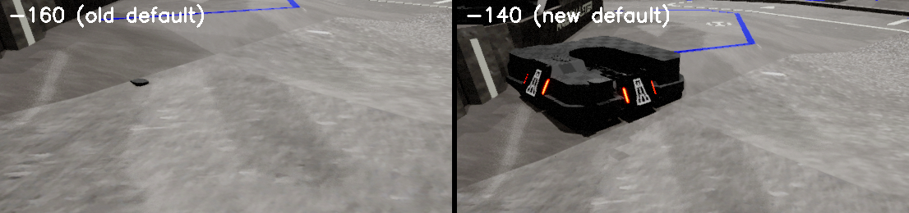

# 渲染采集链路：现状、与 SPEAR 示例工程的对比、取舍

> 相关：[`agents.md`](agents.md)（采集路径硬规则）、[`render_budget.md`](render_budget.md)（显存/帧时间实测杠杆与分级降载）、[`urdf_workflow.md`](urdf_workflow.md)（分辨率/细线的历史结论）、[`risks.md`](risks.md)（显存风险）。
> 上游参考：`~/spear/examples/render_image/run.py`、`~/spear/cpp/unreal_projects/SpearSim/Config/DefaultEngine.ini`、`~/spear/editor/create_asset_bp_camera_sensor.py`。

---

## 1. 我们的采集链路

所有出图都走同一个骨架：

1. 在 `USpSceneCaptureComponent2D`（`/SpContent/Blueprints/BP_CameraSensor` 的 `final_tone_curve_hdr_` 组件）上设 `Width`/`Height`、`CaptureSource`、`bAlwaysPersistRenderingState`；
2. 把后处理拷到组件（关卡体积或玩家相机的混合结果）；
3. `Initialize()` + `initialize_sp_funcs()`；
4. warm 若干帧让 TAA 有历史；
5. 每帧 `bCaptureGpuNextRender = True`，`end_frame(single_step=True)` 后 `read_pixels()`。

读像素**只能**走第 5 步（SpFuncs）。`SpearRenderPort` 需要 `bind_frame_metadata`/`readback_metadata`（`run_id`/`commit_id`/`ue_frame_id`），standalone `-game` 下没有 metadata 组件，必然失败（[`spear_metadata.md`](spear_metadata.md)）。

> **第 5 步的 `single_step` 已按上游论文口径改掉（`rm_sim_spear/render.py`，2026-10-10）。** 它把游戏线程阻塞在帧首 `OnBeginFrame`（早于 Slate 输入和 `GEngine->Tick()`），会让编辑器整个窗口冻结；理由见 [`architecture.md`](architecture.md) §4.1。`SpearRenderPort` 现在用普通 `end_frame()` 收尾，靠 `set_game_paused(False/True)` 保证每个事务只推进一帧。**尚未验证**：没有 `single_step` 时，`bCaptureGpuNextRender` 触发的那次渲染是否仍严格对应本事务施加的位姿（唯一凭据是 §8.4 的 `commit_id` 配対，不是"刚跑完一帧"的时序假设），以及 double/triple 缓冲的 `_BUFFERED_LAG` 配对。`tools/run_physics_sim.py` 的内联采集路径仍用 `single_step=True`。

## 2. 与示例工程的逐项对比

| 做法 | SPEAR 示例 | 本项目（修复前） | 影响 |
|---|---|---|---|
| 采集组件 | `BP_CameraSensor` + `USpSceneCaptureComponent2D` | 同 | 无差异 |
| `CaptureSource` | 保持 BP 的 `SCS_FinalToneCurveHDR`，没有示例覆盖它 | 4 处覆盖为 `SCS_FinalColorLDR`（`test_urdf_views.py`、`run_physics_sim.py`、`spear_scene_binding.py`） | 改变 tonemapper 的输出编码路径；我们注释里"会让细几何断开"的说法**未被验证**，属于待确认项 |
| **捕获内的 Lumen GI/反射** | BP 里显式设 `override_dynamic_global_illumination_method=True` + Lumen、`override_reflection_method=True` + Lumen | 从关卡体积/玩家相机**整结构拷贝** PP，会把这几个 override 标志一起覆盖掉 | 引擎对每个 SceneCapture 强制 `DynamicGlobalIlluminationMethod=None`、`ReflectionMethod=None`，只有组件 PP 的 override 标志能重新打开 → 捕获里没有 GI/反射 |
| 后处理/曝光 | 示例不覆盖 PP，用的是 BP 自带设置；`r.DefaultFeature.AutoExposure` 未设（自适应） | `r.DefaultFeature.AutoExposure=False`（锁定曝光）；`fixed`/`bound` 两条路径此前根本不拷 PP | 曝光与编辑器视口不一致；修复前帧灰度均值 **9.4/255**（该次同时开着 `--low-vram`，见 §4 的归因说明） |
| 纹理流送 | 一次性出图的示例都设 `r.Streaming.FramesForFullUpdate=0` + `r.Streaming.FullyLoadUsedTextures=1` | 默认 `2`/`0`；只有 `test_urdf_views.py --fully-load-textures` 才设 `0`/`1` | 低 mip → 糊 + **细线/alpha-tested 细节断成虚线** |
| 纹理池 | 从不覆盖，用引擎默认 | 曾在 `--low-vram` 里设 `=512` + `LimitPoolSizeToVRAM=1`，**2026-10-08 已移除** | 实测只把峰值移动 −3 MiB，却给常驻 mip 封顶（低 mip 糊/虚线）——纯负收益 |
| `r.ScreenPercentage` | 从不设置 | 曾在 `--low-vram` 里设 `=50`，**2026-10-08 已移除** | **对 SceneCapture 完全无效**（引擎强制 `FLegacyScreenPercentageDriver(1.0)`，`r.ScreenPercentage` 只作用于视口，见 [`urdf_workflow.md`](urdf_workflow.md)） |
| 线程同步等 ini | `[SystemSettings]` 有 `r.OneFrameThreadLag=0`、`r.GTSyncType=1`、`r.CustomDepth=3`、`r.PostProcessing.UserSceneTextureDebug=0` | 修复前连 `[SystemSettings]` 段都没有 | `end_frame(single_step=True)` + 立刻 `read_pixels()` 的语义假设 lag=0；CustomDepth 是 SPEAR 分割回读的前提 |
| 光线追踪 | `r.RayTracing=True` 但 `Enable=0` + `EnableOnDemand=1`（按需开） | `r.RayTracing=True`（默认 `Enable=1`）+ `r.RayTracing.RayTracingProxies.ProjectEnabled=True` | 合并 CAD 图的 BLAS/TLAS 常驻显存 + 走硬件 RT 的 Lumen 路径 |
| Substrate | 无 | `r.Substrate=True` | 非上游的 GBuffer/材质路径，额外的着色器与显存开销 |
| 读第一帧前的帧数 | ≥6 帧（2 帧 step + 连续 2 帧 idle + 1 帧采集），multi_view 还 `step(45)` | warm 4 帧 | TAA 历史不足时首帧偏噪 |
| 采集分辨率 | 512×512 / 1280×720，不超采样 | 曾做 1440×1080 + 2× 超采样 | 8 GiB 下 1440×1080 满画质必然 OOM（[`risks.md`](risks.md)） |

## 3. 为什么示例"画质好又流畅"

不是隐藏技巧。示例把三件事同时做对了：**小场景（apartment_0000 量级）+ 小分辨率（512²/720p）+ 不关任何渲染特性**，而我们的合并 CAD 图是"上千张贴图 + 2.16M 三角面 + 1440×1080 + 超采样 + 两个 SceneCapture"，在同一块 8 GiB 显卡上互相抢预算：

- 满画质 1440×1080：`Out of memory on Vulkan` → `VulkanMemory.cpp` 直接 `Fatal`；
- 2× 超采样 @1440×1080：峰值 7718 MiB，最低只剩 63 MiB；
- device-local 可用预算实测约 5960–6874 MiB。

结论：示例给的是"**不要为了省显存去关渲染特性**，要省就降分辨率/降帧数/降场景"；这条与我们此前"用 `--low-vram` 关 Lumen/RT/VSM 跑画质验收"的做法正好相反。

## 4. 本轮已落地的修复

| 位置 | 改动 | 证据 |
|---|---|---|
| `tools/run_physics_sim.py` | 新增 `--fully-load-textures`（默认开，`--low-vram` 时默认关），采集前设 `r.Streaming.FramesForFullUpdate=0` + `r.Streaming.FullyLoadUsedTextures=1` | 白线由断线变为连续；见第 5 节 |
| `tools/run_physics_sim.py` | `fixed` / `bound` 两条路径也拷后处理（`_copy_player_camera_post_process`，失败则 `_copy_viewport_post_process`） | 帧不再近全黑：同一采集分辨率（512×512）下灰度均值 9.4/255 → 47.6/255。**注意该对比同时改了三个变量**（不再用 `--low-vram`、拷了后处理、机位从 `(70,-90,-120)` 换成视口位姿），所以只能说明"这个组合能出可见画面"，不能把亮度单独归因于后处理拷贝 |
| `tools/run_physics_sim.py` | `fixed`/`main` 机位默认改为**相对已施加位姿的 `base_link` 锚点**（`--frame-robot`，默认开；`--no-frame-robot` 用视口位姿；`--camera-position-cm` 显式覆盖），并修掉 `main` 分支把 `world_offset_cm` 当机位用的 bug | 锚点的 spawn 坐标是关卡原点而不是机器人：位姿是按 `world_offset_cm` **绝对**施加的，在第一帧 `apply_snapshot` 之前解算机位，拍到的是广场不是机器人 |
| `tools/run_physics_sim.py` | spawn 的临时传感器设 stable name `RMSim/physics_view_camera` | 便于后续按名字找回（不设就只能按 class/tag 找） |
| `ue/Config/DefaultEngine.ini` | 新增 `[SystemSettings]`：`r.PostProcessing.UserSceneTextureDebug=0` | 防止 debug overlay 烧进捕获像素 |

### 崩溃教训（必须写进 ini，不能运行时 `set_cvar`）

第一版修复把 `r.PostProcessing.UserSceneTextureDebug=0` 放在运行时 `console_service.set_cvar`，结果在 `UnrealEditor -game` 下**必崩**：

```
Signal 11 caught
FMaterialEditorUtilities::RefreshPostProcessPreviewMaterials(UMaterialInterface*, bool)
  ← TMulticastDelegateBase::Broadcast ← IConsoleVariable::Set ← UnrealService_1.h:137
Unhandled Exception: SIGSEGV: invalid attempt to read memory at address 0x00000000000027a0
```

原因：该 cvar 注册了 MaterialEditor 的刷新回调，而 `-game` 模式下编辑器模块被加载、编辑器子系统并未初始化，回调解引用空子系统集合。SpearSim 把这条设置放在 `DefaultEngine.ini` 的 `[SystemSettings]`（配置加载期生效），不经过运行时广播——**照抄上游设置时要连"放在哪一层"一起抄**。

## 5. 当前验收口径

```bash
env DISPLAY=:1 PYTHONPATH=. /home/coffee/miniconda3/envs/spear-env/bin/python -u \
  tools/run_physics_sim.py --frames 160 --settle-frames 20 --drive-gain 5.0 \
  --joint-armature 0.05 --drive-wheels 6 --view fixed --width 512 --height 512 \
  --output-dir /tmp/rm_sim_spear_physics3
```

判据（三者必须同时成立）：

1. `trace.csv`：`sim_time_s` 单调、无 NaN、`max_qvel` 有界；静止后 `base_link_z_cm` 落在 −151…−153（地面 −160，轮半径 5.55）；
2. 画面：机器人可见、驱动期在画面里产生**成片**变化像素（不是几十个像素的抖动）；
3. 细线：白色场地线在这个分辨率下连续（断线说明内部分辨率或贴图 mip 被压）。

### 未完成：`-game` 里的机器人还没有在画面中出现

测量结果（2026-10-06，`/tmp/rm_sim_spear_off_*`）：

- 同一机位、只把 `--world-offset-cm` 的 x 从 0 改成 400（机器人整体平移 4 m），两帧**逐像素差最大只有 1 个灰度级**（`px>2` = 0）。也就是说这一机位下机器人对画面**没有贡献**。
- 用 `--dump-binding` 复查：`base_link` 锚点确实被摆到 (400, 0, −159.86)，且带 `RMSimLink=base_link` 标签的 341 个视觉 Actor 的世界坐标同步为 (398.2, 22.4, −157.7)（= 锚点 + URDF 视觉原点），`scale=1.0`、`hidden=0`。**说明网格已正确挂到锚点上并跟随位姿**，问题不在绑定或姿态。
- 因此嫌疑落在两处，需要下一步用数据排除：① 该机位与机器人之间被关卡地面/结构遮挡（相机 (−100 cm) 可能位于另一层平台之下）；② 网格相对机器人骨架尺度过小（`GetActorBounds` 抽样的轴承零件半边长只有 0.4–0.6 cm）。

**下一步（明确、可执行）**：读 BP_CameraSensor 的 `world_position` 模态（SpFuncs），取机器人屏幕位置附近的像素反算关卡地面 z，用它替换 `docs/agents.user.md` 里记录的"−160 来自某个 actor 的 Z"。注意 UE 的 `UKismetSystemLibrary.LineTraceSingle` **不在** SPEAR 的 RPC 注册表里（调用一律断言失败，已实测），所以"射线打地面"这条路走不通；`docs/agents.user.md` 里的 `--world-offset-cm` 也必须按这个结论重新标定。

## 7. 细线断裂（虚线）与"左右质量不一致"的实测结论（2026-10-06）

问题：远处细线断成虚线；同一材质在画面左右两侧的高频细节差异明显。

### 7.1 左右差异：不是中线采样 bug，是距离/斜视角

用**正俯视、左右对称**的机位（`--camera-position-cm 0 0 260 --camera-target-cm 0 0 -160`）拍同一片地面，
逐列梯度能量（高频量）左半/右半比：

| 配置 | 左/右高频比 | 8 个纵向条带（左→右） |
|---|---|---|
| TSR（默认） | 0.93 | 3.01 / 3.28 / 3.71 / 3.86 / 3.96 / 3.88 / 3.76 / 3.34 |
| TAA（`r.AntiAliasingMethod=2`） | 0.92 | 3.02 / 3.32 / 3.83 / 3.89 / 3.97 / 3.89 / 3.85 / 3.48 |
| 无 AA | 0.91 | 3.09 / 3.49 / 4.21 / 4.03 / 4.11 / 4.04 / 4.21 / 3.89 |
| `r.ScreenPercentage=50` | 0.93 | 与默认**逐像素一致**（再次证明 SP 对捕获无效） |
| 窗口 1440×1080 | 0.93 | 与窗口 512² **逐像素一致**（捕获不受主视口尺寸影响） |

**对称机位下左右完全均衡（0.91–0.93），且与 AA 模式无关**；而斜视角帧的左右比是 1.15–2.27。
所以"左边清楚、右边没有细节"不是中线/采样 bug，而是**距离与斜视角**（右侧更远/更斜 → 每像素覆盖的
texel 更少、mip 更粗、细特征低于 Nyquist）。它随镜头朝向变化，停止用 actor 名字或元数据去猜，
先看 `--supersample` / mip / 各向异性这三件事。

### 7.2 虚线：是采样密度，不是 AA 模式

同一斜视机位（`300,-300,-80` → `0,0,-150`，红线在画面下半部变远），把红色细线做连通域统计，
"虚线"= 连通域数量多、每段面积小：

| 配置 | 红线像素 | 红色断裂段数 | 段中位面积 | 碎段占比 | 白色线连通域 |
|---|---|---|---|---|---|
| 1.0× + TSR（基线） | 698 | **20** | 12.0 | 0.70 | 97 |
| 1.0× + FXAA | 433 | 26 | 6.0 | 0.85 | 125 |
| 1.0× + TAA | 449 | 20 | 6.0 | 0.75 | 158 |
| **2.0× + TSR** | 627 | **9** | 11.0 | 0.78 | 112 |
| **2.0× + TAA** | 629 | **7** | 14.0 | 0.57 | 121 |
| 2.0× + 无 AA | 619 | 9 | 8.0 | 0.78 | 119 |

- **2× 超采样把断裂段数从 20 降到 7–9（−55%~−65%）**，同时红线的像素总量保持（619–629 vs 698）：
  线还在，只是不再断——正是"可以接受模糊、不能接受断裂"想要的效果。
- **1× 下的 FXAA/TAA 反而更糟**：红线像素量掉到 433/449（−36%），即后处理 AA 把细特征**抹掉**了，
  这与"低频细节丢失"的观感一致。
- 结论：这是**采样密度**问题（内部分辨率/每像素覆盖），不是 AA 算法问题。

### 7.3 代价与处方

| 手段 | 显存 | 帧时间 | 说明 |
|---|---|---|---|
| `--supersample 2.0`（内部分辨率 2880×2160 → 输出 1440×1080 箱式降采样） | UE 占用 +450–800 MiB | +20–35 ms/帧（95→114 ms 一档） | 本工具已支持 `--supersample` / `--max-internal-pixels` |
| 内容侧把线做粗（≥1.5–2 px @ 目标分辨率） | 0 | 0 | 最省事；属于可接受的"模糊" |
| 降低斜视角/距离，或给线条贴图开各向异性 + 合适的 mip bias | 0 | 0 | 治"远处变虚/变断"的根 |
| 提高 `--width/--height`（输出分辨率） | ~0（±100） | 按像素线性 | 数据集出图可用 |

`--supersample` 的像素预算由 `--max-internal-pixels` 兜底：`rm_sim_spear/capture_resolution.py`
保证**预算只会削减超采样、永远不会把内部目标降到输出分辨率以下**（那正是历史上 0.44× 出虚线的机制）。

## 6. 建议但尚未执行的改动（需要确认）

这些都会改变项目/编辑器的默认观感或显存占用，先列精确值，不擅自改：

**已执行（2026-10-08，用户确认）**：`rm_sim_spear/vram.py` 的 `--low-vram` 预设删掉了
`r.ScreenPercentage=50`（对 SceneCapture 无效，只降视口）与 `r.Streaming.PoolSize=512` +
`r.Streaming.LimitPoolSizeToVRAM=1`（峰值只 −3 MiB，代价是低 mip 的糊/虚线）。`tests/test_vram.py`
原先断言 512，已改成"这三条不得再出现"的回归守卫；`--low-vram` 其余部分（关
Lumen/光追/VSM/DF）不变。

| 建议 | 精确位置 | 理由 / 风险 |
|---|---|---|
| 删掉 `r.DefaultFeature.AutoExposure=False` | `ue/Config/DefaultEngine.ini:25` | 上游没设；锁定曝光是黑帧/过曝的直接原因之一。风险：编辑器视口观感会变 |
| RT 改按需：`r.RayTracing.Enable=0` + `r.RayTracing.EnableOnDemand=1`，并去掉 `r.RayTracing.RayTracingProxies.ProjectEnabled` | `ue/Config/DefaultEngine.ini:16-17` | 省 BLAS/TLAS 常驻显存，合并 CAD 图收益最大。风险：硬件 RT 的 Lumen 效果变化 |
| 评估去掉 `r.Substrate=True` | `ue/Config/DefaultEngine.ini:19-20` | 与上游一致；风险：材质可能依赖 Substrate 节点 |
| 采集组件显式打开 GI/反射 override | `tools/test_urdf_views.py` 的 `_copy_viewport_post_process` / `_copy_player_camera_post_process` 里，拷完 PP 后补 `bOverride_DynamicGlobalIlluminationMethod=True` + `DynamicGlobalIlluminationMethod="Lumen"`、`bOverride_ReflectionMethod=True` + `ReflectionMethod="Lumen"` | 对齐示例 BP；这是"捕获里没有 GI"的正解 |
| `test_urdf_views.py` 默认不要关 Lumen/RT/VSM | `tools/test_urdf_views.py:876`（现为 `if not args.keep_expensive_rendering:`） | 与示例一致：画质路径默认不降级，要省显存走分辨率 |
| 对比实验：`CaptureSource` 用 BP 默认值 | 4 处 `SCS_FinalColorLDR` | 验证"细几何是否真的因此断开"；目前只是注释里的说法 |

### 7.4 超采样倍率的开销（1440×1080 输出，斜视细线机位，10 帧）

| 超采样 | 内部目标 | 中位帧时间 | UE 显存占用 | min_free | 红线断裂段数 | 白线连通域 |
|---|---|---|---|---|---|---|
| 1.0× | 1440×1080 | 88.1 ms | 2616 MiB | 3771 MiB | 20 | 295 |
| 2.0× | 2880×2160 | 124.6 ms（+36.5） | 3468 MiB（+852） | 2875 MiB | **10** | 226 |
| **3.0×** | 4320×3240 | 190.0 ms（+101.9） | 5010 MiB（+2394） | 1364 MiB | **3** | 220 |
| 4.0× | 5760×4320 | **崩溃** | — | — | `Out of memory on Vulkan; AllocSize=2048.000MB` | — |

- **4× 在本机不可行**：引擎在 5760×4320 目标上请求一次 **2048 MiB 连续**分配（MemoryTypeIndex=1，随后 4），8 GiB heap + 桌面 ~1.5 GB 占用下拿不到，直接 `VulkanMemory` 级崩溃——不是"更慢"，是硬上限。
- **3× 是可行上限**：断裂段数 20→3（比 2× 的 10 更好），代价 +102 ms/帧、+2.4 GB，min_free 掉到 1364 MiB（已贴近 1024 MiB 的安全线）。
- **2× 是性价比拐点**：+36.5 ms（+41%）、+852 MiB，断裂减半。
- 想要"接近 4× 的连续性但更便宜"：① 用 3× 但把**输出**分辨率降到 1024×768（内部 3072×2304，比 3×@1440×1080 少 43% 像素）；② 内容侧把线加粗（零成本）；③ 2× + 加粗，通常就够。

## 8. 机器人/装甲在画面里看不见：证据与状态（2026-10-06）

### 8.1 不是"机位没对准"那么简单

- `--hide-tag "RMSimRobot=总装"` 隐藏全部 951 个机器人视觉 Actor，画面只变化 **260 像素**
  （mean|Δ| = 0.033，两次 A/B 完全一致）→ 机器人对当前所有机位的画面**几乎没有贡献**。
- 把机位改成瞄准 4 个 `armor_link` 锚点的均值（`--aim-links armor_link_1,...,armor_link_4`）后，
  画面里仍然只有关卡地面/挡板/蓝线，没有机器人也没有装甲。
- 机器人尺度正常：`--dump-robot-bounds` 量到并集包围盒 **73.8 × 67.4 × 27.9 cm**。
- 位姿是生效的：`--dump-binding` 显示 `base_link` 锚点被摆到 (0, 0, −159.86)，且带
  `RMSimLink=base_link` 标签的视觉 Actor 世界坐标同步跟随（= 锚点 + URDF 视觉原点）。

因此最可能的原因是**机器人在关卡可见地面之下**：`--world-offset-cm` 的 −160 来自合并 rune Actor 的 Z，
不是机器人脚下那块地面的实测高度。要确认只需一步：用 BP_CameraSensor 的 `depth_meters` / `world_position`
模态（SpFuncs）读机器人 xy 处的地面 z，再据此改 offset。注意 `UKismetSystemLibrary.LineTraceSingle`
不在 SPEAR 的 RPC 注册表里（实测断言失败），射线方案不可用。

### 8.2 装甲板绑定：结构正确，但视觉验证被 8.1 挡住

`--dump-armor`（绑定后、施加位姿前）实测：

- `armor_link_1..4` 四个锚点全部绑定；
- 每个装甲克隆的网格组件数是 `[4, 4, 4, 4]`（模板 `armor_tune_node_4` + 子件 `armor_tune_node_0..3` 都被克隆）；
- `robot_visual_source = imported_link_hierarchy`；
- 4 个克隆在绑定时刻的世界坐标都是 (0,0,0)，即 `_reset_actor_relative_transform` 已把它们钉在自己的
  `armor_link` 锚点上（锚点在施加位姿前位于关卡原点），随锚点一起被驱动。

**待验证项**：克隆根是"关卡里的前哨站装甲"而不是 URDF 自带的 `armor_link_*` 视觉（导入脚本本来就会跳过
`armor_link_*`），因此需要看图确认①朝向/尺度是否与装甲 link 坐标系一致，②`hide_template=true` 是否真的
隐藏了模板（早期出现过"绑错的机关 Actor 还留在关卡里"）。这两件事都要先让机器人进画面才能判。

### 8.3 装甲绑定的定论（2026-10-06 晚，打包版实测）

上面两件事已经量完，结论是**装甲绑定对画面贡献 0 像素**，8.2 里"结构正确"只是指 attach 成功：

- **同一物理帧的 A/B**：`--plan` 用 `"armor": []` 的副本跑 30 帧，与正常计划逐帧比
  `base_link_x_cm` 最大差 **0.000000 cm**（物理完全一致），画面 `|Δ|>32` 的像素数 = **0**。
  绑定装甲与不绑定装甲**渲染结果完全相同**。
- **模板是谁（含资产实证）**：`_find_actor` 走到 `runtime_actor_name` 回退，命中的是 `armor_tune_node_4`
  —— 关卡里 label 为 `armor`、计划里写作 `Scene/armor` 的那棵树（自身 0 个 mesh 组件）。它的 4 个子件
  `armor_tune_node_0..3` 用的 mesh 就是**场景自带的那套装甲组**：

  | 子件 mesh | 尺寸 cm | 材质 |
  |---|---|---|
  | `/Game/armor_tune/StaticMeshes/前哨站_body36` | 11.5 × 6.8 × 13.5 | `armor_outpost`（+ 一个 WorldGridMaterial 槽） |
  | `/Game/armor_tune/StaticMeshes/前哨站_body398` | 12.0 × 6.9 × 14.1 | `armor_outpost_001` |
  | `/Game/armor_tune/StaticMeshes/前哨站_body37` | 5.7 × 3.8 × 1.2 | **`red_light`**（发光灯条） |
  | `/Game/armor_tune/StaticMeshes/前哨站_body38` | 5.7 × 3.8 × 1.2 | **`red_light`**（发光灯条） |

  也就是说模板**选对了**（正是"场景中已有的灯条发光装甲"），坏的是**放置**；`tune_node` 只是这棵树在独立
  运行时的 UObject 名。同一套四个 mesh 在关卡里还有一份**装配正确**的完整副本，挂在 `armor_outpost_top_red`
  下、位于 (299, −228, 7)；`/Game/armor_tune/StaticMeshes/` 里另有一整套 `前哨站_body*` 备用件。
- **为什么看不见（2026-10-06 晚复测修正）**：早先按 **pivot** 判读写成"落到锚点下方 1.28 m"——那个 1.28 m 是
  STL 网格自身 pivot 与几何的偏移，不是几何位置，该结论作废。绑定后空跑 8 帧（等 UE 传播 attach）再量：
  4 个克隆根都停在各自 `armor_link_*` 锚点上且**自身无几何**（extent 0），而 16 个子件（4 组，每组
  1 块板 `6.8×4.6×6.4` + 2 条灯条 `0.6×2.5×3.2` + 1 块板 `7.1×4.7×6.6`）全部在 **z ≈ −172 … −176.5 cm**
  （竞技场地板在 −140，即**埋进地板下约 32 cm**），并散落在 4 个互不相同的位置
  （(15.3, 103.8)、( −61.5, 28.3)、(15.3, −46.2)、(89.3, 28.3)）。所以不是"重叠"，是**每组的几何都没跟着
  自己的锚点走**，且都在地板以下 → 贡献 0 像素。模板与子件的 `bHidden` 都实测为 1，`hide_template` 本身没问题。
- **四个锚点是空的**：`armor_link_1..4` 是绑定时为找不到导入视觉而 spawn 的空 Actor（无 tag、bounds 为 0）。
  关卡 tag 词表里也只有 `MuJoCoBody`/`RobotLink` 各 9 个（正好是非装甲的 9 个 link），**没有任何装甲寻址**。
- **真正的装甲几何一直在 URDF 里，但它不是我们要的那个**：`assets/总装_urdf/总装.urdf` 的
  `armor_link_1..4` 各带 1 个 visual，同一个 mesh `RoboMaster_装甲模块_AM02_2019_默认_3b8758646d00fab6.stl`
  （1.7 MB，文件在位），四个 link 的 `origin_ue_cm` 分别是 (15.3, 56.5, 6.9)、( −14.2, 28.3, 2.6)、
  (15.3, 1.1, 4.6)、(42.0, 28.3, 6.9) —— 正好绕 74×67 cm 底盘的前/后/左/右四面。**导入脚本按设计跳过了它们**：
  `tools/import_urdf_visuals.py` 的 `DEFAULT_SKIP_LINKS = "armor_link_1,...,armor_link_4"`，理由是
  "装甲板是关卡聚合模板的运行时克隆，导入 URDF 自带视觉会重复渲染"。
- **为什么不应该用它**：这条 STL 导入后唯一的材质槽是 `/Engine/EngineMaterials/WorldGridMaterial`
  （UE 默认材质）→ 画出来就是棋盘格，**没有材质、也没有灯条**；而场景那套是 `armor_outpost` /
  `armor_outpost_001` / `red_light`。所以正确做法是把 `armor_link_*` 放回 `--skip-links`，
  转而把场景那套 `前哨站_body{36,37,38,398}` 装到 4 个装甲 link 上（见 8.3.2）。

### 8.3.2 现状与正确修法（2026-10-06 晚）

已经做过的（**需要回退**）：我一度把 `armor_link_*` 从 skip 列表里去掉并重新导入，结果装甲是画出来了
（A/B 942 像素，见下），但用的是 URDF 那条无材质的 STL —— 与"用场景中已有的灯条发光装甲"的目标相反。

正确的修法（待做）：把 URDF 装甲放回 `--skip-links`（重新导入一次），再让场景那套装甲落到 4 个
`armor_link_*` 上。两条可选路径：

1. **实现文档里承诺的逐 link 资源覆盖**（[`urdf_workflow.md`](urdf_workflow.md) "UE visual override" 一节：
   `ue_overrides.json.links.<link>.visual_source: "ue_asset"` + `ue_asset`）。实测：**这个字段目前没有任何
   代码读它**（`tools/import_urdf_visuals.py` 只读 `manifest.json`；全仓库只有 `pipeline/urdf_manifest.py`
   在写这个键），所以文档描述的机制尚未实现 —— 这才是"URDF 自带的应该被覆盖"没生效的直接原因。
2. **修好现有的克隆路径**：`scene_bindings.armor` 已经把模板指向 `Scene/armor`（= 那套灯条装甲，选对了），
   但克隆出来的 4 组几何全部落在 z ≈ −172…−176.5 cm、散在 4 个位置（见上一节复测），没有跟着各自的锚点。
   修好它的放置后，`clone_per_link` 这条路就能直接用场景装甲。

**已按 1 实施（2026-10-06 晚）**：`pipeline/visual_override.py` 解释 `ue_overrides.json` 的
`visual_source` / `ue_asset`（此前只有生成端写、没有消费端），`import_urdf_visuals.py` 用它替换 URDF mesh。
4 个 `armor_link_*` 现在指向场景那套灯条装甲**整组 4 块 mesh**（`前哨站_body36`/`body398` + 灯条 `body37`/`body38`，
材质 `armor_outpost`/`armor_outpost_001`/`red_light`），并且用的是**组根自己的相对装配**
（loc (6.478, 3.553, −141.482) cm、roll −91.5°，四个 link 相同），让组坐标系与 `armor_link` 坐标系重合。
导入后 `visuals=4, has_mesh=true`，4 个 link 的子件相对变换与场景组**逐位一致**，装配几何中心 ≈ 各自锚点；
渲染与"无装甲"相比 **2021 像素**，车体前后两面各是一整个装甲模块（板 + 上下两条发光灯条）。
协议细节与真实数字见 [`urdf_workflow.md`](urdf_workflow.md) "UE visual override" 一节。
剩下的：计划里 `scene_bindings.armor` 的克隆段还在克隆那套几何跑到地下 1.7 m 的组（0 像素但冗余，应关掉），
以及重新 cook 打包版（pak 里仍是旧地图，没有装甲）。

### 8.3.1 已执行：导入成功，装甲回到机器人身上

2026-10-06 晚执行 `RMSIM_IMPORT_SKIP_LINKS= tools/import_urdf_visuals.py`（编辑器 commandlet）：

- 导入报告 `saved_level=true`、`placement_error_count=0`、`missing_meshes=[]`、
  `removed_previous_actors=960`、`placed_visuals=955`（原来 951，+4 块装甲）、`skipped_links=[]`；
  4 个 `armor_link_*` 现在都是 `visuals=1, has_mesh=true`。
- 编辑器 `-game` A/B：`--hide-tag RMSimLink=armor_link_{1,2,3,4}`（每个 tag 命中 1 个 actor）
  与不隐藏逐帧比较，帧 24 画面差 **942 像素**，包围盒 y 510–625 / x 560–703，正好是车体前左侧多出/
  少掉的那块装甲板（`tmp/rm_sim_pkg/armor_visible_vs_hidden.png`）。导入前这个差值是 **0**。
  但看图就能看出那块板是**棋盘格默认材质**（`WorldGridMaterial`），所以这次导入只解决了"有没有"，
  没有解决"对不对" —— 见 8.3.2。
- 仍然未做：把 URDF 装甲放回 skip、改用场景那套灯条装甲、以及重新 cook 打包版（打包版仍是旧地图）。

### 8.4 位姿施加顺序：这是一个真的 bug，已修（2026-10-06）

导入装甲后量到：`armor_link_*` 的**实际世界坐标比喂进去的位姿低整整一个 base_link 的位移**。
`--dump-binding` 现在同时打印 `fed_poses_cm`（`to_unreal_pose` 的结果）与实际世界坐标，实测（offset −140，第 1 帧）：

| link | 喂入 pose_cm | 实际世界_cm | 差 |
|---|---|---|---|
| armor_link_1 | (15.3, 56.5, **−133.0**) | (15.3, 56.5, **−272.8**) | −139.8 |
| armor_link_2 | (−14.2, 28.3, −137.3) | (−14.2, 28.3, −277.2) | −139.9 |
| cam_link_8 | (10.8, 24.0, −138.2) | (10.8, 24.0, −138.3) | −0.1（link_7 的当帧位移） |
| link_1 … link_7 | 与喂入一致 | 与喂入一致 | 0 |
| base_link | (0, 0, −139.9) | (0, 0, −139.9) | 0 |

用 `--world-offset-cm 0 0 -400` 复测：armor 落到 z = **−792.8** = base(−399.9) + (6.85 − 400)，
即偏移被加了**两次** → 确认是"相对语义"，不是"没被移动"。

**根因**：导入的 link 锚点是**互相 attach** 的（`armor_link_*` 挂在 `base_link` 下，`cam_link_8` 挂在
`link_7` 下），而位姿是按**绝对世界坐标**施加的。`PoseSynchronizer.apply_snapshot` 原来用
`sorted(actor_names)` 排序，于是名字排在其父节点**之前**的子节点先被摆放、随后父节点移动时又把它拖走：
误差 = 父节点当帧位移。第 1 帧父节点从关卡导入位置跳到带偏移的世界位置，误差就是整个偏移（139.8 cm）；
之后每帧虽然会被重新纠正，但仍恒定领先/滞后一个父节点帧位移。`armor_link_*`（a < b）和
`cam_link_8`（c < l）正好都命中这个排序陷阱，`link_1..7`（l > b）侥幸没事。

**修法**：`rm_sim_spear/pose_sync.py` 新增 `order=` 参数；`rm_sim_spear/spear_scene_binding.py`
新增 `link_application_order(plan, link_actors)`，按 `links[].parent` 做拓扑排序（有环/缺父节点时
退化为稳定排序），`run_physics_sim.py` 把它传给 `make_scene_pose_synchronizer`。
**实测修复后**：13 个 link 的 `实际世界 − 喂入 pose` 全部为 **0.0 cm**（含 4 个装甲与 `cam_link_8`）。
离线测试 165 项通过（新增 5 项：顺序被尊重、缺省仍按字典序、未列入名字的稳定位置、父先子后、环/未知父节点）。

### 8.5 "没有材质的圆" = 引擎默认 Pawn 的占位球（不是关卡道具）

`docs/urdf_workflow.md` 曾记录"编辑器全量扫描没有任何 Actor 用 `/Engine/BasicShapes/Sphere`，
所以圆球是机关网格的部件" —— 那个扫描查错了资产，结论不成立。实测：

- 关卡原点上有 `DefaultPawn_2147482377`：**actor 包围盒 ±35 cm**、1 个 `UStaticMeshComponent`、无 tag。
- 引擎源码 `Engine/Source/Runtime/Engine/Private/DefaultPawn.cpp`：`CollisionComponent` 是
  `USphereComponent` + `InitSphereRadius(35.0f)`（对上 ±35），并创建 `MeshComponent0`
  = `UStaticMeshComponent` + static mesh **`/Engine/EngineMeshes/Sphere`（不是 `/Engine/BasicShapes/Sphere`）**
  + 未指定材质（所以是默认棋盘格）+ **`bOwnerNoSee = true`**。
- `bOwnerNoSee` 只对**拥有它的玩家**隐藏，`USceneCaptureComponent2D` 不属于任何玩家 → **每个捕获都画它**，
  而玩家自己的窗口/视口永远看不到 → 这正是"只有图里能看到、看窗口看不到"的原因。
- 独立互证：`docs/rendering.md` §10 用 `sp_world_position_` 俯视探针在原点列读到 **+34.3 cm**，
  与该球顶点 +35 cm 一致（另一种模态、另一条路径）。
- rune 没有这个球，因为它自带只用相机的 `ARunePawn`。
- **修法**：`tools/run_physics_sim.py --hide-pawn-mesh`（默认开）在绑定后对每个 `ADefaultPawn` 调
  `SetActorHiddenInGame(bNewHidden=True)`。实测 A/B（同帧同物理）：`|Δ|>32` 的像素 **67235**，
  差异区域 y 10–713 / x 347–859，除了球本身还有它压在地面上的接触阴影/GI；`bHidden` 由 0 → 1；
  `frame_ms` 与显存峰值不变（4570 MiB / min_free 3212）。不影响 `--view main`，因为隐藏的是网格不是相机。
  交付级修法（项目 GameMode 的 `DefaultPawnClass` 换成纯相机 Pawn，抄 rune 的 `ARunePawn`）需要编辑器改动
  + 重新 cook，尚未做。
  注意：`SetVisibility` 必须按反射参数全名传（`bNewVisibility`/`PropagateToChildren`），
  否则 SPEAR 断言 `isSubsetOf(keys(args), keys(property_descs))` 失败并把 EngineService 打成 error state，
  后续每一帧都会挂 —— 这也是最终改用 `SetActorHiddenInGame` 的原因。

### 8.6 `--dump-binding` 在第 2 帧必崩：诊断代码覆盖了 trace 的 `rows`

`--dump-binding` 之所以能做像素/位姿对照，是因为它打印每个 link 的锚点、`fed_poses_cm` 和
attach 父节点。但那段代码把外层的 **trace 行列表** `rows` 重新赋值成了 dict：

```python
rows = []            # 每帧的 trace 行，循环后面 rows.append(row) / rows[0]
...
if args.dump_binding and frame == 1:
    rows = {name: _link_dump(actor) for ...}   # ← 覆盖
...
rows.append(row)     # frame 2: AttributeError: 'dict' object has no attribute 'append'
```

所以 `--frames 1` 看不出问题，`--frames ≥ 2` 必然在第 2 帧崩、只留 1 张 PNG（2026-10-06 晚
做克隆 A/B 时撞上）。修法：局部改名 `link_dumps`，并把原因写进注释。
同类"循环内覆盖外层名字"的写法已用 AST 扫过 `tools/run_physics_sim.py`，没有第二处。

## 9. 为什么 standalone 捕获达不到编辑器视口的观感（含"变成别的材质"的解释）

### 9.1 采样不足有两种表现，混叠才是"位置上变成别的颜色/材质"

- 采样被**平均**时 → 高频丢失（模糊）。
- 采样不足但**不平均**时 → **混叠（aliasing）**：每个像素只保留一个/极少数样本，采样点落在哪个表面、
  哪个 texel、哪张 mip 上就画哪个 → 本该是 A 的位置画成 B（背景表面、另一张 mip 的平均色、另一种材质的
  颜色、摩尔纹）。所以"变颜色/变材质"不是采样不足的反例，恰恰是它更典型的症状。
- 另外 **mip 链本身就是不同颜色**：花纹贴图的粗 mip 是一片平均色，看起来就是"换了材质"。

### 9.2 关键机制：`USceneCaptureComponent2D` 默认关掉 TemporalAA

引擎源码 `Runtime/Engine/Private/Components/SceneCaptureComponent.cpp:685`：场景捕获组件的 legacy 初始化
里明确写 `ShowFlags.TemporalAA = false; ShowFlags.MotionBlur = false;`（注释：*previous behavior was not
exposing MotionBlur and Temporal AA in scene capture 2d*）。同一处构造函数还把
`DynamicGlobalIlluminationMethod = None`、`ReflectionMethod = None`、`LumenSurfaceCacheResolution = 0.5`
写进捕获组件的 PostProcessSettings。

本机实测与之完全一致：

| 实验 | 结果 | 含义 |
|---|---|---|
| 同一静态机位、连续两帧逐像素比较 | **`px>2 = 0`，`mean|d| = 0.0000`**（多组帧对） | 捕获**没有任何时域抖动/累积**，每帧都是确定性单样本渲染 |
| `--warmup-frames 4` vs `60` | 红线断裂段数都是 **20**，红线像素都是 **698** | 暖机再多也不会收敛（没有 history 可用） |
| `--average-frames 8`（多帧平均） | 帧完全相同 → 平均等于没平均（代码已修，但结论已由上面两条决定） | 时间超采样必须配**抖动**才有效 |

即：**编辑器视口是"每帧抖动 + TSR/TAA 累积 + 人眼积分"的多样本图像；我们的捕获是"单样本、无 history"的
确定图像**。两者不是同一件事，所以观感差距不是"参数没调对"。此外捕获的
`LumenSurfaceCacheResolution = 0.5` 与 GI/反射被强制 None（再靠 override 打开）也让捕获的光照/颜色比
视口更粗、更花。

### 9.3 怎么补回这些样本（按代价排序）

| 手段 | 效果 | 代价 |
|---|---|---|
| `--supersample 2/3`（空间超采样） | 断裂 20 → 10（2×）/ 3–8（3×） | +36 ms/帧（2×）/ +102 ms（3×）；4× 因 2 GB 连续分配 OOM |
| **手工亚像素抖动 + 多帧平均**（引擎不会替捕获抖动，需要自己在两次读回之间把传感器转 1/4、1/2 像素，再平均） | 等价于编辑器拿到的时域多采样，能把混叠变成正确的平均色 | N× 读回时间，显存 ~0；尚未实现 |
| 给捕获打开 TemporalAA show flag（若 SPEAR 暴露该 flag） | 直接拿到抖动+history | 场景捕获历史上会因此产生 ghosting，需要评估 |
| 提高输出分辨率 | 提高采样密度 | 显存 ≈0，帧时间按像素线性 |
| 内容侧：加粗细线、**去掉 CAD 共面重复面**（Z-fighting 也会在"别的位置画出别的材质"）、检查 LOD 材质槽 | 根治非采样类错色 | 需要改资产 |

## 10. 地面高度实测与机器人入画（2026-10-06）

用 BP_CameraSensor 的 `sp_world_position_` / `sp_depth_meters_` 模态（组件名带 `sp_` 前缀，
`DefaultSceneRoot.sp_world_position_`）做俯视采样，得到关卡地面高度网格（相机在 +300 cm 向下看）：

| y\x | −100 | 0 | 100 | 200 | 300 |
|---|---|---|---|---|---|
| −100 | −140.5 | −140.5 | −140.5 | −140.5 | — |
| 0 | −129.1 | **+34.3**（原点处的球/立柱） | −137.9 | −137.9 | −137.9 |
| 100 | −124.1 | −94.8 | −104.3 | −135.3 | — |

**竞技场地面在 z ≈ −137.9 … −140.5 cm**，而 `--world-offset-cm` 一直用 **−160**（来自合并 rune Actor 的 Z）：
机器人等于被埋进地面约 20 cm，因此画面里"机器人所在的位置显示的是地面材质"——这正是"位置上变成别的
东西"的又一实例，而且**与采样无关**。

修正后实测（`--world-offset-cm 0 0 -140`，同一机位）：

| 偏移 | 隐藏机器人带来的像素变化 | 结论 |
|---|---|---|
| −160 | **260 px**（mean|Δ|=0.033） | 只露出一条边，等于看不见 |
| **−140** | **12084 px**（mean|Δ|=1.165） | 机器人正常入画（画面中心下方可见车体与轮子） |

`docs/agents.user.md` 里的默认偏移随后改成 −140，并注明它来自这次实测。

### 10.1 更正与补充：默认偏移当时没改，以及轮子的碰撞体（2026-10-09 晚）

上面那句只对了一半。**`docs/agents.user.md` 改了，`tools/run_physics_sim.py` 的
`--world-offset-cm` 默认值一直是 `0 0 -160`**（连它自己的 help 都写着 "use 0 0 -140"）。
于是任何不带这个开关的调用——包括 `docs/agents.user.md` 里那条主命令——都会把机器人放到
可见地面以下 20 cm。这不是视觉问题，是"MuJoCo 的地面在哪儿"的问题。

同一次背靠背复测（`--frames 30 --settle-frames 20 --drive-wheels 0`、1024×768、同一机位），
把偏移当自变量、画面当因变量（`tmp/sink/`）：

| 偏移 | 固定机位（170 cm 高） | 掠射机位（60 cm 高，`--camera-standoff-cm 155.56 --camera-height-cm 60 --camera-aim-height-cm 20`） |
|---|---|---|
| **−160（旧默认）** | 整台机器人只剩路面上一块 **≈10 px** 的碎片 | 车体整体没入路面，只露出顶板的一条边 |
| **−140（新默认）** | 机器人完整入画 | **轮子踩在路面上、车底有可见缝隙**（`tmp/sink/graze140/frame_0030.png`） |

`graze140` 与 `graze137` 逐像素几乎一样 ⇒ 机器人脚下那块路面就在 −140 附近，−140 是对的。



左：`--world-offset-cm 0 0 -160`（旧默认），整台机器人没进路面，只剩顶板上一小块黑片。
右：默认（−140），机器人站在路面上。

**关卡地面不是一个平面。** 第 10 节的网格跨 **−124.1 … −140.5 cm**（同一次俯视采样），
所以单一 `world_offset_cm` 只能是折中：−140 是路面那一档，但机器人换个 xy 位置就可能差几厘米。
"沉进地面"类的症状先用 `--dump-robot-bounds` / `--hide-tag` / `world_position` 模态量，
不要靠猜。

**轮子的碰撞体原来也是错的。** `simple_collision` 用 `model.geom_aabb` 的并集造轮子圆柱，
而 `geom_aabb` 是**每个 geom 自己坐标系里的 AABB**：并集既丢掉了每个零件的 `pos`/`quat`，
又退化成"最大的单个零件"。对这些全向轮，它取到的是**侧板的 55.5 mm**，而不是**滚子（真正的
滚动面）的 60.1 mm**，圆柱还被放在轮心而不是轮胎带上（轴向偏 17.4 mm）。实测代价：

| | base_link 静止高度 | 四个轮子的 CAD 最低点（相对 z=0 平面） | 车体姿态 |
|---|---|---|---|
| 修前 | 72.88 mm | −0.36 / −3.03 / −6.36 / **−9.25** mm | 倾斜 1.01° / −0.47° |
| **修后** | 73.41 mm | −0.32 / −0.31 / −0.20 / −0.20 mm | 水平 |
| 参照：全 CAD 碰撞（`simple_collision=False`） | 79.34 mm | −0.24 mm（全局最低点） | 水平 |

修法是 `mujoco_driver.wheel_cylinder()`：把网格顶点按各自的 `pos`/`quat` 变换到轮体坐标系，
绕关节轴取最大半径，再用"半径 ≥ 95% 最大值"的那一圈顶点定轴向长度。落点由
`tests/test_mujoco_physics_options.py::test_wheels_touch_the_plane_instead_of_sinking_through_it`
钉住（四个轮子必须落在 ±1 mm 内）。

**还有一处不是轮子的问题：这台 URDF 的"底"是云台。** `link_5_joint`（yaw）与 `link_7_joint`
（pitch）没有任何驱动器，重力下云台+图传/相机整组比 zero pose 又转了 0.30 rad，于是
`link_6` 的 `nuc盖板` 停在平面以下 **36.5 mm**、`link_7` 以下 8.0 mm。`simple_collision`
不给云台碰撞体，它就**直接穿过地面**（地面不透明，所以画面上看不出，只是"云台不见了"）；
换成全 CAD 碰撞则反过来——机器人**靠 NUC 盖板站在地上，四个轮子悬空 4.2 mm**
（MuJoCo contact：`floor <-> link_6`，`dist = −0.243 mm`）。两条路都说明
**云台 zero pose 本身就不对**，这是资产/导出问题，本次没有改（需要先决定"把云台按住"还是
"重导 URDF"，见 [`urdf_workflow.md`](urdf_workflow.md)）。

复现：

```
# 落地/入画的 A/B（同一机位，只改偏移）
env DISPLAY=:1 PYTHONPATH=. python -u tools/run_physics_sim.py --frames 30 --settle-frames 20 \
  --drive-wheels 0 --width 1024 --height 768 --save-images sync --view fixed \
  --camera-standoff-cm 155.56 --camera-height-cm 60 --camera-aim-height-cm 20 \
  --world-offset-cm 0 0 -140 --output-dir tmp/sink/graze140
# 轮子/云台相对地面的几何（不需要 UE）
PYTHONPATH=. python -m unittest tests.test_mujoco_physics_options -v
```

**顺带量到的一件小事**：冻结模拟（`--settle-frames 20`）只有 0.1 s，不够"落地"。同一组参数下
`base_link_z_cm` 在第 30 帧（t=0.15 s）还是 **−130.14 cm**，而 3 s 后的平衡值是 **−132.66 cm**——
机器人是在**还在往下掉的时候**就被开驱动的（被地面弹起来后正在回落）。这不是"陷进地面"，
但任何用"落地后的高度"做的判据都要先跑够时间，别拿 20 帧的值当真值。

## 11. 抖动超采样 vs 空间超采样 vs 模糊（2026-10-06 实测）

工具新增：`--average-frames N`（每张图读 N 次）+ `--jitter-pixels R`（每次读之前把传感器按
黄金角圆盘序列偏 R 个像素）+ `--downsample-filter {area,gaussian}` / `--downsample-sigma-px`
（重建滤波）+ `--blur-sigma-px`（对**已采样**的成图做高斯模糊，用来验证"先模糊再采样"）。

同一斜视机位、1440×1080、取第 4 帧；红线连通域 = 断裂段数，`sharpness` = 全图平均梯度（越高越锐）：

| 配置 | 断裂段数 | 段中位面积 | 红线像素 | sharpness | 帧时间 |
|---|---|---|---|---|---|
| 1 样本（基线） | 20 | 12.0 | 698 | 2.69 | 95.5 ms |
| 1 样本 + 成图高斯 σ0.8 | 16 | 21.0 | 969 | **1.02** | 101.2 ms |
| 2× 空间 + box 重建 | 9 | 11.0 | 628 | 1.83 | 142.9 ms |
| 2× 空间 + 高斯重建 σ0.6 | 7 | 20.0 | 954 | 0.96 | 172.8 ms |
| **3× 空间 + 高斯重建 σ0.6** | **3** | 105.0 | 960 | 0.88 | 301.5 ms |
| **8× 抖动 + 平均（1× 内部）** | **5** | 41.0 | 814 | **2.55** | 337.1 ms |
| 16× 抖动 + 平均 | 5 | 42.0 | 806 | 2.55 | 611.3 ms |

结论：

1. **"先高斯模糊再采样"只有放在采样之前才对**：从超采样缓冲做高斯重建（2×/3× + Gaussian）确实
   能把断裂压到 7/3 段；而**对已经采样完的成图做模糊没有用**（段数只从 20 降到 16，sharpness 从 2.69
   掉到 1.02）——混叠出来的"错误颜色/材质"已经被烤进像素里，模糊只是把它抹匀。
2. **抖动 + 平均是唯一"保持锐度"的解法**：8× 抖动把断裂压到 5 段，而 sharpness 保持 2.55（≈基线
   2.69），红线像素从 698 升到 814（是补上了覆盖，不是抹粗）。16× 抖动不再更好（5 段、同 sharpness，
   但帧时间翻倍）→ **8 个样本是拐点**。
3. **空间超采样每个样本更便宜**（固定开销占主导）：2× 只多 47 ms 就拿到 4 样本；而每多一次读回
   ≈ +88 ms。所以能加内部倍率时优先加空间倍率；**只有在 4× 撞上 2 GB 连续分配上限、或需要保持锐度时，
   才用抖动**（抖动不增加 RT 尺寸，显存几乎不变）。
4. 按目的选：要"连续 + 清晰" → 8× 抖动（337 ms）；能接受模糊、要最连续 → 3× + 高斯重建（3 段，
   301 ms，但 sharpness 0.88）；只想便宜改善 → 2× box（143 ms，9 段）。
5. 组合技（待测）：2× 空间 × 4 抖动 = 16 样本，预计 ~500 ms，可能同时拿到"很连续 + 较锐"。

> ⚠️ 本节第 2–4 条把"补样本"当成默认解法，**第 12 节推翻了这个前提**：`~/rm_sim_rune` 的打包产物在同一张
> 地图、同一分辨率、**单样本**下就给出了干净的画面，而且它整进程显存比我们还高。采样不是我们的瓶颈，
> 视角和交付形态才是。抖动/超采样降级为"某个必须贴地掠射的机位才用的可选项"。

---

## 12. 与 `~/rm_sim_rune` 打包产物的正面对照（2026-10-06）

触发：用户直接运行 rune 的打包产物 `/tmp/rm_sim_package/Linux/rm_sim.sh`，观感"没一点问题"、不爆内存，
并质疑为什么要用 16× 抖动（0.6–1.0 s/帧）。本轮做了正面测量，结论是**该抄的不是画质参数，是交付形态和视角**。

### 12.1 rune 的交付链路（已确认，和我们的捕获同构）

- 产物是 **cooked standalone**（`package_linux.sh`：UAT `BuildCookRun` + ZenServer + `jq` 改写
  `ue.projectstore` 的 `.zenserver.hostname`，见 [`reuse.md`](reuse.md) §4.6）。启动脚本
  `/tmp/rm_sim_package/Linux/rm_sim.sh` → `rm_sim/Binaries/Linux/rm_sim rm_sim`。
- 采集是 `ARunePawn` 上的普通 `USceneCaptureComponent2D`：`CaptureSource=SCS_FinalColorLDR`、
  `bCaptureEveryFrame=false`、`bCaptureOnMovement=false`、`bAlwaysPersistRenderingState=true`、
  `SdkCaptureInterval = 1/120 s`；每次先 `SetCameraView(PlayerCameraManager->GetCameraCacheView())`
  并把 `View.PostProcessSettings`/`PostProcessBlendWeight` 整份复制到组件，再 `CaptureScene()` +
  `ReadPixels()`（`SimUnreal/Plugins/sim/Source/sim/Private/RunePawn.cpp:33-92`）。
  **我们走的是同一条路**（[`agents.md`](agents.md) §3、本文 §9.2）。
- 输出 1440×1080 BGRA8，经 POSIX 共享内存 `/dev/shm/rmsim_camera_v2` 发布；UDP 39001 收相机指令。
- 因此它是一个"同地图、同分辨率、同采集机制"的干净参照物。

### 12.2 怎么观察它（零显存成本）

新增 [`tools/read_rune_frames.py`](../tools/read_rune_frames.py)（协议编解码有离线单测
`tests/test_rune_capture.py`）：

```bash
python3 tools/read_rune_frames.py --output /tmp/rune_now.png --fps-seconds 6 --imu
# 把 rune 的相机压到俯角 25° 再抓帧；看完记得还原成 0,0,0
python3 tools/read_rune_frames.py --camera 0,-25,0 --output /tmp/rune_down.png
python3 tools/read_rune_frames.py --camera 0,0,0
```

### 12.3 实测对照

| 指标 | rune 打包 standalone | 我们 `UnrealEditor -game` |
|---|---|---|
| 采集分辨率 / 采样数 | 1440×1080 / **1** | 1440×1080 / 1（基线）～2（验收） |
| 交付帧率 | **21.4 fps**（共享内存发布速率实测） | 11.4 fps（1×，88.1 ms）～7.7 fps（2×，129.3 ms） |
| 整进程显存 | 5352 MiB（`nvidia-smi` compute-apps） | ≈3.9–4.3 GiB（footprint 2616 MiB + 桌面基线 1.3–1.7 GB） |
| 整进程 RSS | 3.2 GB | 未测（编辑器二进制，量级更大） |
| Nanite / RT / VSM pages / SurfaceCache | 默认全开（on / on / 4096 / 4096） | **off / off / 1024 / 1024** |
| 日志里的 VSM 告警 | **0 条** | `[VSM] Non-Nanite Marking Job Queue overflow`（11 次会话中 9 次） |

> 口径提醒：rune 的 5352 MiB 是用 `nvidia-smi` 读的**整进程**占用，且当时另有一个 cook 进程在跑
> （噪声 ±200 MiB 量级）；我们的 2616 MiB 是"峰值 − 桌面基线"的 UE footprint。两者不是同一口径，
> 只能得出**量级相当、我们没有更省**这个结论。

### 12.4 配置差异只有一处，在 `[SystemSettings]`

`ue/Config/DefaultEngine.ini` 的 `[/Script/Engine.RendererSettings]` 与 rune 的
`SimUnreal/Config/DefaultEngine.ini` **逐条相同**（`r.Substrate=True`、`r.RayTracing=True` +
`RayTracingProxies.ProjectEnabled`、`r.DefaultFeature.AutoExposure=False`、LocalExposure 两个对比度、
`r.AllowStaticLighting=False`、`r.Shadow.Virtual.Enable=1`、`DGIMethod=1`、`ReflectionMethod=1`、
`r.SkinCache.CompileShaders=True`、HardwareTargeting=Desktop/Maximum）。
`ue/Content` 就是 rune `SimUnreal/Content` 的副本（`1.uasset` 8627131 B、`2.uasset` 2174549 B、
`A_B1.uasset` 858902 B、`base_mat.uasset` 14973 B、`asset_manifest.json` 645109 B 逐字节等大）。

唯一差异是我们在 `[SystemSettings]` 加的 6 条：

| 开关 | 省 | 性质 |
|---|---|---|
| `r.PostProcessing.UserSceneTextureDebug=0` | — | **SPEAR 必需**（否则捕获里叠调试图）|
| `r.RayTracing.Enable=0` + `EnableOnDemand=1` | −551 MiB | 画质中立 |
| `r.Shadow.Virtual.MaxPhysicalPages=1024` | −427 MiB | 画质中立 |
| `r.LumenScene.SurfaceCache.AtlasSize=1024` | −295 MiB | 画质中立 |
| `r.Nanite=0` | −669…−834 MiB | **本场景网格不是 Nanite**，像素级无差 |
| `r.Lumen.TraceMeshSDFs=0` | −10 MiB | 跟随上游 SpearSim |

**rune 一条这类开关都没有**，它把 Lumen/光追/VSM/Nanite/SurfaceCache 全留在默认值上，照样不爆。

### 12.5 已有 A/B：把设置还原成 rune 的值并不会改善画面

`/tmp/rm_sim_ab_nanite/{a_base,c_base_again}` 是**未改 ini 时期**的运行（日志确认
`MaxPhysicalPages:4096`、`SurfaceCache.AtlasSize:4096`、`Ray tracing is enabled (dynamic)`），
`b_nanite_off`/`d_nanite_off_again` 是同一会话只加 `r.Nanite:0` 的对照。四组画面
mean|delta| ≈ 0.04，肉眼不可分。把 `a_base`、`b_nanite_off` 与 17:47 的验收帧并排
（同一区域、近似机位）：模糊的椭圆暗斑、亮雾楔形、地面椒盐噪点在**三者中位置一致**。

另外：`a_base`（Nanite 开）**同样**触发 `[VSM] Non-Nanite Marking Job Queue overflow` —— 这条告警来自
"合并后的 CAD 网格本身不是 Nanite 网格、却要覆盖很大一片 shadow map"，与我们 `r.Nanite=0` 无关。

**结论：我们看到的画质问题不是 `[SystemSettings]` 砍出来的。** 那 6 条只买显存，不卖画质。

**同机位同帧复核（E2，2026-10-06 晚）**：机位 `(110,−110,−80)` → `(0,0,−140)`、1440×1080、单样本、
第 8 帧，逐条还原 rune 的值（`--ini r.Nanite=1 --ini r.RayTracing.Enable=1
--ini r.Shadow.Virtual.MaxPhysicalPages=4096 --ini r.LumenScene.SurfaceCache.AtlasSize=4096`）：

| 量 | 当前 `[SystemSettings]` | rune 等值 | 差 |
|---|---|---|---|
| 图像 | — | — | **mean\|Δ\| 0.019，p99 = 0**，只有 0.21% 像素差 >2（max 78，是零散 sparkle） |
| speckle（中值残差） | 1.492 | 1.492 | 0 |
| detail（mean\|∇\|） | 2.504 | 2.504 | 0 |
| `peak_used_mb` / `min_free_mb` | 3968 / 3813 | **6305 / 1476** | **+2337 MiB** |

也就是说：**抄 rune 的渲染设置要多花 2.3 GB 显存，换来逐像素相同的画面。** 我们那 6 条是纯赚的，
应该保留（这一点推翻了我原先"rune 什么都不关所以我们也别关"的猜测——rune 不关是因为它的预算够，
不是因为关了会难看）。

### 12.6 差异落点在视角（掠射角）

机位高度阶梯（E1，2026-10-06 晚，`pos=(110,−110,z)` → `tgt=(0,0,−140)`，1440×1080、单样本、第 8 帧；
图：`tmp/rune/camera_height_ladder.png`）：

| 机位（离地面） | `frame_ms` 中位 | `peak_used_mb` | 画面 |
|---|---|---|---|
| **60 cm（我们一直在用）** | 97.7 | 3968 | 近处地面糊成一片灰雾，场地线几乎不可见，只剩光斑与阴影色块 |
| 150 cm | — | 3997 | 蓝图/白线/暗墙纹理都出来了，远处地面仍有明显椒盐 |
| 250 cm | 92.4 | 3974 | 场地蓝/红线连续可辨，场景可读，接近 rune 的观感 |

- 我们所有观察机位都在**地面以上 40–60 cm**、俯角约 **−14°**（`pos=(110,−110,−100)`、
  `tgt=(0,0,−140)`；地板实测 −137.9…−140.5 cm，见 §10），是贴着场地看出去的极端掠射视角；
  rune 的 pawn 机位在 **2 m 以上**。
- 我们自己在 **4.2 m 高、垂直俯视**、同一套设置、`--supersample 1.0`（即单样本、无 AA）下拍出来的细线
  是**连续**的：`/tmp/rm_sim_spatial/topdown_tsr_win1080/frame_0006.png`。
- 用 SDK 指令把 rune 的相机压到 **−25° 俯角**后抓帧（`tmp/rune/frame_pitch-25.png`）：白色场地线仍然
  连续、地面没有椒盐、没有椭圆色块。
- 机制上自洽：单样本 + 捕获里被 `ShowFlags.TemporalAA=false` 关掉的 AA（§9.2），1 px 宽的细几何和
  掠射面上的纹理 minification 只能"整段选中/整段丢掉"；掠射角把这个概率推到接近 1。**要抹掉它就得加样本
  （超采样/抖动），而那正是 rune 不需要付的代价——因为它不这么看。**
- 显存几乎不随这个变化（3968 / 3997 / 3974），所以抬机位是**零显存**的画质改善。

### 12.7 处方：该"照着他抄"的是交付形态和视角

按收益/代价排序：

1. **不要把超采样/抖动当默认**。rune 交付的就是**单样本 1440×1080**，而它整进程显存比我们还高。
   我们的 4× 失败是 **2 GB 连续分配**撞墙（`AllocSize=2048MB`），不是总预算不够；`≥3×` 直接删掉考虑。
2. **抄交付形态：把 `ue/` 打成 cooked standalone 再跑。** SPEAR 原生支持这条路
   （`SPEAR.LAUNCH_MODE: "game"` + `SPEAR.INSTANCE.GAME_EXECUTABLE=<...>.sh`，
   `~/spear/python/spear/instance.py:656-760`），本仓库的入口是
   [`tools/package_linux.sh`](../tools/package_linux.sh) + `run_physics_sim.py --game-executable <..>.sh`。
   代价：一次完整 cook（本次实测 cook 1451 包 ≈ 8 min；包 1.6 GB）。**实测收益见 §12.9。**
   **Zen 注意事项**：`-NoZenAutoLaunch=` 只是让 UAT 去连一个已有 server；server 一死 cook 就不再前进，
   但进程仍然活着（2026-10-06 19:00 那次 rune cook 卡在 `Cooked packages 391/3777` 超过 30 分钟，
   Zen 进程已消失、8558 无人监听）。`tools/package_linux.sh` 因此自己起 Zen + 看门狗重启 + `trap` 收尸 +
   另一个 `UnrealEditor*` 在跑时直接拒绝启动（`--force` 可越过）。
3. **抬机位**：观察机位抬到 1.5–2.5 m（rune 量级）。零显存、零帧时间（§12.6 实测），且不影响机器人入画
   （机器人 union bounds 73.8×67.4×27.9 cm，2 m 外 1440×1080 里仍占足够像素）。**注意这一条是对广角
   调试机位的补丁**：交付相机是 8 mm（水平 42°）而不是现在的 90°，属于同一类零成本杠杆，见 §13。
4. 若某个机位**必须**贴地掠射，才用 **2×**（143 ms / +852 MiB）；4×、16× 不再考虑。

### 12.8 待验证

- **E3 地图内容 diff**：我们的 `creo_stp.umap` 4.4 MB vs rune 11.5 MB。用 UE Python/Commandlet 查
  `PostProcessVolume`、灯光、关卡 actor 数量（**不要直接读 uasset**，见 `CLAUDE.md`），
  确认我们的地图没有在拷贝时丢内容。

### 12.9 打包版 vs `UnrealEditor -game`：实测（2026-10-06 晚，同机位同参数，背靠背两次）

机位 `(110,−110,−80)` → `(0,0,−140)`、1440×1080、单样本、8 帧、`--world-offset-cm 0 0 -140`；
两次运行之间机器状态相同（都还有那个卡死的 rune cook 占着 ~27% CPU）：

| 指标 | `UnrealEditor -game` | cooked standalone | 差 |
|---|---|---|---|
| `frame_ms` 中位 | 91.2 ms（min 89.0 / max 135.9） | **87.1 ms（min 86.6 / max 106.3）** | −4.5%，且抖动明显更小 |
| 进程 RSS 峰值 | 6.60 GB | **3.62 GB** | **−2.98 GB（−45%）** |
| UE footprint（peak − 采样起点） | 2673 MiB | 3073 MiB | +400 MiB（口径噪声 ±200 MiB） |
| `min_free_mb` | 3011 | 2572 | −439 MiB |
| 图像 | — | — | 视觉一致：mean\|Δ\| 2.13、p99 13，差异集中在几何边缘的亚像素位移 + Lumen 随机采样噪声；speckle/detail 1.494/2.509 vs 1.477/2.451 |

结论要按口径分开讲：

- **省的是内存（RSS −45%），不是显存。** 这一条正好打在本次事故的根因上（32 GB 机器在 cook 时被
  29 个 ShaderCompileWorker + 6.6 GB cooker 顶到 ~25 GB，内核杀掉 ZenServer，cook 假死）。
- **帧时间只小胜（−4.5%）**，不是 rune 那种量级差异；说明我们的帧时间主要花在
  捕获读回 + Python 单步往返上，而不是编辑器模块。要靠近 rune 的 21 fps 得动那条链路，不是动打包。
- **显存没有变便宜**（甚至略高），所以显存预算该省的仍要省（`[SystemSettings]` 那 6 条别撤）。
- 打包版还顺手消掉了 `UnrealEditor -game` 的编辑器模块面（运行时 `set_cvar` 后处理 cvar 的 SIGSEGV 等）。

**打包实操（本次踩到的顺序）**：

1. `tools/package_linux.sh` → cook 期间 Zen 被内核杀掉，cook 把 1451 个包**全部烘焙完并落到本地**
   `ue/Saved/Cooked/Linux/rm_sim_spear`（286 MB），但 UAT 因为 `LogZenStoreWriter: Error: Failed to commit
   oplog entry` 报 `ExitCode=25 (Error_UnknownCookFailure)`。
2. **不要重跑 cook**：`tools/package_linux.sh --resume --force` 直接跳过 build+cook，做
   `-skipbuild -skipcook -stage -pak -archive`，6 秒得到
   `build/package/Linux/rm_sim_spear.sh`（1.6 GB，`Content/Paks/rm_sim_spear-Linux.ucas` 490 MB；
  2026-10-06 起默认输出到仓库 `build/`，之前的 `/tmp/rm_sim_spear_package` 被一次系统 tmp 清理删掉了）。
3. 少数字段缺失（`Water/Meshes/RiverMesh`、`DeformerGraph/*` 没进 pak，因为它们的 oplog 提交失败），
   与我们的地图无关，打包版启动时会 warning 但不影响画面。
4. `--game-executable <pkg>.sh` 时必须放宽 RPC 超时：打包版从 pak 流式加载地图 + PSO 首次创建，
   `get_game()` 的 `get_static_struct_descs` 会超过默认 2.0 s（上游注释里就写了这种情况要把
   `CLIENT_INTERNAL_TIMEOUT_SECONDS` 设保守）。本仓库加了 `--rpc-timeout-seconds 20`，并在命令里带
   `VK_ICD_FILENAMES=/usr/share/vulkan/icd.d/nvidia_icd.json`。

打包版的 160 帧验收（`--frames 160 --settle-frames 20 --drive-wheels 6 --world-offset-cm 0 0 -140`，
1440×1080 单样本，证据在 `tmp/packaged_accept160/`）：

| 判据 | 结果 |
|---|---|
| 时间单调 | 160/160 ✓ |
| 落地 | `base_link_z` 首帧 −139.84 → 末帧 −133.48 cm（地板 −140） |
| 推进距离 | f20→f160 **Δx = 6.718 cm**（与 `UnrealEditor -game` 的验收**逐位一致**，说明物理不受交付形态影响） |
| `max|qvel|` | 2.278（同上，逐位一致） |
| `frame_ms` | 中位 **88.5** ms，p90 94.1，仅 6/160 帧 ≥100 ms（编辑器 1× 路径为 91.2 / max 135.9） |
| 显存 | `peak_used_mb` 5224 / `min_free_mb` 2558 |

### 12.10 "从桌面打开项目，Zen 服务器总是卡死"：Zen 是无辜的（2026-10-06 晚）

先说结论：**当天所有留存日志里，ZenServer 没有一次卡死或起不来**（17 次会话，全部 <1 s 起来、
`status: OK!`、退出时 `log ending` 优雅收尾；没有 `still waiting for other process`、没有
`Local ZenServer is unreachable, initiating recovery`，内核日志里也没有 OOM kill）。看起来"卡死"
的是另外两件事，都发生在 **`~/.local/share/applications/UnrealEngine.desktop` 这个入口**上。

**一、这个入口会让 ZenServer 的主人变成短命进程**

该 `.desktop` 的 `Exec` 只有引擎路径、**没有项目参数**，于是走"项目浏览器 → `SwitchProject` 重启"
这条路。用 journal 的 cgroup 标签（`UnrealEngine.desktop[pid]`）能把每次点击还原成两个进程：

| pid | journal 里可见的输出区间 | 角色 | ZenServer |
|---|---|---|---|
| 16425 | 23:06:40 – 23:06:54 | 启动器（项目浏览器） | **它拉起**（`--owner-pid 16425 --child-id Zen_16425_Startup`） |
| 16940 | 23:06:54 – 23:07:45 | 真正的编辑器 | 复用（`Found existing instance running on port 8558 matching our settings`） |
| 17549 | 23:09:05 – 23:09:22 | 启动器 | **它拉起**（`--owner-pid 17549`） |
| 18087 | 23:09:22 – 23:09:51 | 真正的编辑器 | 复用 |

**能确证的是归属，不是时刻**：`--owner-pid` 写的是**第一个**进程，而用户正在看的编辑器是**第二个**，
它只是"复用已有实例"。所以这个 ZenServer 的寿命挂在那个只负责交接的启动器上：
启动器一消失，server 就跟着收走，而编辑器还在用它（`ZenServerInterface.cpp` 里 server 一没就要走
`TryRecovery`，每次最多等 30 s，还带 `ZenServerLaunch` 全局临界区）。
两个 server 的实际收尾时刻（23:07:46 / 23:12:32）都比"启动器最后一行日志"晚 52 s / 3 min 10 s；
第二个更是比**编辑器退出**（23:09:51）还晚 2 min 41 s——journal 只能证明进程"没有再输出"，
不能证明它何时退出，所以这里不下"判活检查很慢"的结论，只记录这个时间差。

**只有桌面入口这条路会这样**：`UnrealEditor <project>.uproject`、`UnrealEditor-Cmd -run=...`
和 `-game` 都是单进程，`--owner-pid` 就是编辑器自己，日志里逐条对得上。

**二、日志里真正的多秒空白是 HTTPS 连通性探测，不是 Zen**

桌面入口启动的编辑器只继承 gnome 会话环境，而那个环境**没有代理变量**：
`/proc/$(pgrep -x gnome-shell)/environ` 和 `systemctl --user show-environment` 里都没有
`http_proxy`；交互 shell（zsh）里有 `http_proxy=https_proxy=http://127.0.0.1:7897/`。
于是编辑器启动时的 `https://www.google.com/generate_204` 走直连 → DNS 污染（实测解析成
`2001::1`、`31.13.92.37`、`185.45.5.35`）→ TLS RST，每次 3 s 超时 + 重试，日志里正好留下
29–30 s 空白。同一条请求两种环境实测：

```text
带代理：        http=204  time=0.234s
不带代理：      curl: (28) Failed to connect ... after 5202 ms: 连接超时
```

那些空白**紧跟在 `LogZenServiceInstance ... status: OK!` 后面**，所以从日志尾部看就像"Zen 卡死了"。
（帧号在空白期间仍在涨，说明引擎没被冻住，是启动期的后台重试。）

**三、处方**

1. 让这个入口直接开项目，别再走项目浏览器重启（同时把代理和 `no_proxy` 一起给上）：

   ```ini
   Exec=env http_proxy=http://127.0.0.1:7897/ https_proxy=http://127.0.0.1:7897/ \
        no_proxy=localhost,127.0.0.1,::1,[::1],0.0.0.0 \
        /home/coffee/Linux_Unreal_Engine_5.8.0/Engine/Binaries/Linux/UnrealEditor \
        /home/coffee/rm_sim_spear/ue/rm_sim_spear.uproject
   ```

   `no_proxy` 里必须带 `::1`（`[::1]` 一起写更稳）：Zen/DDC 走的是
   `http://[::1]:8558`，被送进 Clash 就真的会变成"Zen 卡死"。已按这个写法放了一个新入口
   `~/.local/share/applications/rm_sim_spear.desktop`（`StartupWMClass=UnrealEditor`）；
   原来的 `UnrealEngine.desktop` **未改动**（它仍然没有项目参数、`StartupWMClass` 还是错写的
   `freecad`），要继续用它打开别的项目就把同一段 `env ...` 前缀抄过去。
2. **编辑器开着的时候不要跑 cook/commandlet**：同一个 HOME 下所有 Unreal 进程抢
   `FSystemWideCriticalSection("ZenServerLaunch")`（`~/.config/Epic/ZenServerLaunch`），
   编辑器会打印 `still waiting for other process to complete startup/recovery, waited N seconds`
   并等下去（5 s/次、单次尝试上限 30 s）。
3. 打包脚本的 ZenServer 改用 **端口 38958**（`RM_SIM_ZEN_PORT` 可覆盖）：它自己的 HOME
   （`RM_SIM_BUILD_HOME`，UAT 临时家目录）和 Zen 数据目录（现在是仓库里 git-ignored 的
   `build/zen`，`RM_SIM_ZEN_DIR` 可覆盖，因为那是 ~1.7 GB 可复用的 DDC、不该躺在会被清的 /tmp 里）
   都和编辑器隔开了，**端口是它和编辑器唯一共享的资源**，占着 8558 会让编辑器自己那次
   auto-launch 绑不上端口、然后重试到超时。脚本的 `pgrep -af UnrealEditor` 也修了自匹配
   （调用者的命令行里出现 "UnrealEditor" 就会把自己挡在门外）。

**附带的 Zen 卫生问题**（不影响正确性，值得清）：`~/.config/Epic/UnrealEngine/Common/Zen/Data`
已经 1.7 GB、`sessions/` 攒了 562 个目录（server 每次启动都要 `loaded 560 persisted session(s)`），
`cache` 273 MB + `cas` 1.1 GB + `gc` 258 MB。要清就停掉所有 Unreal 进程后删 `sessions/` 与 `gc/`，
`cas`/`cache` 是 DDC 本体、删了只会让下次 cook/打开变慢。`sentry_init returned failure`
（`crashpad_handler` 不在 `Install/` 旁边）只影响 Zen 自己的崩溃上报，可以忽略。

## 13. 镜头模型与角采样密度：采样不足首先是镜头问题（2026-10-08）

### 13.1 现状：这个工程从来没设过 FOV，也没有景深

捕获的投影**唯一来源是 game viewport**：SPEAR 读 `PlayerCameraManager` 的 POV
（`~/spear/python/spear/services/viewport_service.py:101-130`），把 `fov_degrees` 按渲染目标宽高比
换算后写进采集组件的 `FOVAngle`（同文件 `:59-77`、[`test_urdf_views.py:150-163`](../tools/test_urdf_views.py#L150-L163)：
换算是**保持垂直视场**、水平方向按目标宽高比伸缩）。standalone `-game` 下这就是 UE 的默认 90°；
`ue/Config/*.ini` 里没有任何 FOV 覆盖（`DefaultInput.ini` 的 `FOVScale` 是鼠标输入，无关）。
景深同样没有：三条采集路径都只拷后处理，从不写 DoF
（[`run_physics_sim.py:628-699`](../tools/run_physics_sim.py#L628-L699)）。

机器人自己的相机由绑定计划挂在 `cam_link_8` 上
（`generated/urdf/总装/scene_binding_plan.json` 的 `camera = {link: cam_link_8, ue_class:
/SpContent/Blueprints/BP_CameraSensor}`），`--view bound` 用的就是它，FOV 是蓝图默认值。

**90° 在 1/2.3" 传感器上相当于 2.8 mm 镜头**——那不是装在这种小车上的镜头。8 mm 只有 42.2°。

新增两件事把这个事实钉住：

- [`rm_sim_spear/lens.py`](../rm_sim_spear/lens.py)：由（焦距、传感器宽高、光圈、对焦距离）推出
  `FOVAngle` 与 UE CircleDoF 覆盖值；纯数学、离线单测（[`tests/test_lens.py`](../tests/test_lens.py)）。
  项目镜头常量 `ROBOT_CAMERA_LENS`（[`lens.py:245`](../rm_sim_spear/lens.py#L245)）= **8 mm +
  1/1.8"（7.18×5.32 mm）→ 水平 48.3°**；光圈 f/2.4 已确认（2026-10-08），对焦 200 cm 仍是**假设值**
  （见 §13.5）；
- **已接线（2026-10-08）**：`--view bound` 默认就套这个镜头（4:3 捕获下 `FOVAngle` = 47.8° +
  CircleDoF），`--robot-lens/--no-robot-lens` 控制开关，`--lens-fstop` / `--lens-focus-cm` 覆盖上面两个
  假设值；世界固定的 `fixed`/`main` 调试机位默认仍用 viewport/蓝图那套，要拿同一姿态做两镜头对照就加
  `--robot-lens`。实现：[`test_urdf_views.py:311`](../tools/test_urdf_views.py#L311)（换镜头，必须排在
  后处理拷贝之后）、[`run_physics_sim.py:744`](../tools/run_physics_sim.py#L744)（选镜头并应用）；
- [`run_physics_sim.py:594`](../tools/run_physics_sim.py#L594) 打印 `{"event": "capture_projection"}`
  （viewport 源 FOV 与按宽高比换算的结果），应用后再打印 `{"event": "capture_lens"}`
  （[`:758`](../tools/run_physics_sim.py#L758)：`lens`、**实测** `fov_angle_degrees`、
  `depth_of_field_applied`）。以前"这一帧到底多少度"在日志里**查不到**（`tmp/*.log` 里没有一条 fov
  记录），所以只能靠猜。

### 13.2 8 mm 值多少角分辨率（1440×1080、4:3）

| 传感器 | 8 mm 水平 FOV | 垂直 FOV | °/px（平均） | °/px（轴上） | 像素/度 相对 90° |
|---|---|---|---|---|---|
| 1/2.8" 5.37 mm | 37.1° | 28.3° | 0.0258 | 0.0267 | **2.98×** |
| 1/2.5" 5.76 mm | 39.6° | 30.0° | 0.0273 | 0.0284 | 2.80× |
| 1/2.3" 6.17 mm | 42.2° | 31.8° | 0.0288 | 0.0302 | **2.64×** |
| **1/1.8" 7.18 mm（交付）** | **48.3°** | **36.8°** | **0.0332** | **0.0353** | **2.26×** |
| 2/3" 8.80 mm | 57.6° | 44.8° | 0.0400 | 0.0438 | 1.82× |

对照：现在的 90° 是 **0.0625 °/px（平均）**。换成 8 mm，同样 1440×1080 每单位立体角的采样多
**4.5×（平均口径）～7.0×（轴口径）**——**等于免费开了一档比 2× 更狠的超采样**，而 2× 超采样实测要
+852 MiB / +36.5 ms（§7.4）。同一支 8 mm 换焦距（1/2.3"）：2.8 mm→95.5°（0.0657 °/px，比我们现在的
默认还宽）、4 mm→75.3°、6 mm→54.4°、12 mm→28.8°（0.0197 °/px，约 4×）。

表里的水平 FOV 是**传感器满幅**的值，增益列用的是按 §13.1 规则裁到捕获宽高比之后的 FOV：1/1.8" 的
传感器宽高比是 1.35、捕获是 4:3（1.33），所以保持垂直视场、水平裁到 **47.8°**（1/2.3" 满幅 42.2° →
捕获 41.5°）。`lens.py::fov_angle_deg(aspect)` 就是这个规则，`--robot-lens` 写进组件的也是裁剪值。

两个附带事实：

- **轴上像素最粗、边缘最细**：透视投影把 `tan` 线性映射到像素，等像素步长在边缘覆盖的角度更小
  （广角的边缘放大）。90° 下轴上像素是平均值的 1.27×，8 mm 下只有 1.05× —— 窄镜头不仅采样更密，
  密度也更**均匀**。
- 分辨率不是采样：FOV 变窄提高的是"每度多少像素"，不改变"一个像素能不能覆盖一条 0.3 px 的线"。

### 13.3 景深：8 mm 的 DoF 是真实存在的一档

UE 的 circle DoF 是物理模型，而且是**可以对着引擎源码验证的物理**（UE 5.8）：
`ComputeFocalLengthFromFov` 用 `f = 0.5·d/tan(hfov/2)` 从**视图 FOV + `DepthOfFieldSensorWidth`**
反推焦距（`DiaphragmDOFUtils.cpp:28-42`），`Fstop` 与 `FocalDistance` 再给出弥散圆。所以只要 FOV 来自
真实镜头、传感器宽度填真实值，UE 算出来的焦距就等于铭牌上的 8 mm，模糊也就是真实镜头的。三个默认值
必须显式覆盖，否则会**静默失效**（这正是 `lens.py` 里那串 `bOverride_*` 的作用）：

- `DepthOfFieldFocalDistance` 默认 **0**，渲染器把它读作"关掉景深"（`Scene.cpp:606`）；
- `DepthOfFieldSensorWidth` 默认 **24.576 mm（APS-C）**（`Scene.cpp:611`）——不填的话，引擎会在我们
  47.8° 的视图后面"造"出一支 **27.7 mm** 镜头，糊得完全不对；
- `DepthOfFieldEnabled` 是效果总开关（`DiaphragmDOFUtils.cpp:53`），且每个字段的 `bOverride_*` 位都要
  置位。`DepthOfFieldMethod` 在 5.8 已废弃、渲染器里没有代码读它，所以 `lens.py` 故意不设这一项
  （设了只会看着像生效）。

以另一个传感器（1/2.3"）为例，看光圈对景深的灵敏度（1440 px、CoC = 2 px ≈ 8.6 µm）：

| 光圈 | 超焦距 | 对焦 1.5 m 的景深 |
|---|---|---|
| f/1.8 | 4.16 m | 1.10–2.34 m |
| f/2.0 | 3.74 m | 1.07–2.49 m |
| f/2.8 | 2.68 m | 0.96–3.39 m |
| f/4.0 | 1.88 m | 0.84–7.34 m |

对焦 2.5 m 时 f/2 是 1.50–7.48 m，对焦 3 m 时 1.67–14.96 m，对焦超焦距（3.74 m）才是 1.87 m–∞。
**在 1–3 m 的作业距离上，f/2 的 8 mm 会把 1 m 内和 2.5 m 外真的虚掉** —— 这是交付数据里应当有的
东西，所以不能再用"细线是否连续"这种无限锐的判据去验收整套采集。

交付镜头（1/1.8" + 8 mm **f/2.4**）在同样口径（1440 px、CoC = 2 px，弥散圆 10.0 µm）下、按假设的对焦
200 cm 算：超焦距 **2.68 m**、景深 **1.15–7.77 m**。光圈灵敏度（对焦仍在 2 m）：f/2.0 → H 3.22 m、
1.24–5.25 m；f/2.8 → H 2.30 m、1.07–14.9 m；f/4 → H 1.61 m、0.89 m–∞。对焦灵敏度（f/2.4）：对焦 1 m →
0.73–1.59 m、1.5 m → 0.96–3.38 m、3 m → **1.42 m–∞**。也就是说：**若实际装配是把镜头拧到超焦距
（约 2.7–3 m），整段作业距离都是清楚的**；而如果对焦在 1 m 上，2 m 外就全虚。光圈已确认，**对焦距离
是现在唯一还没落地的参数**，必须来自实机装配而不是沿用默认；`--lens-focus-cm` 就是为此留的。

要区分两类"糊"：景深是**低频模糊**（光学 PSF，真实相机也有），混叠/断裂是**高频采样失败**
（光栅化点采样才有）。真实传感器在采样前还有光学低通（镜头 PSF + 像素孔径），所以超采样仍然有
物理意义——它是我们模拟"传感器自身的 MTF"的手段，目标应是**"和真实相机一样锐"**，而不是比传感器更锐。

### 13.4 这件事怎么改 §12 的处方

- §12.6/§12.7 把"抬机位到 1.5–2.5 m"当零成本处方，那是对**广角调试机位**的补丁：40–60 cm 贴地掠射
  加 90° 是我们自己造出来的最坏组合。机器人自己的相机是 8 mm，装在 ~30 cm 高、朝前看，1–3 m 内的
  地面线在像素上比那个调试机位大得多。
- 所以定超采样档位时，应当用**交付相机（8 mm、机器人相机位姿、目标在 DoF 内）**重测 §7.4 的
  `红线断裂段数 / 白线连通域`，而不是继续用 90° 的贴地机位给超采样定价。
- 免费杠杆的顺序因此变成：① 设对镜头（FOV + DoF，0 显存、0 帧时间）；② 换成真实相机位姿/抬机位
  （0 成本）；③ 仍不够时才上 2×。
- 两镜头对照现在可以直接跑：`--view bound`（默认带 8 mm 镜头）vs `--view bound --no-robot-lens`
  （90° 参考），或在同一固定姿态上 `--view fixed --robot-lens` vs 不加 `--robot-lens`；判据仍是 §7.4 的
  `红线断裂段数 / 白线连通域`，但要在目标落在景深内的距离上比。

### 13.5 已知与假设

已知（2026-10-08 用户确认）：焦距 **8 mm**、光圈 **f/2.4**、传感器 **1/1.8"（7.18×5.32 mm）**、相机就是
URDF 的 `cam_link_8`。

仍是假设、需要实机装配确认：**对焦距离**（暂定 200 cm）。它不影响 FOV，但直接决定景深（§13.3：f/2.4
下对焦 1 m 是 0.73–1.59 m，对焦 3 m 是 1.42 m–∞）。如果镜头是"拧到超焦距"的装配，把 `--lens-focus-cm`
设成 270–300 才与实机一致。另外未确认：真实输出分辨率（我们按 1440×1080 算 CoC）、畸变标定
（去畸变后的等效焦距会小于 8 mm）、自动曝光/增益是否开启（我们目前锁定曝光，
`r.DefaultFeature.AutoExposure=False`）。

`lens.py` 的 `SENSOR_FORMATS_MM` 保留五个常见规格，换相机时直接用：同一支 8 mm，传感器从 1/2.8" 换到
2/3"，水平 FOV 会从 37.1° 变到 57.6°。

本文所有数字的复现命令：

```bash
cd ~/rm_sim_spear && PYTHONPATH=. python3 - <<'PY'
from rm_sim_spear.lens import Lens, SENSOR_FORMATS_MM
aspect, width = 4.0/3.0, 1440
for name, (w, h) in SENSOR_FORMATS_MM.items():
    lens = Lens(focal_length_mm=8.0, sensor_width_mm=w, sensor_height_mm=h)
    near, far = lens.depth_of_field_m(2.0, width)
    print(f"{name:6} hfov {lens.horizontal_fov_deg:5.1f}  deg/px {lens.average_pixel_angle_deg(width, aspect):.4f}"
          f"  gain {lens.angular_gain(90.0, aspect):.2f}x  DoF {near:.2f}-{far:.2f} m")
PY
```

运行时实际用的 FOV 看 stdout 的 `{"event": "capture_projection"}`（`viewport_fov_degrees` /
`capture_fov_degrees`），不再靠推测。

